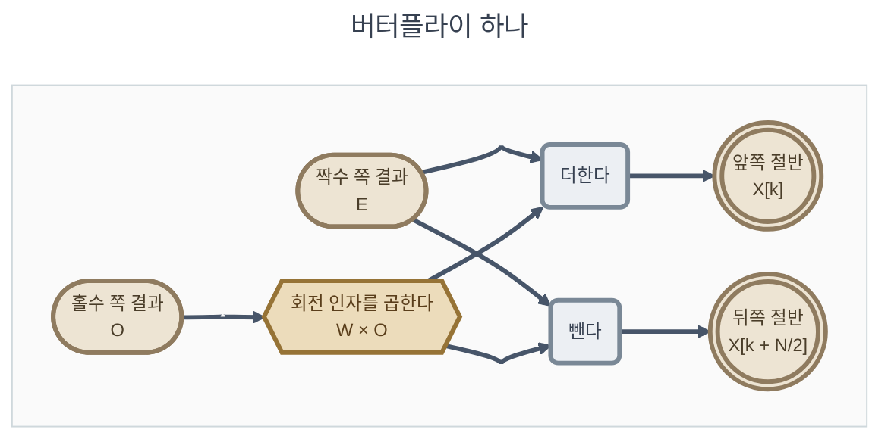

# 지식과 공식

**TL;DR**: 코드로 구현할 때 필요한 공식 16개(`공식_1` ~ `공식_16`)를 구현 순서대로 모았다. 공식마다 무엇인지, 어느 단계에 쓰는지, 어떻게 나왔는지(도출)를 작은 손계산과 함께 적었다. 확인·참고용 식은 08, WAV 파일의 구조와 변환은 07에 있다.

> [!NOTE]
> 개념을 말로 풀어 쓴 설명은 [FFT와 IFFT 학습 노트](../../../seminar-E8300/docs/회차자료조사/5회차/FFT/FFT_IFFT_학습노트.md)에 있다. 이 문서는 구현에 필요한 식과 그 도출을 모았다.

---

## 0. 읽는 법

공식마다 아래 순서로 적었다.

| 부분 | 내용 |
|---|---|
| 무엇인가 | 그 식이 계산하는 것 |
| 어디에 쓰는가 | [04_구현 가이드라인.md](04_구현%20가이드라인.md)의 어느 단계에서 쓰는가 |
| 식과 기호 | 식, 식에 나오는 기호의 뜻 |
| 도출 | 식이 어떻게 나왔는가. 앞의 공식에서 한 걸음씩 이어 간다. 작은 크기의 손계산을 함께 적었다 |
| 근거, 검산 | 출처와 수치 확인 |

도출의 손계산 값은 기대값 검산 기대값_20에 있다.

공식마다 근거의 종류를 표시했다.

| 표시 | 뜻 |
|---|---|
| **출처** | 원문을 열어 확인했다. 문서명과 절 제목을 적었다 |
| **유도** | 원문에 그대로 있지 않고 이 문서에서 계산으로 이끌어 냈다 |
| **정의** | 이 프로젝트에서 그렇게 하기로 정한 것이다 |
| **검산** | 수치로 확인한 출력이 있다 |

검산 출력은 두 파일에 있다.

| 이름 | 파일 |
|---|---|
| 분석 검산 | [첨부_분석_수치검증 출력.txt](../tasks/가이드/20260928_1728_pr-guide-and-setup/첨부_분석_수치검증%20출력.txt) |
| 기대값 검산 | [첨부_이력_기대값 검산 출력.txt](../tasks/가이드/20260928_1728_pr-guide-and-setup/첨부_이력_기대값%20검산%20출력.txt) |

> [!NOTE]
> 이 문서에는 **코드로 구현할 때 필요한 식**만 둔다(2026-09-29 사용자 지시). 구현에 쓰지 않는 식 — 켤레 대칭, bin 번호와 주파수, 에너지 관계, 주기형 윈도우, 순서를 뒤집은 스펙트럼, 합성 윈도우, 지연, 최대 오차, SNR, 시험용 사인파 — 은 [08_참고 공식.md](08_참고%20공식.md)에 있다. WAV 파일의 구조와 정수·실수 변환은 [07_WAV 파일.md](07_WAV%20파일.md)에 있다.

### 0.1 공식 한눈에

공식은 구현 순서대로 번호를 붙였다.

| 공식 | 무엇인가 | 쓰는 단계 |
|---|---|---|
| 공식_1 오일러 공식 | 각도 하나로 크기 1인 복소수를 만든다 | 단계_3(회전 인자 표), 단계_2 |
| 공식_2 DFT | 샘플 $N$개 → 주파수 성분 $N$개 | 그대로 옮기는 곳은 단계_2뿐(중간_1의 겹침 없는 복원에 쓴다). FFT가 계산하는 값의 정의 |
| 공식_3 역 DFT | 주파수 성분 $N$개 → 샘플 $N$개 | 그대로 옮기는 곳은 단계_2뿐(중간_1의 겹침 없는 복원에 쓴다). 공식_8의 바탕 |
| 공식_4 회전 인자 | $e^{-j2\pi/N}$과 그 거듭제곱의 성질 넷 | 단계_3 |
| 공식_5 버터플라이 | 절반 길이 DFT 둘로 전체 DFT를 만든다 | 단계_3 |
| 공식_6 단계 수와 연산량 | 버터플라이를 몇 단계, 몇 번 하는가 | 단계_3 |
| 공식_7 비트 반전 | FFT 전에 입력을 늘어놓는 순서 | 단계_3 |
| 공식_8 켤레 역변환 | FFT로 IFFT를 한다 | 단계_4 |
| 공식_9 대칭형 Hanning | 버퍼에 곱할 가중치 512개 | 단계_5, 단계_7, 단계_8 |
| 공식_10 버퍼 내용 | 버퍼의 $i$번 칸이 파일의 몇 번 샘플인가 | 단계_6 |
| 공식_11 프레임 수 | 몇 번 반복하는가 | 단계_6 |
| 공식_12 분석 | 프레임 하나의 스펙트럼 | 단계_7 |
| 공식_13 되돌린 프레임 | IFFT 결과 = 윈도우를 곱한 버퍼 | 단계_8 |
| 공식_14 겹쳐 더한 결과 | 겹쳐 더하면 샘플 × 윈도우 합 | 단계_8 |
| 공식_15 복원 | 윈도우 합으로 나눠 샘플을 되찾는다 | 단계_8 |
| 공식_16 겹쳐 더할 자리 | IFFT 결과를 더할 샘플 번호 | 단계_8 |

직교성(§3)은 공식_3의 도출에 쓰는 성질이어서 번호를 붙이지 않았다.

---

## 1. 표기와 기호

| 기호 | 뜻 | 이 프로젝트의 값 |
|---|---|---|
| $N$ | FFT 크기, 버퍼 길이 | 512 |
| $R$ | 프레임 크기(한 번에 새로 들어오는 샘플 수) | 16 |
| $f_s$ | 샘플링 주파수 | 16000 Hz |
| $L$ | 입력 샘플의 총 개수 | WAV 파일에 따라 다름 |
| $x[n]$ | 입력 샘플, $n = 0 \dots L-1$. 그 밖의 $n$에서는 0으로 본다 | |
| $w[i]$ | 윈도우, $i = 0 \dots N-1$ | 대칭형 Hanning |
| $m$ | 프레임 번호, 0부터 | |
| $b_m[i]$ | 프레임 $m$을 처리할 때의 버퍼 내용 | |
| $X_m[k]$ | 프레임 $m$의 스펙트럼, $k = 0 \dots N-1$ | 복소수 512개 |
| $y_m[i]$ | 프레임 $m$의 스펙트럼을 IFFT한 결과 | |
| $y[n]$ | 프레임들을 겹쳐 더한 값 | |
| $W[r]$ | 위치 $r$에서의 윈도우 합, $r = 0 \dots R-1$ | 16개 |
| $\hat{x}[n]$ | 복원한 샘플 | |
| $j$ | 허수 단위. Python에서는 `1j`로 쓴다 | |
| $z^*$ | 복소수 $z$의 켤레 | |

위 표는 문서 전체에서 쓰는 기호를 모은 것이다. 이와 별개로 **공식마다 바로 아래에** 그 공식에 나오는 기호를 다시 적었다. 공식 하나만 찾아 읽어도 되게 하기 위해서다.

> [!NOTE]
> 같은 글자가 자리에 따라 다른 것을 가리키는 곳이 있다. $n$은 §3 ~ §5에서는 **한 프레임 안의** 샘플 번호(0 ~ 511)이고, §7부터는 **파일 전체에서의** 샘플 번호(0 ~ $L-1$)다. $W_N$(회전 인자)과 $W[r]$(윈도우 합)도 서로 다른 것이다. 공식 아래의 표에 그 공식에서의 뜻을 적었다.

---

## 2. 복소수와 오일러 공식

**공식_1** 오일러 공식

- **무엇인가** — 각도 $\theta$ 하나로 **크기가 1이고 각도가 $\theta$인 복소수**를 만드는 식이다. 복소평면에서 반지름 1인 원 위의 점이다
- **어디에 쓰는가** — 코드에서는 **회전 인자 표를 만들 때**(단계_3, 공식_4) 쓴다. 단계_2의 느린 DFT를 만들면 거기서도 쓴다. Python에서는 `cmath.exp`로 계산하거나, 이 식대로 `math.cos`와 `math.sin`으로 실수부와 허수부를 따로 구한다([05](05_Python%20문법%20길잡이.md) §12.2)

$$e^{j\theta} = \cos\theta + j\sin\theta$$

| 기호 | 뜻 |
|---|---|
| $e$ | 자연로그의 밑. Python에서는 $e^{z}$를 `cmath.exp(z)`로 계산한다 |
| $j$ | 허수 단위. $j^2 = -1$. Python에서는 `1j` |
| $\theta$ | 각도. 단위는 라디안이고 한 바퀴가 $2\pi$다 |
| $\cos\theta$ | 결과의 실수부 |
| $\sin\theta$ | 결과의 허수부 |

**도출** (출처: J. O. Smith, *Mathematics of the DFT*, "$e^{j\theta}$" — 급수를 짝수 차수와 홀수 차수로 나누는 방법)

1. 지수 함수는 급수로 적을 수 있다: $e^{x} = 1 + x + \dfrac{x^2}{2!} + \dfrac{x^3}{3!} + \dfrac{x^4}{4!} + \cdots$
2. $x$ 자리에 $j\theta$를 넣는다. $j^2 = -1$, $j^3 = -j$, $j^4 = 1$이 되풀이된다:
   $e^{j\theta} = 1 + j\theta - \dfrac{\theta^2}{2!} - j\dfrac{\theta^3}{3!} + \dfrac{\theta^4}{4!} + j\dfrac{\theta^5}{5!} - \cdots$
3. 짝수 차수 항은 실수, 홀수 차수 항은 허수다. 나누어 모은다:
   실수부 $1 - \dfrac{\theta^2}{2!} + \dfrac{\theta^4}{4!} - \cdots$, 허수부 $\theta - \dfrac{\theta^3}{3!} + \dfrac{\theta^5}{5!} - \cdots$
4. 이 두 급수가 각각 $\cos\theta$와 $\sin\theta$의 급수다. 그래서 $e^{j\theta} = \cos\theta + j\sin\theta$

검산: $\theta = 0.7$에서 급수 20항의 합과 $\cos 0.7 + j\sin 0.7$이 모두 $0.764842 + 0.644218j$였다(기대값 검산 기대값_20의 도출_1).

**뒤에서 쓰는 성질** (유도)

| 성질 | 식 | 까닭 | 쓰는 곳 |
|---|---|---|---|
| 크기는 늘 1 | $\lvert e^{j\theta}\rvert = 1$ | $\sqrt{\cos^2\theta + \sin^2\theta} = 1$ | 곱해도 크기가 바뀌지 않는다 |
| 곱하면 각도가 더해진다 | $e^{ja}\,e^{jb} = e^{j(a+b)}$ | 지수 법칙 | 회전 인자의 거듭제곱 (§4.1) |
| 한 바퀴 돌면 제자리 | 정수 $p$에 대해 $e^{j2\pi p} = 1$ | $\cos 2\pi p = 1$, $\sin 2\pi p = 0$ | 직교성, [08](08_참고%20공식.md) 참고_1의 도출 |
| 반 바퀴는 $-1$ | $e^{j\pi} = -1$ | $\cos\pi = -1$, $\sin\pi = 0$ | 성질_3 (§4.1) |
| 켤레는 각도의 부호를 바꾼 것 | $(e^{j\theta})^* = e^{-j\theta}$ | 아래 표의 마지막 줄 | 공식_2, 공식_8 |

| $\theta$ | 0 | $\pi/4$ | $\pi/2$ | $\pi$ | $3\pi/2$ | $2\pi$ |
|---|---|---|---|---|---|---|
| $e^{j\theta}$ | 1 | $0.7071 + 0.7071j$ | $j$ | $-1$ | $-j$ | 1 |

근거: 기대값 검산 기대값_20의 도출_1. $e^{j0.4}\,e^{j1.1}$과 $e^{j1.5}$가 모두 $0.0707372 + 0.997495j$였다.

- 근거: **출처** — J. O. Smith, *Mathematics of the DFT*, "Euler's Identity"
- 어떤 복소수에 이것을 곱하면 크기는 그대로 두고 각도만 $\theta$만큼 돌린다(위 표의 둘째 줄)

복소수 $z = a + jb$에 대해 쓰는 것:

| 이름 | 식 |
|---|---|
| 크기 | $\lvert z\rvert = \sqrt{a^2 + b^2}$ |
| 켤레 | $z^* = a - jb$ |
| 오일러 공식의 켤레 | $\left(e^{j\theta}\right)^* = e^{-j\theta}$ |

마지막 줄의 근거: **유도** — 공식_1에서 허수부의 부호를 바꾸면 $\cos\theta - j\sin\theta$이고, 이는 $\theta$ 자리에 $-\theta$를 넣은 것과 같다.

---

## 3. DFT와 역 DFT

**공식_2** DFT

- **무엇인가** — 샘플 $N$개에 **주파수마다 얼마나 들어 있는지**를 재는 식이다. 결과 $X[k]$는 복소수이고, 크기는 $k$번 주파수 성분의 크기, 각도는 그 성분의 위상(시작 위치)이다
- **어디에 쓰는가** — 이 식을 **그대로** 코드로 옮기는 곳은 단계_2의 느린 DFT뿐이다(중간_1의 겹침 없는 복원에 쓴다). 최종 흐름에서는 단계_3의 FFT(공식_4 ~ 공식_7)가 이 식과 같은 값을 빠르게 계산한다. 그래도 FFT의 도출(공식_5)이 이 식에서 시작하고, 단계_7의 분석(공식_12)이 계산하는 것도 이 식이며, 테스트 벡터의 기대값도 이 식으로 계산했다([06](06_테스트%20벡터%20사용법.md) §7)

$$X[k] = \sum_{n=0}^{N-1} x[n]\, e^{-j 2\pi k n / N}, \qquad k = 0, 1, \dots, N-1$$

> [!TIP]
> 이 식을 지수 표기 없이 cos와 sin으로 풀어(코사인 합, 사인 합) 그림으로 설명한 것이 [09_DFT 그림 설명.md](09_DFT%20그림%20설명.md)에 있다.

| 기호                    | 뜻                                     | 이 프로젝트의 값     |
| --------------------- | ------------------------------------- | ------------- |
| $X[k]$                | 결과. $k$번 bin의 스펙트럼 값이며 복소수다             | 512개          |
| $k$                   | 주파수 bin의 번호                             | 0 ~ 511       |
| $x[n]$                | 입력. 변환할 값들 가운데 $n$번째                  | 윈도우를 곱한 버퍼의 값 |
| $n$                   | 입력 안에서의 번호                            | 0 ~ 511       |
| $N$                   | 변환의 길이                                | 512           |
| $\sum_{n=0}^{N-1}$    | $n$을 0부터 $N-1$까지 바꿔 가며 모두 더한다         | 512개를 더한다     |
| $e^{-j 2\pi k n / N}$ | 크기가 1이고 각도가 $-2\pi k n/N$인 복소수 (공식_1) |               |

**도출** (출처: J. O. Smith, *Mathematics of the DFT*, "The DFT" — "The kth sample X(ω_k) of the spectrum of x is defined as the inner product of x with the kth DFT sinusoid s_k")

1. **재고 싶은 주파수의 사인파를 만든다.** 길이 $N$ 동안 정확히 $k$바퀴 도는 복소 사인파는 $s_k[n] = e^{j2\pi kn/N}$이다. $n$이 1 늘 때마다 각도가 $2\pi k/N$씩 늘고, $n = N$에서 $2\pi k$, 곧 $k$바퀴가 된다(공식_1)
2. **닮은 정도를 재는 방법을 정한다.** 두 수열이 얼마나 닮았는지는 **내적**으로 잰다. 같은 자리끼리 곱해 모두 더하는데, 복소수일 때는 한쪽에 켤레를 취한다: $\langle x, s_k\rangle = \sum_n x[n]\, s_k[n]^*$ (원문의 정의)
3. **켤레를 계산한다.** $s_k[n]^* = e^{-j2\pi kn/N}$ (공식_1 아래의 "켤레는 각도의 부호를 바꾼 것")
4. **넣는다.** $X[k] = \langle x, s_k\rangle = \sum_n x[n]\, e^{-j2\pi kn/N}$ — 공식_2다
5. **왜 이 값이 "그 주파수의 양"인가.** 입력이 $k$번 사인파 하나뿐이면 곱한 값이 매번 1이어서 $N$이 쌓이고, 다른 주파수의 사인파면 곱한 값이 원을 고르게 돌아 합이 0이 된다. 아래의 **직교성**이다

**손계산** — $N = 4$, $x = [1, 0, -1, 0]$ (4샘플에 한 바퀴 도는 코사인)

| $k$ | 곱하는 값 $e^{-j2\pi kn/4}$ ($n = 0 \dots 3$) | 곱한 결과 | $X[k]$ (합) |
|---|---|---|---|
| 0 | $1,\ 1,\ 1,\ 1$ | $1,\ 0,\ -1,\ 0$ | 0 |
| 1 | $1,\ -j,\ -1,\ j$ | $1,\ 0,\ 1,\ 0$ | 2 |
| 2 | $1,\ -1,\ 1,\ -1$ | $1,\ 0,\ -1,\ 0$ | 0 |
| 3 | $1,\ j,\ -1,\ -j$ | $1,\ 0,\ 1,\ 0$ | 2 |

근거: 기대값 검산 기대값_20의 도출_3. 한 바퀴 도는 코사인이 bin 1과 bin 3($= N - 1$)에 나타났다. 코사인은 $+1$바퀴 도는 사인파와 $-1$바퀴 도는 사인파를 반씩 더한 것이기 때문이다 — 공식_1과 그 켤레를 더하면 $e^{j\theta} + e^{-j\theta} = 2\cos\theta$(유도). bin 3이 $-1$바퀴 자리인 까닭은 [08](08_참고%20공식.md) 참고_1에 있다.

**공식_3** 역 DFT

- **무엇인가** — 주파수 성분 $N$개로 **원래 샘플 $N$개를 되돌리는** 식이다. $k$번 복소 사인파를 $X[k]$만큼씩 모두 더해 신호를 다시 쌓는다
- **어디에 쓰는가** — 이 식을 **그대로** 옮기는 곳은 단계_2의 느린 역 DFT뿐이다(중간_1의 겹침 없는 복원에 쓴다). 최종 흐름에서는 단계_4의 IFFT(공식_8)가 대신한다. 공식_8의 $1/N$과 켤레를 쓰는 방법이 이 식에서 나온다

$$x[n] = \frac{1}{N} \sum_{k=0}^{N-1} X[k]\, e^{+j 2\pi k n / N}, \qquad n = 0, 1, \dots, N-1$$

| 기호 | 뜻 | 이 프로젝트의 값 |
|---|---|---|
| $x[n]$ | 결과. 되돌린 값들 가운데 $n$번째 | 512개 |
| $X[k]$ | 입력. $k$번 bin의 스펙트럼 값 | 복소수 512개 |
| $\frac{1}{N}$ | 다 더한 뒤 $N$으로 나눈다 | 512로 나눈다 |
| $\sum_{k=0}^{N-1}$ | $k$를 0부터 $N-1$까지 바꿔 가며 모두 더한다 | |
| $e^{+j 2\pi k n / N}$ | 공식_2와 각도의 부호만 반대인 복소수 | |
| $n$, $k$, $N$ | 공식_2와 같다 | |

**직교성** — 공식_3과 [08](08_참고%20공식.md) 참고_3의 도출에 쓴다

$$\sum_{n=0}^{N-1} e^{j2\pi (k-l) n/N} = \begin{cases} N & k = l \\ 0 & k \ne l \end{cases} \qquad (k, l = 0 \dots N-1)$$

| 기호 | 뜻 |
|---|---|
| $k$, $l$ | 두 주파수 bin의 번호 |
| $e^{j2\pi(k-l)n/N}$ | $k$번 사인파와 $l$번 사인파의 켤레를 곱한 것 ($s_k[n]\, s_l[n]^*$) |

도출 (출처: J. O. Smith, *Mathematics of the DFT*, "Orthogonality of the DFT Sinusoids" — 등비수열의 합을 쓰는 방법):

1. $k = l$이면 지수가 0이어서 항이 모두 $e^0 = 1$이다. $N$개를 더하면 $N$
2. $k \ne l$이면 $z = e^{j2\pi(k-l)/N}$으로 둔다. 합은 $1 + z + z^2 + \cdots + z^{N-1}$이다
3. 이런 합(등비수열의 합)은 $\dfrac{1 - z^N}{1 - z}$이다. 합에 $1 - z$를 곱해 보면 가운데 항이 모두 지워져 $1 - z^N$만 남는다
4. $z^N = e^{j2\pi(k-l)} = 1$ ($k - l$은 정수, 공식_1 아래의 "한 바퀴 돌면 제자리")이므로 분자가 0이다
5. 분모 $1 - z$는 0이 아니다. $k - l$이 $N$의 배수가 아니면 $z \ne 1$이다. 그래서 합은 0

말로 하면: 다른 주파수의 사인파끼리 곱하면 그 결과가 원을 정확히 몇 바퀴 고르게 돌고, 원 위의 점을 고르게 더하면 0이다.

검산: $N = 8$에서 $k - l = 0, 1, 2, 3$일 때 합이 $8, 0, 0, 0$. $N = 512$에서 $k - l = 5$일 때 크기 2.6e-14(기대값 검산 기대값_20의 도출_2).

**공식_3의 도출** (유도 — 공식_2와 직교성으로, 공식_3이 정말 되돌리는지 확인한다)

1. 공식_3의 오른쪽에 공식_2를 넣는다. 안쪽 합의 번호는 헷갈리지 않게 $n'$으로 적는다:
   $\dfrac{1}{N}\sum_k \Bigl(\sum_{n'} x[n']\,e^{-j2\pi kn'/N}\Bigr) e^{j2\pi kn/N}$
2. 지수를 합치고(공식_1 아래의 "곱하면 각도가 더해진다") 두 합의 순서를 바꾼다:
   $\dfrac{1}{N}\sum_{n'} x[n'] \sum_k e^{j2\pi k(n - n')/N}$
3. 안쪽 합은 직교성과 같은 모양이다(지수가 $2\pi \times$ 정수 $\times$ 정수 $/ N$). $n' = n$이면 $N$, 아니면 0이다
4. 바깥 합에서 $n' = n$인 항 하나만 남는다: $\dfrac{1}{N}\, x[n]\, N = x[n]$

그래서 공식_3을 계산하면 원래 샘플이 나온다. $1/N$이 필요한 까닭은 3의 안쪽 합이 $N$이 되기 때문이다. 지수의 부호가 $+$인 까닭은 2에서 공식_2의 $-$와 합쳐 $n - n'$을 만들기 위해서다.

손계산: 위의 $X = [0, 2, 0, 2]$를 공식_3에 넣으면 $[1, 0, -1, 0]$이 나온다(도출_3).

- 근거: **출처** — 같은 책 "DFT Definition", "Inverse DFT". 원문은 지수를 $\omega_k t_n$으로 적고 $\omega_k = k\Omega$, $\Omega = 2\pi/(NT)$, $t_n = nT$로 정의한다. 곱하면 $\omega_k t_n = 2\pi k n/N$이다(**유도**)
- 두 식의 차이는 지수의 부호와 $1/N$뿐이다

> [!IMPORTANT]
> **규약**: 이 프로젝트는 $1/N$을 **역변환에만** 둔다(원문과 같다). 이 문서와 가이드라인의 기대값은 모두 이 규약으로 계산했다. $1/N$을 다른 곳에 두면 기대값이 달라진다.

### 3.1 손으로 아는 기대값

$N = 512$, 공식_2의 규약일 때.

| 입력 | 결과 | 근거 |
|---|---|---|
| 임펄스: $x[0] = 1$, 나머지 0 | 모든 $k$에서 $X[k] = 1$ | 유도(공식_2에 대입), 기대값 검산 기대값_1 |
| 직류: 모든 $n$에서 $x[n] = 1$ | $X[0] = 512$, 나머지 0 | 기대값 검산 기대값_1 |
| 코사인: $x[n] = \cos(2\pi \cdot 32 \cdot n/512)$ | $X[32] = 256$, $X[480] = 256$, 나머지 0 | 기대값 검산 기대값_1 |
| 사인: $x[n] = \sin(2\pi \cdot 32 \cdot n/512)$ | $X[32] = -256j$, $X[480] = +256j$, 나머지 0 | 기대값 검산 기대값_1 |

"나머지 0"은 계산 오차 때문에 실제로는 1e-13 수준의 값이 나온다(기대값 검산에서 최대 4.7e-13).

8점으로 손계산을 맞춰 볼 때 쓸 값: $x = [1, 2, 3, 4, 0, 0, 0, 0]$

| $k$ | $X[k]$ |
|---|---|
| 0 | $10$ |
| 1 | $-0.414214 - 7.242641j$ |
| 2 | $-2 + 2j$ |
| 3 | $2.414214 - 1.242641j$ |
| 4 | $-2$ |
| 5 | $2.414214 + 1.242641j$ |
| 6 | $-2 - 2j$ |
| 7 | $-0.414214 + 7.242641j$ |

근거: 기대값 검산 기대값_10.

---

## 4. radix-2 FFT

### 4.1 회전 인자

**공식_4** 회전 인자 (정의)

- **무엇인가** — DFT에 나오는 복소수 $e^{-j2\pi kn/N}$을 모두 **한 복소수 $W_N$의 거듭제곱**으로 나타낸 것이다
- **어디에 쓰는가** — 단계_3에서 회전 인자 표를 만들 때. 아래 네 성질이 FFT를 가능하게 한다

$$W_N = e^{-j 2\pi / N}$$

| 기호 | 뜻 | 이 프로젝트의 값 |
|---|---|---|
| $W_N$ | 크기가 1이고 각도가 $-2\pi/N$인 복소수. 한 바퀴를 $N$으로 나눈 만큼 돌린다 | $W_{512}$ |
| $W_N^{k}$ | $W_N$을 $k$번 곱한 것. 각도가 $k$배가 된다 | |
| $N$ | 변환의 길이 | 512 |

§9의 윈도우 합 $W[r]$과는 다른 것이다.

이것을 쓰면 공식_2는 $X[k] = \sum_n x[n]\, W_N^{kn}$이다. $e^{-j2\pi kn/N} = (e^{-j2\pi/N})^{kn}$이기 때문이다(공식_1 아래의 "곱하면 각도가 더해진다").

**회전 인자의 성질** (유도)

| 번호 | 성질 | 도출 | 쓰는 곳 |
|---|---|---|---|
| 성질_1 | $W_N^{N} = 1$ | $e^{-j2\pi} = 1$ — 한 바퀴 | 성질_2 |
| 성질_2 | $W_N^{k+N} = W_N^{k}$ | $W_N^{k}\,W_N^{N} = W_N^{k}$ — 지수가 $N$ 늘면 제자리 | 공식_5의 도출 5 |
| 성질_3 | $W_N^{k+N/2} = -W_N^{k}$ | $W_N^{N/2} = e^{-j\pi} = -1$ — 반 바퀴 | 공식_5의 둘째 줄 |
| 성질_4 | $W_N^{2} = W_{N/2}$ | $e^{-j2\pi \cdot 2/N} = e^{-j2\pi/(N/2)}$ — 분모가 절반이 된다 | 공식_5의 도출 4, 공식_6 |

$N = 8$로 맞춰 보기:

| $k$ | $W_8^k$ | $W_8^{k+4}$ (성질_3) | $W_8^{2k}$ | $W_4^k$ (성질_4) |
|---|---|---|---|---|
| 0 | 1 | $-1$ | 1 | 1 |
| 1 | $0.7071 - 0.7071j$ | $-0.7071 + 0.7071j$ | $-j$ | $-j$ |
| 2 | $-j$ | $j$ | $-1$ | $-1$ |
| 3 | $-0.7071 - 0.7071j$ | $0.7071 + 0.7071j$ | $j$ | $j$ |

근거: 기대값 검산 기대값_20의 도출_4.

### 4.2 짝수와 홀수로 나누기

입력을 짝수 번째와 홀수 번째로 나누어 각각 $N/2$점 DFT를 한다.

$$E[k] = \sum_{n=0}^{N/2-1} x[2n]\, W_{N/2}^{kn}, \qquad O[k] = \sum_{n=0}^{N/2-1} x[2n+1]\, W_{N/2}^{kn}$$

**공식_5** 버터플라이

> [!TIP]
> 회전 인자를 원을 N등분한 크기 1인 복소수로, 복소수 곱을 각도 더하기로 보고 이 식과 비트 반전, 공식_8을 지수 표기 없이 그림으로 설명한 것이 [10_FFT 그림 설명.md](10_FFT%20그림%20설명.md)에 있다.

- **무엇인가** — 길이 $N/2$짜리 DFT 두 개(짝수 번째 값들의 DFT $E$, 홀수 번째 값들의 DFT $O$)를 합쳐 **길이 $N$짜리 DFT를 만드는** 식이다. FFT가 빠른 까닭이 이 식이다
- **어디에 쓰는가** — 단계_3 FFT의 가장 안쪽에서 되풀이하는 계산. 단계_4의 IFFT도 FFT를 쓰므로 같다

$$
\begin{aligned}
X[k] &= E[k] + W_N^{k}\, O[k] \\
X[k + N/2] &= E[k] - W_N^{k}\, O[k]
\end{aligned}
\qquad k = 0, \dots, N/2 - 1
$$

| 기호 | 뜻 | 이 프로젝트의 값 |
|---|---|---|
| $E[k]$ | 입력의 **짝수** 번째 값들($x[0], x[2], x[4], \dots$)만 모아 $N/2$점 DFT를 한 결과 | 256개 |
| $O[k]$ | 입력의 **홀수** 번째 값들($x[1], x[3], x[5], \dots$)만 모아 $N/2$점 DFT를 한 결과 | 256개 |
| $W_N^{k}$ | 회전 인자 $W_N$을 $k$번 곱한 것 (§4.1) | |
| $X[k]$ | 합친 결과의 앞쪽 절반 | bin 0 ~ 255 |
| $X[k + N/2]$ | 합친 결과의 뒤쪽 절반 | bin 256 ~ 511 |
| $k$ | 절반 안에서의 번호 | 0 ~ 255 |
| $N$ | 합친 뒤의 길이 | 512 (마지막 단계일 때) |

**도출** (첫째 줄은 출처: J. O. Smith, *Mathematics of the DFT*, "Decimation in Time". 원문은 $W_N^k$를 twiddle factor라고 부른다. 둘째 줄과 각 걸음은 유도)

1. 공식_2를 회전 인자로 적는다: $X[k] = \sum_{n=0}^{N-1} x[n]\, W_N^{kn}$
2. 더하는 항을 $n$이 짝수인 것($n = 2p$)과 홀수인 것($n = 2p + 1$)으로 나눈다. $p = 0 \dots N/2 - 1$이다:
   $X[k] = \sum_p x[2p]\, W_N^{2kp} + \sum_p x[2p+1]\, W_N^{k(2p+1)}$
3. 둘째 합에서 $W_N^{k}$를 밖으로 꺼낸다($W_N^{k(2p+1)} = W_N^{2kp}\, W_N^{k}$):
   $X[k] = \sum_p x[2p]\, W_N^{2kp} + W_N^{k} \sum_p x[2p+1]\, W_N^{2kp}$
4. 성질_4로 $W_N^{2kp} = W_{N/2}^{kp}$다. 그러면 첫째 합은 짝수 번째 값들의 $N/2$점 DFT, 곧 $E[k]$이고, 둘째 합은 홀수 번째 값들의 $N/2$점 DFT, 곧 $O[k]$다(§4.2의 식):
   $X[k] = E[k] + W_N^{k}\, O[k]$ — 첫째 줄
5. 뒤쪽 절반을 구하려고 $k$ 자리에 $k + N/2$를 넣는다. $E$와 $O$는 길이 $N/2$의 DFT여서 성질_2(길이 $N/2$에 적용)로 $E[k + N/2] = E[k]$, $O[k + N/2] = O[k]$다. 회전 인자는 성질_3으로 $W_N^{k+N/2} = -W_N^{k}$다:
   $X[k + N/2] = E[k] - W_N^{k}\, O[k]$ — 둘째 줄
6. 그래서 $k = 0 \dots N/2 - 1$에 대해 $W_N^k\, O[k]$를 **한 번** 곱하고, 그 값을 $E[k]$에 더하고 빼면 출력 2개가 나온다

손계산 — $N = 8$, $x = [1, 2, 3, 4, 0, 0, 0, 0]$의 마지막 합치기에서 $k = 1$일 때(도출_5):

| 값 | 계산 | 결과 |
|---|---|---|
| $E[1]$ | 짝수 번째 $[1, 3, 0, 0]$의 4점 DFT의 bin 1: $1 + 3 \times (-j)$ | $1 - 3j$ |
| $O[1]$ | 홀수 번째 $[2, 4, 0, 0]$의 4점 DFT의 bin 1: $2 + 4 \times (-j)$ | $2 - 4j$ |
| $W_8^1$ | $e^{-j2\pi/8}$ | $0.7071 - 0.7071j$ |
| $W_8^1\, O[1]$ | 곱셈 | $-1.4142 - 4.2426j$ |
| $X[1]$ | $E[1] + W_8^1\, O[1]$ | $-0.4142 - 7.2426j$ |
| $X[5]$ | $E[1] - W_8^1\, O[1]$ | $2.4142 + 1.2426j$ |

§3.1의 8점 표와 같다.

### 4.3 단계 구조

$E$와 $O$도 같은 방법으로 다시 반씩 나눈다. 길이가 1이 될 때까지 나누면 길이 1인 DFT는 입력 그대로다(공식_2에 $N = 1$을 넣으면 $X[0] = x[0]$). 거기서부터 거꾸로 합쳐 올라온다.

**공식_6** 단계의 수와 연산량 (유도)

- **무엇인가** — 공식_5를 몇 단계에 걸쳐 모두 몇 번 하는지 세는 식이다. FFT의 반복문이 이 구조를 따른다
- **어디에 쓰는가** — 단계_3에서 반복문의 모양을 정할 때(바깥은 단계, 그 안은 묶음, 가장 안은 묶음 안의 짝). 단계_2와 속도를 비교할 때

| 기호 | 뜻 | 이 프로젝트의 값 |
|---|---|---|
| $N$ | 변환의 길이 | 512 |
| $\log_2 N$ | 2를 몇 번 곱하면 $N$이 되는가 | 9 ($2^9 = 512$) |
| $s$ | 단계의 번호. 1부터 $\log_2 N$까지 | 1 ~ 9 |
| $2^s$ | 단계 $s$에서 한 묶음의 길이 | 2, 4, 8, … , 512 |

| 항목 | 식 | $N = 512$ |
|---|---|---|
| 단계 수 | $\log_2 N$ | 9 |
| 단계마다 버터플라이 수 | $N/2$ | 256 |
| 전체 버터플라이 수 = 복소수 곱셈 수 | $(N/2)\log_2 N$ | 2,304 |
| 정의식(공식_2)의 곱셈 수 | $N^2$ | 262,144 |

**도출** (유도)

1. 공식_5는 길이를 절반으로 나눈다. 512 → 256 → 128 → … → 1까지 나누려면 9번이다($2^9 = 512$). 거꾸로 합치는 것도 9단계다
2. 길이 1의 DFT는 입력 그대로다(공식_2에 $N = 1$을 넣으면 $X[0] = x[0]$). 그래서 맨 아래에서는 계산할 것이 없다
3. 한 단계에서 값 $N$개가 모두 한 번씩 버터플라이에 들어간다. 버터플라이 하나가 값 2개를 다루므로 단계마다 $N/2 = 256$개다
4. 전체는 $9 \times 256 = 2{,}304$개다. 버터플라이마다 복소수 곱셈이 1번이다(공식_5의 도출 6)
5. 정의식은 bin $N$개마다 $N$번 곱하므로 $N^2$번이다

단계 $s$ ($s = 1, 2, \dots, 9$)에서 일어나는 일 (유도):

| 항목 | 값 |
|---|---|
| 한 묶음의 길이 | $2^s$ |
| 묶음의 개수 | $N / 2^s$ |
| 버터플라이가 잇는 두 칸의 간격 | $2^{s-1}$ |
| 쓰는 회전 인자 | $W_{2^s}^{\,k} = W_N^{\,k \cdot N/2^s}$, $k = 0 \dots 2^{s-1}-1$ |

$N = 8$일 때의 예:

| 단계 | 묶음 길이 | 묶음 수 | 두 칸의 간격 | 회전 인자 ($W_8$의 몇 제곱) |
|---|---|---|---|---|
| 1 | 2 | 4 | 1 | 0 |
| 2 | 4 | 2 | 2 | 0, 2 |
| 3 | 8 | 1 | 4 | 0, 1, 2, 3 |

표의 각 칸이 나온 까닭 (유도): 단계 $s$에서 합친 뒤의 길이가 $2^s$이므로 묶음 길이는 $2^s$, 묶음 수는 $N \div 2^s$다. 공식_5는 앞쪽 절반과 뒤쪽 절반을 짝지으므로 짝의 간격은 묶음 길이의 절반 $2^{s-1}$이다. 쓰는 회전 인자는 길이 $2^s$의 것, 곧 $W_{2^s}^k$이고, 성질_4를 되풀이하면 $W_{2^s} = W_N^{N/2^s}$이어서 $W_N$ 표에서 $N/2^s$ 간격으로 고르면 된다.

$N = 8$, $x = [1, 2, 3, 4, 0, 0, 0, 0]$을 단계마다 따라가기(도출_5):

| 순서 | 자리 0 | 자리 1 | 자리 2 | 자리 3 | 자리 4 | 자리 5 | 자리 6 | 자리 7 |
|---|---|---|---|---|---|---|---|---|
| 비트 반전으로 늘어놓음 (공식_7) | 1 | 0 | 3 | 0 | 2 | 0 | 4 | 0 |
| 단계 1 뒤 (묶음 길이 2, 회전 인자 1) | 1 | 1 | 3 | 3 | 2 | 2 | 4 | 4 |
| 단계 2 뒤 (묶음 길이 4, 회전 인자 $1, -j$) | 4 | $1 - 3j$ | $-2$ | $1 + 3j$ | 6 | $2 - 4j$ | $-2$ | $2 + 4j$ |
| 단계 3 뒤 (묶음 길이 8) | 10 | $-0.4142 - 7.2426j$ | $-2 + 2j$ | $2.4142 - 1.2426j$ | $-2$ | $2.4142 + 1.2426j$ | $-2 - 2j$ | $-0.4142 + 7.2426j$ |

단계 2의 첫 묶음 $[1, 1, 3, 3]$을 예로 들면:

| 짝 | $E$ | $O$ | 회전 인자 | $W\,O$ | $E + W\,O$ | $E - W\,O$ |
|---|---|---|---|---|---|---|
| 자리 0과 자리 2 ($k = 0$) | 1 | 3 | 1 | 3 | 4 (자리 0) | $-2$ (자리 2) |
| 자리 1과 자리 3 ($k = 1$) | 1 | 3 | $-j$ | $-3j$ | $1 - 3j$ (자리 1) | $1 + 3j$ (자리 3) |

단계 3 뒤의 값이 §3.1의 8점 표와 같다. numpy의 FFT와의 최대 차이는 1.1e-15였다.

회전 인자는 $W_N^0 \dots W_N^{N/2-1}$ 256개면 모든 단계에서 쓸 수 있다. 미리 계산해 두면 된다.

| $k$ | $W_{512}^k$의 실수부 | 허수부 |
|---|---|---|
| 0 | 1 | 0 |
| 1 | 0.999924701839 | −0.012271538286 |
| 64 | 0.707106781187 | −0.707106781187 |
| 128 | 0 | −1 |
| 192 | −0.707106781187 | −0.707106781187 |

근거: 기대값 검산 기대값_9.

### 4.4 비트 반전

**공식_7** 비트 반전 순서 (유도)

- **무엇인가** — FFT를 시작하기 전에 입력을 **다시 늘어놓는 순서**다. 이렇게 늘어놓으면 공식_5를 제자리에서 되풀이할 수 있다
- **어디에 쓰는가** — 단계_3의 할 일 1과 3

| 말 | 뜻 | 이 프로젝트의 값 |
|---|---|---|
| 비트 수 | 인덱스를 이진수로 적을 때의 자릿수. $\log_2 N$ | 9 |
| 원래 인덱스 | 입력에서의 번호 | 0 ~ 511 |
| 뒤집은 이진수 | 원래 인덱스를 정해진 자릿수의 이진수로 적고 앞뒤를 뒤집은 것 | |
| 놓이는 자리 | 뒤집은 이진수를 다시 정수로 읽은 값. 그 입력을 옮겨 놓을 자리다 | 0 ~ 511 |

**도출** (유도)

1. 공식_5는 짝수 번째를 앞 절반에, 홀수 번째를 뒤 절반에 둔다. 짝수와 홀수는 인덱스의 **맨 아래 비트**가 0인지 1인지다. 그래서 원래의 맨 아래 비트가 "앞 절반인가 뒤 절반인가", 곧 늘어놓은 자리의 **가장 큰 자리 비트**가 된다
2. 앞 절반(짝수 번째) $0, 2, 4, 6$을 다시 짝수 번째와 홀수 번째로 나눈다. 이 안의 짝홀은 인덱스를 2로 나눈 몫 $0, 1, 2, 3$의 짝홀, 곧 원래 인덱스의 **아래에서 둘째 비트**다. 이것이 둘째로 큰 자리를 정한다
3. 끝까지 되풀이하면 원래의 맨 아래 비트가 맨 위 자리로, 둘째 비트가 둘째 자리로 간다. 곧 **비트의 순서가 뒤집힌다**

$N = 8$에서 나누어 가는 모습:

| 나눈 횟수 | 늘어놓인 인덱스 (/ 는 묶음의 경계) |
|---|---|
| 0 | 0, 1, 2, 3, 4, 5, 6, 7 |
| 1 (짝수 / 홀수) | 0, 2, 4, 6 / 1, 3, 5, 7 |
| 2 | 0, 4 / 2, 6 / 1, 5 / 3, 7 |
| 3 | 0 / 4 / 2 / 6 / 1 / 5 / 3 / 7 |

마지막 줄은 자리 0부터 차례로 그 자리에 오는 인덱스다. 비트 반전은 두 번 하면 제자리이므로 아래 표의 "놓이는 자리"와 같은 수열이 된다.

$N = 8$ (3비트):

| 원래 인덱스 | 이진수 | 뒤집은 이진수 | 놓이는 자리 |
|---|---|---|---|
| 0 | 000 | 000 | 0 |
| 1 | 001 | 100 | 4 |
| 2 | 010 | 010 | 2 |
| 3 | 011 | 110 | 6 |
| 4 | 100 | 001 | 1 |
| 5 | 101 | 101 | 5 |
| 6 | 110 | 011 | 3 |
| 7 | 111 | 111 | 7 |

$N = 512$ (9비트)의 몇 가지:

| 원래 인덱스 | 놓이는 자리 |
|---|---|
| 0 | 0 |
| 1 | 256 |
| 2 | 128 |
| 3 | 384 |
| 4 | 64 |
| 255 | 510 |
| 511 | 511 |

근거: 기대값 검산 기대값_8.

입력을 이 순서로 다시 늘어놓은 뒤 단계 1부터 9까지 버터플라이를 적용하면 출력이 $k = 0 \dots 511$ 순서로 나온다. **검산**: 이 방법으로 계산한 결과와 정의식 결과의 최대 차이는 4.4e-12였다(분석 검산 검산_2).

---

## 5. FFT로 IFFT 구하기

**공식_8** 켤레를 이용한 역변환 (유도)

- **무엇인가** — 이미 만든 FFT 함수 하나로 **역변환까지** 하는 방법이다
- **어디에 쓰는가** — 단계_4 IFFT

$$x[n] = \frac{1}{N}\left(\sum_{k=0}^{N-1} X[k]^*\, e^{-j 2\pi k n / N}\right)^{\!*}$$

| 기호 | 뜻 |
|---|---|
| $x[n]$ | 결과. 되돌린 값들 가운데 $n$번째 |
| $X[k]^*$ | 스펙트럼 값의 켤레. 안쪽의 별표다 |
| $\sum \dots e^{-j 2\pi k n / N}$ | 공식_2와 같은 모양이다. 곧 **FFT를 그대로 쓴다** |
| 괄호 밖의 $^*$ | 다 더한 결과의 켤레. 바깥쪽의 별표다 |
| $\frac{1}{N}$ | 마지막에 $N$(512)으로 나눈다 |

말로 하면: ① 스펙트럼의 켤레를 취한다 → ② FFT를 한다 → ③ 결과의 켤레를 취한다 → ④ $N$으로 나눈다.

**도출** (유도)

1. 켤레의 규칙: $(a\,b)^* = a^*\,b^*$, $(a + b)^* = a^* + b^*$, $(z^*)^* = z$ ($z = a + jb$에 대입해 확인할 수 있다)
2. 공식_3의 한 항을 켤레 두 번으로 적는다: $X[k]\,e^{+j2\pi kn/N} = \bigl(X[k]^*\,e^{-j2\pi kn/N}\bigr)^*$ — 켤레를 두 번 취하면 제자리이고, $e^{+j\theta}$의 켤레는 $e^{-j\theta}$다(공식_1 아래)
3. 합의 켤레는 켤레의 합이므로 $\sum_k X[k]\,e^{+j2\pi kn/N} = \Bigl(\sum_k X[k]^*\,e^{-j2\pi kn/N}\Bigr)^*$
4. 괄호 안은 $X^*$를 입력으로 넣은 공식_2, 곧 **FFT**다
5. 공식_3의 $1/N$을 붙이면 공식_8

손계산: 공식_5의 8점 스펙트럼에 ① 켤레 ② FFT ③ 켤레 ④ 8로 나누기를 하면 $[1, 2, 3, 4, 0, 0, 0, 0]$이 나온다(도출_6).

다른 방법: FFT의 회전 인자 지수 부호만 $+$로 바꾸어 같은 절차를 돌리고 $N$으로 나눈다. 공식_2와 공식_3의 차이가 부호와 $1/N$뿐이라는 점에서 나온다(유도).

**검산**: 공식_8의 방법으로 FFT 뒤 IFFT를 했을 때 입력과의 최대 차이는 5.9e-16(±1 범위 난수, 분석 검산 검산_2), 1.6e-11(16bit 범위 난수, 기대값 검산 기대값_7)이었다.

> [!NOTE]
> 입력이 실수였다면 IFFT 결과도 실수여야 한다. 계산 오차 때문에 허수부에 아주 작은 값이 남는다(기대값 검산 기대값_7에서 최대 1.5e-11). 실수부만 쓴다.

---

## 6. Hanning 윈도우

**공식_9** 대칭형 Hanning

- **무엇인가** — 버퍼 512칸에 곱할 **가중치 512개**다. 양 끝은 0, 가운데는 1에 가깝고, 그 사이는 부드럽게 이어진다
- **어디에 쓰는가** — 단계_5에서 만들고, 단계_7에서 버퍼에 곱하고, 단계_8에서 위치별 윈도우 합(공식_14)을 구할 때
- **왜 곱하는가** — 1.5가 곱하기 때문이다(모사 조건, [02](02_1.5%20FFT%20경로%20사양.md) §4). 곱하지 않으면 버퍼의 양 끝에서 신호가 뚝 끊긴다. J. O. Smith의 *Spectral Audio Signal Processing* "Hann or Hanning or Raised Cosine"은 곱하지 않았을 때(사각 윈도우) −13 dB인 첫 사이드로브가 Hann 윈도우에서 −31.5 dB로 내려간다고 적는다. 사이드로브는 한 주파수가 가까운 칸 밖으로 새어 나가는 크기다. 칸 사이에 놓인 주파수([08](08_참고%20공식.md) 참고_10의 440 Hz)가 멀리 떨어진 칸까지 퍼지는 것이 줄어든다는 뜻이다(해석)

$$w[i] = 0.5 - 0.5\cos\!\left(\frac{2\pi i}{N-1}\right), \qquad i = 0, 1, \dots, N-1$$

| 기호 | 뜻 | 이 프로젝트의 값 |
|---|---|---|
| $w[i]$ | 윈도우의 $i$번째 값. 0과 1 사이의 실수 | 512개 |
| $i$ | 윈도우 안에서의 번호 | 0 ~ 511 |
| $N$ | 윈도우의 길이 | 512 |
| $N - 1$ | 분모 | **511** |
| $\cos$ | 코사인. 각도의 단위는 라디안 | |

**도출** (유도. "음의 봉우리가 0에 닿도록 올린 코사인 한 주기"라는 설명은 J. O. Smith, 같은 절의 것이다)

1. 코사인 한 주기를 512칸에 펼친다: $\cos\!\left(\dfrac{2\pi i}{N-1}\right)$. $i = 0$에서 $\cos 0 = 1$, 가운데 $i = (N-1)/2$에서 $\cos\pi = -1$, 끝 $i = N - 1$에서 $\cos 2\pi = 1$이다
2. 부호를 바꾸면 $-1 \to 1 \to -1$ 모양이 된다
3. 1을 더하고 2로 나누면 $0 \to 1 \to 0$ 모양이 된다: $\dfrac{1 - \cos(\cdot)}{2} = 0.5 - 0.5\cos(\cdot)$ — 공식_9
4. 분모를 $N - 1$로 둔 까닭: 마지막 칸 $i = N - 1$에서 정확히 한 바퀴가 되게 해 **양 끝이 모두 0**이고 좌우가 대칭이 되게 한다. 분모를 $N$으로 두면 버퍼 밖인 $i = N$에서 0이 된다([08](08_참고%20공식.md) 참고_4)
5. 같은 식을 $\sin^2\!\left(\dfrac{\pi i}{N-1}\right)$로도 쓸 수 있다. $0.5 - 0.5\cos 2a = \sin^2 a$(반각 공식)이기 때문이다. $a = 0.3$에서 양쪽이 모두 0.0873321925였다(도출_8)

$N = 8$로 줄여 보면(도출_8):

| $i$ | 0 | 1 | 2 | 3 | 4 | 5 | 6 | 7 |
|---|---|---|---|---|---|---|---|---|
| 대칭형 (분모 7) | 0 | 0.1883 | 0.6113 | 0.9505 | 0.9505 | 0.6113 | 0.1883 | 0 |
| 주기형 (분모 8) | 0 | 0.1464 | 0.5 | 0.8536 | 1 | 0.8536 | 0.5 | 0.1464 |

대칭형은 가운데가 $i = 3.5$여서 1이 나오지 않는다. 512점도 가운데가 255.5여서 1이 나오지 않는다(아래 표의 최댓값).

- 근거: **출처** — NumPy 문서 `numpy.hanning` (원문은 점의 수를 $M$으로 적는다: $w(n) = 0.5 - 0.5\cos(2\pi n/(M-1))$, $0 \le n \le M-1$)
- $N = 512$이면 분모는 **511**이다
- 1.5의 윈도우 표가 이 식과 일치한다 → [02_1.5 FFT 경로 사양.md](02_1.5%20FFT%20경로%20사양.md) §4

$N = 512$일 때의 성질:

| 성질    | 값                                              | 근거                                                 |
| ----- | ---------------------------------------------- | -------------------------------------------------- |
| 양 끝   | $w[0] = 0$, $w[511] = 0$                       | 기대값 검산 기대값_2                                       |
| 좌우 대칭 | $w[i] = w[511-i]$                              | 유도(코사인의 대칭), 기대값 검산 기대값_2에서 최대 위반 5.6e-16          |
| 최댓값   | $w[255] = w[256] = 0.999990550766$. 1은 나오지 않는다 | 기대값 검산 기대값_2. NumPy 문서도 점의 수가 짝수이면 1이 나오지 않는다고 적는다 |
| 합     | 255.5                                          | 기대값 검산 기대값_2                                       |
| 제곱의 합 | 191.625                                        | 기대값 검산 기대값_2                                       |

---

## 7. 프레임

**공식_10** 프레임 $m$의 버퍼 내용 (정의)

- **무엇인가** — 프레임 $m$을 처리할 때 버퍼의 $i$번 칸에 **파일의 몇 번째 샘플**이 들어 있는지 알려 주는 식이다
- **어디에 쓰는가** — 단계_6에서 버퍼가 맞게 채워졌는지 확인할 때. 단계_8에서 IFFT 결과를 **어느 자리에 더할지** 정할 때(같은 식을 거꾸로 쓴다, 공식_16)

$$b_m[i] = x[(m+1)R - N + i], \qquad i = 0, \dots, N-1$$

| 기호 | 뜻 | 이 프로젝트의 값 |
|---|---|---|
| $b_m[i]$ | 프레임 $m$을 처리할 때 버퍼의 $i$번째 칸에 들어 있는 값 | |
| $m$ | 프레임의 번호. 0부터 | |
| $i$ | 버퍼 안에서의 번호. 0이 가장 오래된 것, 511이 가장 새 것 | 0 ~ 511 |
| $x[\,\cdot\,]$ | 입력 샘플. 대괄호 안은 **파일 전체에서의** 샘플 번호다. 번호가 0보다 작거나 $L$ 이상이면 값을 0으로 본다 | |
| $R$ | 프레임 크기 | 16 |
| $N$ | 버퍼의 길이 | 512 |
| $(m+1)R - N + i$ | 그 칸에 들어 있는 샘플의 번호 | $16(m+1) - 512 + i$ |

- 버퍼는 0으로 시작하고, 프레임마다 앞의 $R$개를 버리고 뒤에 새 $R$개를 붙인다. 근거는 [02_1.5 FFT 경로 사양.md](02_1.5%20FFT%20경로%20사양.md) §5다
- 버퍼의 맨 뒤($i = 511$)가 가장 새 샘플이다

**도출** (유도)

1. 프레임 0에서 샘플 0 ~ 15, 프레임 1에서 16 ~ 31이 들어온다. 프레임 $m$까지 모두 $(m+1)R$개가 들어왔고, 번호는 $0 \dots (m+1)R - 1$이다
2. 새 샘플은 버퍼 뒤에 붙으므로 맨 뒤 칸 $i = N - 1$에는 가장 새 샘플 $(m+1)R - 1$이 있다
3. 한 칸 앞으로 갈 때마다 한 샘플 앞의 것이다. $i$번 칸은 맨 뒤에서 $N - 1 - i$칸 앞이므로 샘플 번호는 $(m+1)R - 1 - (N - 1 - i) = (m+1)R - N + i$
4. 이 번호가 0보다 작으면 아직 들어오지 않은 자리다. 버퍼를 0으로 시작했으므로 값은 0이다

| 프레임 $m$ | 들어온 샘플 | 버퍼 511번 칸의 샘플 번호 | 버퍼 0번 칸의 샘플 번호 |
|---|---|---|---|
| 0 | 16개 | 15 | −496 (아직 없음, 값 0) |
| 1 | 32개 | 31 | −480 (값 0) |
| 31 | 512개 | 511 | 0 |
| 32 | 528개 | 527 | 16 |

근거: 기대값 검산 기대값_20의 도출_10.

입력이 $x[n] = n$일 때:

| 프레임 | $b[0]$ | $b[495]$ | $b[496]$ | $b[511]$ |
|---|---|---|---|---|
| 0 | 0 | 0 | 0 | 15 |
| 1 | 0 | 15 | 16 | 31 |
| 31 | 0 | 495 | 496 | 511 |
| 32 | 16 | 511 | 512 | 527 |
| 33 | 32 | 527 | 528 | 543 |

근거: 기대값 검산 기대값_4. 프레임 31에서 버퍼가 처음으로 실제 샘플로 가득 찬다. 프레임 0 ~ 31의 $b[0] = 0$ 가운데 프레임 31의 것은 $x[0] = 0$이고 나머지는 아직 채워지지 않은 0이다.

**한 샘플이 걸치는 프레임** (유도)

- **무엇인가** — 샘플 하나가 **어느 프레임들의 버퍼에 들어 있는지**다
- **어디에 쓰는가** — 공식_14, 공식_11, [08](08_참고%20공식.md) 참고_7의 도출. 코드에 직접 쓰지는 않는다

샘플 $n$이 버퍼 안에 있는 프레임은 $m = \lfloor n/R \rfloor$부터 $\lfloor n/R \rfloor + N/R - 1$까지, 모두 $N/R = 32$개다. $\lfloor \cdot \rfloor$은 내림이다(Python의 `//`).

도출:

1. 프레임 $m$에서 샘플 $n$이 놓이는 칸은 공식_10을 거꾸로 풀어 $i = n - (m+1)R + N$이다
2. 버퍼 안에 있으려면 $0 \le i \le N - 1$이어야 한다
3. 오른쪽 조건 $n - (m+1)R + N \le N - 1$을 정리하면 $(m+1)R \ge n + 1$이다. 샘플 $n$이 이미 들어와 있어야 한다는 뜻이다. 이를 만족하는 가장 작은 $m$이 $\lfloor n/R \rfloor$ — 샘플 $n$이 들어오는 프레임이다
4. 왼쪽 조건 $n - (m+1)R + N \ge 0$을 정리하면 $(m+1)R \le n + N$이다. 샘플 $n$이 아직 버퍼 앞으로 밀려 나가지 않았다는 뜻이다. 이를 만족하는 가장 큰 $m$이 $\lfloor n/R \rfloor + N/R - 1$이다($N$이 $R$의 배수이므로)
5. 개수는 $N/R = 32$

| 샘플 $n$ | 처음 들어가는 프레임 (칸) | 마지막으로 걸치는 프레임 (칸) |
|---|---|---|
| 0 | 0 (496번) | 31 (0번) |
| 15 | 0 (511번) | 31 (15번) |
| 16 | 1 (496번) | 32 (0번) |
| 1000 | 62 (504번) | 93 (8번) |

근거: 기대값 검산 기대값_20의 도출_10.

**공식_11** 프레임의 수 (유도)

- **무엇인가** — 입력 $L$개를 끝까지 복원하려면 **프레임을 몇 번 처리해야 하는지**다
- **어디에 쓰는가** — 단계_6에서 반복 횟수를 정할 때, 단계_10에서 확인할 때(1초 분량이면 1,031)

$$M = \left\lceil \frac{L}{R} \right\rceil + \frac{N}{R} - 1$$

| 기호 | 뜻 | 이 프로젝트의 값 |
|---|---|---|
| $M$ | 처리할 프레임의 수 | 1초(16,000샘플)이면 1,031 |
| $L$ | 입력 샘플의 수 | 파일에 따라 다르다 |
| $R$ | 프레임 크기 | 16 |
| $N$ | 버퍼의 길이 | 512 |
| $\lceil \cdot \rceil$ | 올림. 소수점 아래가 있으면 위의 정수로 올린다. Python에서는 `math.ceil` | |
| $N/R - 1$ | 입력이 끝난 뒤에 더 넣는 0 프레임의 수 | 31 |

**도출** (유도)

1. 마지막 샘플의 번호는 $L - 1$이다. 이 샘플이 들어가는 프레임은 $\lfloor (L-1)/R \rfloor$이다(§7의 "한 샘플이 걸치는 프레임")
2. 공식_14가 성립하려면 이 샘플도 32개 프레임을 모두 거쳐야 한다. 마지막으로 걸치는 프레임은 $\lfloor (L-1)/R \rfloor + N/R - 1$이다
3. 프레임은 0번부터이므로 개수는 마지막 번호에 1을 더한 $\lfloor (L-1)/R \rfloor + N/R$이다
4. $\lfloor (L-1)/R \rfloor + 1 = \lceil L/R \rceil$(정수 $L \ge 1$에서 성립)이므로 $M = \lceil L/R \rceil + N/R - 1$
5. 뜻: 앞 항 $\lceil L/R \rceil$은 입력을 16개씩 나눈 묶음 수다(마지막 묶음이 모자라면 0을 채운다). 뒤 항 $N/R - 1 = 31$은 입력이 끝난 뒤에 더 넣는 **0으로 된 프레임**의 수다

| $L$ | 마지막 샘플이 들어가는 프레임 | 마지막으로 걸치는 프레임 | $M$ |
|---|---|---|---|
| 1 | 0 | 31 | 32 |
| 16 | 0 | 31 | 32 |
| 17 | 1 | 32 | 33 |
| 16,000 | 999 | 1,030 | 1,031 |

근거: 기대값 검산 기대값_20의 도출_11.

| 입력 샘플 수 $L$ | 입력 프레임 | 전체 프레임 $M$ |
|---|---|---|
| 1 | 1 | 32 |
| 16,000 | 1,000 | 1,031 |
| 16,001 | 1,001 | 1,032 |
| 16,016 | 1,001 | 1,032 |
| 160,000 | 10,000 | 10,031 |

근거: 기대값 검산 기대값_5.

---

## 8. 분석

**공식_12** 분석 (한 프레임의 스펙트럼)

- **무엇인가** — 프레임 하나의 **스펙트럼**이다. 버퍼에 윈도우를 곱한 것을 DFT한 것이다
- **어디에 쓰는가** — 단계_7. 1.5가 FFT로 얻는 것이 이 값이다

$$X_m[k] = \sum_{i=0}^{N-1} b_m[i]\, w[i]\, e^{-j 2\pi k i / N}$$

| 기호 | 뜻 | 이 프로젝트의 값 |
|---|---|---|
| $X_m[k]$ | 프레임 $m$의 스펙트럼에서 $k$번 bin의 값 | 프레임마다 복소수 512개 |
| $b_m[i]$ | 프레임 $m$의 버퍼 내용 (공식_10) | |
| $w[i]$ | 윈도우 (공식_9) | |
| $b_m[i]\, w[i]$ | 버퍼와 윈도우를 같은 자리끼리 곱한 값. 이것이 공식_2의 입력 $x[n]$ 자리에 들어간다 | |
| $i$ | 버퍼 안에서의 번호. 공식_2의 $n$과 같은 역할이다 | 0 ~ 511 |
| $k$, $N$ | 공식_2와 같다 | |

**도출** (유도)

1. 공식_10으로 버퍼 $b_m[i]$를 만든다
2. 공식_9의 윈도우를 같은 자리끼리 곱한다: $b_m[i]\,w[i]$
3. 그것을 공식_2의 입력 $x[n]$ 자리에 넣는다(번호 $n$ 대신 $i$) — 공식_12

새로 계산하는 것은 없다. 단계_6의 버퍼, 단계_5의 윈도우, 단계_3의 FFT를 차례로 잇는 것이다.

- 근거: **출처** — J. O. Smith, *Spectral Audio Signal Processing*, "Overlap-Add (OLA) STFT Processing"의 STFT 정의 $X_m(\omega) = \sum_n x(n)\, w(n - mR)\, e^{-j\omega n}$
- 원문은 시간의 기준점을 신호의 처음에 두고, 위 식은 프레임의 처음에 둔다(**정의**). 그래서 위상이 원문의 식과 다르다. 복원에는 영향이 없다 — 같은 프레임 안에서 분석하고 되돌리기 때문이다

---

## 9. 겹쳐 더하기와 복원

### 9.1 프레임 하나를 되돌리면

**공식_13** 되돌린 프레임 (유도)

- **무엇인가** — 프레임 하나의 스펙트럼을 **손대지 않고** IFFT했을 때 나오는 것이다
- **어디에 쓰는가** — 단계_8의 할 일 3에서 IFFT 결과가 무엇인지 알 때

$$y_m[i] = b_m[i]\; w[i]$$

| 기호 | 뜻 |
|---|---|
| $y_m[i]$ | 프레임 $m$의 스펙트럼 $X_m[k]$를 IFFT한 결과의 $i$번째 값 |
| $b_m[i]$ | 프레임 $m$의 버퍼 내용 (공식_10) |
| $w[i]$ | 윈도우 (공식_9) |

**도출** (유도)

1. 공식_12에 따라 $X_m[k]$는 $b_m[i]\,w[i]$를 입력으로 한 DFT다
2. 공식_3은 DFT를 하기 전의 입력을 되돌린다(공식_3의 도출)
3. 그래서 $X_m[k]$를 IFFT하면 $b_m[i]\,w[i]$가 나온다 — 공식_13

$y_m[i]$를 $w[i]$로 나누면 $b_m[i]$가 나올 것 같지만 **쓸 수 없다**. $w[0] = w[511] = 0$이어서 나눌 수 없고, 끝 근처는 값이 매우 작아 계산 오차가 크게 부풀려진다.

### 9.2 겹쳐 더하기

각 프레임의 $y_m[i]$를 그 샘플의 원래 자리 $n = (m+1)R - N + i$에 더한다.

**공식_14** 겹쳐 더한 결과 (유도)

- **무엇인가** — 모든 프레임의 IFFT 결과를 **제자리에 겹쳐 더하면** 무엇이 되는지다. 원래 샘플에 "그 자리의 윈도우 합"이 곱해진 값이 된다
- **어디에 쓰는가** — 단계_8의 할 일 4(겹쳐 더하기)의 결과가 무엇인지, 할 일 1(윈도우 합 16개)이 왜 필요한지

$$y[n] = x[n] \cdot W[n \bmod R], \qquad W[r] = \sum_{q=0}^{N/R-1} w[r + qR]$$

| 기호 | 뜻 | 이 프로젝트의 값 |
|---|---|---|
| $y[n]$ | 모든 프레임의 $y_m[i]$를 제자리에 겹쳐 더한 값 | |
| $x[n]$ | 원래의 입력 샘플 | |
| $n$ | **파일 전체에서의** 샘플 번호 | 0 ~ $L-1$ |
| $n \bmod R$ | $n$을 $R$로 나눈 나머지 | 0 ~ 15 |
| $W[r]$ | 위치 $r$에서의 윈도우 합. 회전 인자 $W_N$과는 다른 것이다 | 16개 (§9.3) |
| $r$ | 프레임 안에서의 위치 | 0 ~ 15 |
| $q$ | 더할 윈도우 값을 고르는 번호 | 0 ~ 31 |
| $w[r + qR]$ | 윈도우의 $r$, $r + 16$, $r + 32$, … 번 값 | 32개 |
| $N/R$ | 한 샘플이 걸치는 프레임의 수 | 32 |

**도출** (유도):

1. 샘플 $n$은 32개 프레임에 걸친다(§7). 그 프레임들을 $m = \lfloor n/R \rfloor + q'$, $q' = 0 \dots 31$로 적는다
2. 프레임 $m$에서 샘플 $n$이 놓이는 버퍼 위치는 $i = n - (m+1)R + N$이다. $n = \lfloor n/R \rfloor R + (n \bmod R)$를 넣으면 $i = (n \bmod R) + N - R - q'R$이다
3. $q'$가 0부터 31까지 움직이면 $i$는 $(n \bmod R) + qR$, $q = 31 \dots 0$을 한 번씩 지난다
4. 공식_13에 따라 각 프레임이 더하는 값은 $x[n]\, w[i]$다. 32개를 더하면 $x[n]$에 윈도우 값 32개의 합이 곱해진다

즉 겹쳐 더한 값은 원래 샘플에 **그 자리의 윈도우 합**이 곱해진 것이다. 윈도우 합은 $n$을 16으로 나눈 나머지에만 달려 있다.

**작은 크기로 따라가기** — $N = 4$, $R = 2$, $x = [10, 20, 30, 40]$(도출_9)

윈도우(공식_9, 분모 3)는 $[0, 0.75, 0.75, 0]$이고, 윈도우 합은 $W[0] = w[0] + w[2] = 0.75$, $W[1] = w[1] + w[3] = 0.75$다. 프레임 수는 공식_11로 $\lceil 4/2 \rceil + 4/2 - 1 = 3$이다.

| 프레임 | 버퍼 (공식_10) | IFFT 결과 = 버퍼 × 윈도우 (공식_13) | 더할 자리 (샘플 번호) |
|---|---|---|---|
| 0 | $[0, 0, 10, 20]$ | $[0, 0, 7.5, 0]$ | $-2, -1, 0, 1$ |
| 1 | $[10, 20, 30, 40]$ | $[0, 15, 22.5, 0]$ | $0, 1, 2, 3$ |
| 2 | $[30, 40, 0, 0]$ | $[0, 30, 0, 0]$ | $2, 3, 4, 5$ |

| 샘플 번호 | 0 | 1 | 2 | 3 |
|---|---|---|---|---|
| 겹쳐 더한 값 $y$ | 7.5 | 15 | 22.5 | 30 |
| $y \div x$ | 0.75 | 0.75 | 0.75 | 0.75 |
| $y \div W[n \bmod 2]$ (공식_15) | 10 | 20 | 30 | 40 |

자리 −2, −1, 4, 5는 입력에 없던 곳이어서 버린다. 샘플 0은 프레임 0(칸 2)과 프레임 1(칸 0)에 걸치고, 더해지는 윈도우 값은 $w[2] + w[0] = W[0]$이다 — 도출의 3, 4 그대로다.

### 9.3 윈도우 합의 값

| $r$ | $W[r]$ (대칭형) | $r$ | $W[r]$ (대칭형) |
|---|---|---|---|
| 0 | 15.968832743823 | 8 | 15.968700335684 |
| 1 | 15.968799659308 | 9 | 15.968705067765 |
| 2 | 15.968771291858 | 10 | 15.968714531211 |
| 3 | 15.968747645760 | 11 | 15.968728724591 |
| 4 | 15.968728724591 | 12 | 15.968747645760 |
| 5 | 15.968714531211 | 13 | 15.968771291858 |
| 6 | 15.968705067765 | 14 | 15.968799659308 |
| 7 | 15.968700335684 | 15 | 15.968832743823 |

근거: 분석 검산 검산_3.

| 윈도우 | 최소 | 최대 | (최대 − 최소) ÷ 최대 |
|---|---|---|---|
| 대칭형 (분모 511) | 15.968700335684 | 15.968832743823 | 8.292e-06 |
| 주기형 (분모 512) | 16.000000000000 | 16.000000000000 | 0 |

윈도우를 일정 간격으로 겹쳐 더한 합이 모든 위치에서 같은 것을 COLA(constant overlap-add)라고 한다. *Spectral Audio Signal Processing*의 "Overlap-Add (OLA) STFT Processing"은 이 조건을 $\sum_m w(n - mR) = 1$로 적는다(출처). 위 표에서 주기형은 합이 일정하고 대칭형은 일정하지 않다(검산).

### 9.4 복원

**공식_15** 복원 (유도)

- **무엇인가** — 겹쳐 더한 값에서 **원래 샘플을 되찾는** 식이다
- **어디에 쓰는가** — 단계_8의 할 일 5

$$\hat{x}[n] = \frac{y[n]}{W[n \bmod R]}$$

| 기호 | 뜻 |
|---|---|
| $\hat{x}[n]$ | 복원한 샘플. 글자 위의 표시는 "계산으로 되찾은 값"이라는 뜻이다 |
| $y[n]$ | 겹쳐 더한 값 (공식_14) |
| $W[n \bmod R]$ | 그 샘플의 위치($n$을 16으로 나눈 나머지)에 해당하는 윈도우 합 |

**도출** (유도): 공식_14의 양변을 $W[n \bmod R]$로 나눈다. $W[r]$은 모두 15.9 이상이어서 0으로 나누는 일이 없다. 1.5의 윈도우(대칭형)는 $W[r]$이 위치마다 조금씩 달라서(§9.3, 최대와 최소의 차이가 최대의 8.3e-6) 하나의 상수가 아니라 **위치별 값**으로 나눈다.

| 나누는 값 | 최대 절대 오차 | 반올림 후 입력과 일치 |
|---|---|---|
| 위치별 합 $W[n \bmod R]$ | 2.18e-11 | 전 샘플 일치 |
| 상수 (16개 합의 평균) | 0.170 | 전 샘플 일치 |

근거: 분석 검산 검산_4. 입력은 16bit 범위 난수 16,000샘플이다. 오차의 단위는 16bit 정수 한 눈금이다.

> [!NOTE]
> 상수로 나눠도 이 시험에서는 반올림 뒤 입력과 일치했다. 상수 $c$로 나눌 때의 오차는 $x[n]\,(W[r]/c - 1)$이어서 샘플 값이 클수록 커진다(유도). 이 프로젝트는 오차가 샘플 값에 달리지 않는 위치별 합으로 나눈다.

### 9.5 겹쳐 더할 자리

**공식_16** 겹쳐 더할 자리 (정의)

- **무엇인가** — 프레임 $m$의 IFFT 결과에서 $i$번째 값을 **파일의 몇 번 샘플 자리에 더할지**다
- **어디에 쓰는가** — 단계_8의 할 일 4

$$n = (m+1)R - N + i, \qquad i = 0, \dots, N-1$$

| 기호 | 뜻 | 이 프로젝트의 값 |
|---|---|---|
| $n$ | 더할 자리. **파일 전체에서의** 샘플 번호 | |
| $m$ | 프레임의 번호 | |
| $i$ | IFFT 결과 안에서의 번호 | 0 ~ 511 |
| $R$, $N$ | 프레임 크기, 버퍼의 길이 | 16, 512 |

$n < 0$이거나 $n \ge L$인 자리는 입력에 없던 곳이므로 출력에 넣지 않는다.

**도출** (유도): 공식_10에서 프레임 $m$의 $i$번 칸에 들어 있던 것이 샘플 $(m+1)R - N + i$였다. 그 칸에서 나온 IFFT 결과(공식_13)도 같은 샘플의 것이므로 같은 자리로 돌려놓는다. 곧 공식_10을 거꾸로 쓴 것이다.

| 자리를 잘못 잡으면 | 결과 |
|---|---|
| $-N$을 빠뜨림: $(m+1)R + i$ | 512샘플 늦게 나온다 |
| 프레임의 시작을 $mR$로 봄: $mR + i$ | 496샘플 늦게 나온다 |

근거: 기대값 검산 기대값_20의 도출_13(같은 신호를 세 가지 자리로 복원해 비교).

---

## 10. 참고 자료

| 자료 | 주소 | 쓴 곳 |
|---|---|---|
| J. O. Smith, *Mathematics of the Discrete Fourier Transform (DFT), with Audio Applications*, 2nd ed. — "Euler's Identity", "$e^{j\theta}$", "DFT Definition", "The DFT", "Inverse DFT", "Orthogonality of the DFT Sinusoids", "Decimation in Time" | `https://ccrma.stanford.edu/~jos/mdft/` | 공식_1 ~ 공식_5 |
| J. O. Smith, *Spectral Audio Signal Processing* — "Overlap-Add (OLA) STFT Processing", "Hann or Hanning or Raised Cosine" | `https://ccrma.stanford.edu/~jos/sasp/` | 공식_9, 공식_12, §9.3 |
| NumPy 문서 `numpy.hanning` | `https://numpy.org/doc/stable/reference/generated/numpy.hanning.html` | 공식_9 |
| 1.5 펌웨어 코드 | [02_1.5 FFT 경로 사양.md](02_1.5%20FFT%20경로%20사양.md) §8 | 공식_9, 공식_10 |

> [!NOTE]
> 외부 자료는 2026-09-28과 2026-09-29에 열어 확인했다. NumPy 문서는 윈도우 **식의 출처**로만 인용했다. 이 프로젝트에서 윈도우는 직접 계산한다.
