# 구현 가이드라인

**TL;DR**: 구현을 11단계(단계_0 ~ 단계_10)와 중간 단계 하나(중간_1)로 나누고, 단계마다 목표·입력과 출력·할 일·**확인 방법과 기대값**·관련 공식·필요한 문법을 적었다. 구현 코드는 없다. 앞 단계가 확인되어야 다음 단계로 간다. 먼저 단계_2의 느린 DFT와 역 DFT로 **겹침 없이** 복원하고(중간_1), 그 뒤 FFT, 윈도우, 겹침을 넣는다. 끝까지 가면 16 kHz 모노 16bit WAV가 전 샘플 일치로 복원된다.

> [!IMPORTANT]
> 이 문서는 **무엇을 만들고 어떻게 확인하는지**만 말한다. 파일 이름과 함수 이름은 제안이며 바꿔도 된다. 코드가 필요하면 대화로 직접 요청하면 된다.

---

## 0. 시작하기 전에

### 0.1 전체 흐름

```mermaid
---
title: "WAV 완전 복원 파이프라인"
config:
  theme: base
  themeVariables:
    darkMode: false
    background: "#fafafa"
    primaryColor: "#eef0f3"
    primaryTextColor: "#374151"
    primaryBorderColor: "#7a8896"
    lineColor: "#475569"
    fontFamily: "Pretendard, Apple SD Gothic Neo, sans-serif"
    fontSize: "12px"
    clusterBkg: "#fafafa"
    clusterBorder: "#cfd8dc"
    edgeLabelBackground: "#ffffff"
  flowchart:
    curve: monotoneY
    nodeSpacing: 30
    rankSpacing: 30
    padding: 12
    htmlLabels: true
---
flowchart TD
    subgraph canvas [" "]
        direction TB

        Start(["입력 WAV<br/>16 kHz, 모노, 16bit"])
        Read[/"WAV 읽기<br/>단계_1"/]
        Feed("16샘플씩 꺼내기<br/>단계_6")
        Buf[("512칸 버퍼<br/>처음에는 전부 0")]
        Win("윈도우 곱<br/>단계_5, 단계_7")
        Fft[["FFT 512점<br/>단계_3"]]
        Spec@{ shape: doc, label: "스펙트럼<br/>복소수 512개" }
        Ifft[["IFFT 512점<br/>단계_4"]]
        Ola("겹쳐 더하기<br/>단계_8")
        Norm{{"위치별 윈도우 합으로<br/>나누기"}}
        Save[/"WAV 저장<br/>단계_9"/]
        Check((("입력과 비교<br/>단계_10")))

        Start ==> Read ==> Feed ==> Buf ==> Win ==> Fft ==> Spec
        Spec ==> Ifft ==> Ola ==> Norm ==> Save ==> Check
        Read -. "원본 샘플" .-> Check

        classDef terminal fill:#ede4d3,stroke:#8f7b5f,stroke-width:3px,color:#4a3d29
        classDef step     fill:#eceff3,stroke:#7a8896,stroke-width:3px,color:#374151
        classDef io       fill:#dde6ee,stroke:#6c849c,stroke-width:3px,color:#2a3f55
        classDef trigger  fill:#ecdcbb,stroke:#967336,stroke-width:3px,color:#5a3e1b
        classDef core     fill:#dee6d4,stroke:#708356,stroke-width:3px,color:#3d4c2b

        class Start,Check terminal
        class Feed,Win,Ola step
        class Read,Save,Buf io
        class Norm trigger
        class Fft,Ifft,Spec core

        linkStyle default stroke-width:3px
        linkStyle 11 stroke:#7a6e8c,stroke-width:2px,stroke-dasharray:6 4
    end

    style canvas fill:#fafafa,stroke:#cfd8dc,stroke-width:1px
```



### 0.2 단계의 순서와 의존 관계

| 단계        | 만드는 것          | 앞서 끝나 있어야 하는 단계  |
| --------- | -------------- | ---------------- |
| 단계_0      | 환경 확인          | —                |
| 단계_1      | WAV 읽기와 쓰기     | 단계_0             |
| 단계_2      | 정의식 DFT와 역 DFT | 단계_0             |
| 중간_1      | 겹침 없는 복원 (윈도우 없음) | 단계_1, 단계_2 |
| 단계_3      | radix-2 FFT    | 단계_0             |
| 단계_4      | IFFT           | 단계_3             |
| 단계_5      | Hanning 윈도우    | 단계_0             |
| 단계_6      | 프레임 공급         | 단계_0             |
| 단계_7      | 분석             | 단계_3, 단계_5, 단계_6 |
| 단계_8      | 합성             | 단계_4, 단계_7       |
| 단계_9      | WAV 저장         | 단계_1, 단계_8       |
| 단계_10     | 복원 검증          | 단계_9             |

단계_1, 단계_3, 단계_5, 단계_6은 서로 기대지 않는다. 어느 것부터 해도 된다.

진행 순서: 단계_1, 단계_2를 마치고 **중간_1(겹침 없는 복원)을 먼저** 한다. 그 뒤 단계_3부터 FFT, 윈도우, 겹침을 넣는다(2026-09-30 사용자 결정). FFT와 IFFT가 맞는지는 테스트 벡터로 확인한다.

### 0.3 파일 배치

**지금 하는 단계는 `src/main.py`에 구현하고, 끝낸 단계의 코드는 별도 파일로 떼어 낸다.** `main`에는 떼어 낸 코드의 호출을 주석으로 남긴다(2026-09-30 사용자 결정 — FFT를 하는 동안 관계없는 코드로 헷갈리지 않게. 처음 결정은 2026-09-29의 단일 파일).

| 파일 | 담는 것 | 상태 |
|---|---|---|
| `src/main.py` | 지금 하는 단계의 함수와 전체 실행 | `import wave`, 입력과 출력 경로, `read_wav`, `write_wav`, `main` 함수, 실행 부분(사용자 요청으로 Claude가 씀, 2026-09-29). `main`에는 겹침 없는 DFT 복원의 호출 네 줄이 주석으로 있다. 단계_3, 단계_4는 사용자 요청으로 반복문 틀(`bit_reverse_order`, `twiddle_table`, `fft`, `ifft`)만 넣었고 식은 직접 채운다(2026-09-30). 그 뒤 단계도 직접 쓴다 |
| `src/dft.py` | 끝낸 단계: 단계_2, 중간_1 | `dft`, `idft`(식은 직접 채움), `restore_no_overlap`, `print_dft_summary`. 2026-09-30 사용자 요청으로 Claude가 `main.py`에서 옮겼다 |
| `tests/test_main.py` | 시험 | `main` 함수가 있는지 보는 시험 하나, 단계_3과 단계_4 시험 6개(비트 반전, 회전 인자 표, 테스트 벡터 셋, FFT 뒤 IFFT. 사용자 요청으로 Claude가 씀, 2026-09-30). 그 밖의 단계별 시험은 직접 쓴다 |
| `tests/test_dft.py` | 단계_2 시험 | 테스트 벡터와 비교하는 시험 4개(사용자 요청으로 Claude가 씀, 2026-09-29. 2026-09-30 `test_main.py`에서 옮김) |
| `src/testvec.py`, `src/testvec_data.py` | 결과를 확인하는 도구 | 준비되어 있다 ([06](06_테스트%20벡터%20사용법.md)) |

Python에는 C의 `main.c`처럼 정해진 파일 이름이 없다. 실행한 파일의 첫 줄부터 차례로 돈다. `main.py`라는 이름은 관례다.

| 알아 둘 것 | 내용 | 근거 |
|---|---|---|
| 파일 이름의 규칙 | 짧게, 전부 소문자로. 읽기 쉬워지면 밑줄을 쓴다 | PEP 8 "Package and Module Names" |
| 주된 동작을 담는 함수 | `main`이라는 이름의 함수에 담는 경우가 가장 흔하다 | Python 문서 "`__main__` — Top-level code environment" |
| 직접 실행할 때만 도는 부분 | `if __name__ == "__main__":` 아래 | 같음, [05](05_Python%20문법%20길잡이.md) §8 |

> [!IMPORTANT]
> 시험 파일이 `from main import 함수이름`으로 함수를 불러올 때, `main.py`의 **맨 바깥에 적힌 코드는 모두 실행된다.** WAV를 읽고 쓰는 전체 실행 부분은 `if __name__ == "__main__":` 아래에 둔다. 그래야 시험을 돌릴 때 실행되지 않는다. 같은 구성의 임시 폴더에서 확인했다 — 맨 바깥의 `print`는 시험을 돌릴 때도 출력되었고, `if __name__ == "__main__":` 아래의 `print`는 직접 실행할 때만 출력되었다(2026-09-29).

구현이 끝난 뒤 모듈로 나눈다면 아래처럼 나눌 수 있다(참고).

| 파일 | 담는 것 | 단계 |
|---|---|---|
| `src/config.py` | 공통 상수 — FFT 크기 512, 프레임 16, 샘플링 16000 | 전체 |
| `src/wav_io.py` | WAV 읽기, 쓰기 | 단계_1, 단계_9 |
| `src/dft.py` | 정의식 DFT, 역 DFT | 단계_2 |
| `src/fft.py` | FFT, IFFT | 단계_3, 단계_4 |
| `src/window.py` | Hanning 윈도우, 위치별 윈도우 합 | 단계_5, 단계_8 |
| `src/framing.py` | 프레임 공급 | 단계_6 |
| `src/stft.py` | 분석, 합성 | 단계_7, 단계_8 |
| `src/main.py` | 전체를 이어 실행 | 단계_9, 단계_10 |
| `tests/test_*.py` | 단계별 시험 | 각 단계 |

> [!NOTE]
> 사내 코드의 접두어(`tdc_` 등)를 이 프로젝트에도 붙일지는 모듈을 나눌 때 직접 정하면 된다. 위 이름은 접두어 없이 적었다. 이 이름들은 numpy, matplotlib, pytest, 표준 라이브러리의 모듈 이름과 겹치지 않는다(2026-09-29 확인).

### 0.4 미리 정할 것

| 정할 것 | 이 문서가 전제한 것 | 근거 |
|---|---|---|
| $1/N$의 위치 | 역변환에만 둔다 | [03_지식과 공식.md](03_지식과%20공식.md) §3 |
| 데이터를 담는 그릇 | Python 리스트와 `complex` | 아래 NOTE |
| 복소수 연산 | `complex(실수부, 허수부)`로 담고 `.real`, `.imag`로 꺼내기만 한다. 더하기, 곱하기, 나누기, 크기는 **실수부와 허수부로 풀어 쓴다**(곱: 실수부 ac − bd, 허수부 ad + bc). C로 옮길 때 같은 모양이 되게 한다(2026-09-30 사용자 결정). FFT의 나비 연산과 회전 인자 곱도 이렇게 쓴다 | C의 복소수 지원은 컴파일러마다 다르다 — C11부터 선택 사항(cppreference "Complex number arithmetic"), MSVC는 연산자 없음(Microsoft Learn "C complex math support") |
| 프레임 안 샘플의 순서 | 오래된 것이 앞, 새 것이 뒤 | [03_지식과 공식.md](03_지식과%20공식.md) 공식_10 |

> [!NOTE]
> numpy 배열을 써도 된다. 다만 처음에는 리스트로 짜는 쪽이 한 줄 한 줄이 무엇을 하는지 보기 쉽다(해석). 어느 쪽이든 `numpy.fft`는 쓰지 않는다.

### 0.5 기대값의 출처

이 문서의 기대값은 Claude가 같은 절차를 미리 돌려 얻은 출력이다. 전문은 [첨부_이력_기대값 검산 출력.txt](../tasks/가이드/20260928_1728_pr-guide-and-setup/첨부_이력_기대값%20검산%20출력.txt)와 [첨부_분석_수치검증 출력.txt](../tasks/가이드/20260928_1728_pr-guide-and-setup/첨부_분석_수치검증%20출력.txt)에 있다. 아래에서는 각각 "기대값 검산", "분석 검산"이라고 부른다.

소수점 아래 끝자리는 계산 순서에 따라 조금 다를 수 있다. 비교는 허용 오차를 두고 한다.

> [!TIP]
> 단계_2 ~ 단계_5와 단계_7은 미리 준비한 **테스트 벡터**로 512개 값을 한꺼번에 비교할 수 있다. 다르면 어느 자리가 다른지와 양쪽 값을 보여 준다. 단계_8 ~ 단계_10은 원본과 복원을 비교해 **복원율(%)** 을 볼 수 있다. 쓰는 법은 [06_테스트 벡터 사용법.md](06_테스트%20벡터%20사용법.md)에 있다. 단계마다 쓰는 라이브러리 함수는 [05_Python 문법 길잡이.md](05_Python%20문법%20길잡이.md)의 "하고 싶은 일로 찾기"에 모았다.

---

## 단계_0 환경 확인

| 항목 | 내용 |
|---|---|
| 목표 | 가상환경에서 Python과 pytest가 도는 것을 확인한다 |
| 만들 것 | 없음 |
| 할 일 | ① 가상환경을 켠다 ② Python의 **경로**와 버전을 확인한다 ③ pytest를 돌린다(시험이 이미 들어 있다) ④ 준비된 검사 도구가 불러와지는지 본다 |
| 확인 | `where python`의 첫 줄에 `.venv`가 들어 있다. Python 3.11.0이 나온다. pytest에서 `test_main_exists`가 통과한다 |
| 문법 | [05](05_Python%20문법%20길잡이.md) §1, §2, §8, §21 |
| 절차 | [01_프로젝트 구성과 실행 환경.md](01_프로젝트%20구성과%20실행%20환경.md) §3 ~ §6 |

터미널 명령 (명령 프롬프트 기준).

```bat
cd /d D:\Claude\projects\fft-perfect-reconstruction
.venv\Scripts\activate.bat
where python
python --version
python -m pytest -v
python -c "import sys; sys.path.insert(0, 'src'); import testvec; print(len(testvec.FFT_CASES))"
deactivate
```

| 명령 | 기대하는 출력 | 근거 |
|---|---|---|
| `where python` | 첫 줄이 `D:\Claude\projects\fft-perfect-reconstruction\.venv\Scripts\python.exe` | 2026-09-29 실행 |
| `python --version` | `Python 3.11.0` | 같음 |
| `python -m pytest -v` | `tests/test_main.py::test_main_exists PASSED`. 단계_2 시험 4개는 단계_2를 채우기 전까지 실패한다(`4 failed, 1 passed`) | 2026-09-29 실행 |
| 마지막 `python -c` 줄 | `5` | 2026-09-29 실행 |

프롬프트가 `PS`로 시작하면 PowerShell이다. 그때는 아래 첫 줄을 먼저 친다. 그 터미널에서는 `python`이 가상환경의 Python이 된다([01](01_프로젝트%20구성과%20실행%20환경.md) §3.4).

```powershell
$env:PATH = "$PWD\.venv\Scripts;" + $env:PATH
(Get-Command python).Source
python -m pytest -v
```

`(Get-Command python).Source`가 `...\.venv\Scripts\python.exe`를 내면 된 것이다. 터미널을 새로 열면 첫 줄을 다시 친다.

시험을 더 써 볼 때 [05](05_Python%20문법%20길잡이.md) §21의 기온 예시를 그대로 옮기면 `ModuleNotFoundError: No module named 'temperature'`가 난다. 그 예시는 `src/temperature.py`가 있어야 돈다. 이 프로젝트의 함수는 `main.함수이름`으로 부른다.

> [!WARNING]
> PowerShell에서 `where python`은 아무것도 출력하지 않는다(`where`가 다른 명령의 별칭이다). PowerShell에서는 이 PC의 실행 정책 때문에 가상환경이 켜지지 않는다. 켜지지 않은 채로도 `python --version`은 `Python 3.11.0`을 내므로(전역 Python도 같은 버전이다) 버전만 보면 속는다. 그 상태에서 pytest를 돌리면 `No module named pytest`가 나온다. 자세한 것은 [01](01_프로젝트%20구성과%20실행%20환경.md) §3.2, §3.4.

아직 쓰지 않는 `import`에는 Ruff가 "쓰지 않는 import"(`F401`)로 밑줄을 친다. 곧 쓸 것(`tests/test_main.py`의 `testvec`, `src/main.py`의 `dft`와 `testvec`)에는 줄 끝에 `# noqa: F401`을 붙여 밑줄을 껐다(2026-09-30).

---

## 단계_1 WAV 읽기와 쓰기

| 항목 | 내용 |
|---|---|
| 목표 | 16bit 모노 WAV를 정수 리스트로 읽고, 정수 리스트를 WAV로 쓴다 |
| 만들 것 | 읽는 함수, 쓰는 함수 — `src/main.py`의 `read_wav`, `write_wav`(사용자 요청으로 Claude가 씀, 2026-09-29) |
| 읽기의 입력과 출력 | 입력: 파일 경로 / 출력: 샘플 정수 리스트, 채널 수, 샘플 폭, 샘플링 주파수 |
| 쓰기의 입력과 출력 | 입력: 파일 경로, 샘플 정수 리스트, 채널 수, 샘플 폭, 샘플링 주파수 / 출력: 없음 (파일이 생긴다) |
| 입력 파일 | `data/input/sine_1k.wav` — **시험용 사인파**(1000 Hz, 진폭 10000, 1초, 16 kHz). ffmpeg로 만든다([01](01_프로젝트%20구성과%20실행%20환경.md) §7.3). 이 문서의 기대값은 모두 이 파일 기준이다 |
| 공식 | 없음. WAV 파일은 [07](07_WAV%20파일.md) — 처음이면 07의 §1과 §4(실제 파일의 바이트)부터 읽는다. 사인파의 식은 [08](08_참고%20공식.md) 참고_10 |
| 문법 | [05](05_Python%20문법%20길잡이.md) §2, §4, §5, §9, §15, §16 |

**할 일**

1. 읽기: 헤더의 네 값(채널 수, 샘플 폭, 샘플링 주파수, 프레임 수)과 샘플 전체를 읽는다. 네 값과 길이(프레임 수 ÷ 샘플링 주파수)를 출력하고, 샘플은 샘플 폭만큼씩 잘라 little-endian 부호 있는 정수로 바꾼다. 샘플과 함께 채널 수, 샘플 폭, 샘플링 주파수를 돌려준다
2. 쓰기: 정수 하나하나를 샘플 폭 크기의 little-endian 부호 있는 값으로 바꿔 이어 붙인다. 채널 수, 샘플 폭, 샘플링 주파수는 미리 정하지 않고 읽기가 돌려준 값을 설정한다
3. `main`에서 `data/input/sine_1k.wav`를 읽고, 받은 값을 그대로 넘겨 `data/output/sine_1k.wav`로 쓴다

> [!NOTE]
> 2026-09-30부터 `read_wav`는 읽은 정수를 **32768로 나눈 float**(−1 ≤ x < 1, 1.5와 같은 범위)를 돌려주고, `write_wav`는 float를 받아 32768을 곱해 반올림하고 자른 뒤 쓴다([07](07_WAV%20파일.md) 변환_2, 사용자 결정). 아래 "읽은 샘플"의 값은 16bit 정수 기준이다. float로는 32768로 나눈 값이다(10000 → 0.30517578).

**확인** — 프로젝트 폴더에서 `python src\main.py`를 실행한다. 화면에 아래가 나온다(2026-09-29 실행).

```text
파일: data/input/sine_1k.wav
채널 수: 1
샘플 폭: 2 바이트
샘플링 주파수: 16000 Hz
프레임 수: 16000
길이: 1.0 초
```

| 확인할 것 | 기대값 |
|---|---|
| 읽은 샘플의 앞 17개 | 0, 3827, 7071, 9239, 10000, 9239, 7071, 3827, 0, −3827, −7071, −9239, −10000, −9239, −7071, −3827, 0 |
| 샘플 수, 최대, 최소 | 16000, 10000, −10000 |
| 쓴 파일의 크기 | 32,044바이트 (헤더 44 + 데이터 32,000). 입력은 32,078바이트다 — ffmpeg가 넣은 `LIST` 청크 34바이트([01](01_프로젝트%20구성과%20실행%20환경.md) §7.2) |
| 쓴 파일의 헤더 | 입력과 같다 (채널 1, 샘플 폭 2, 샘플링 16000, 프레임 수 16000) |
| 입력을 `C:\Windows\Media\Alarm01.wav`(스테레오, 22050 Hz)로 바꿨을 때 | 쓴 파일이 입력과 바이트까지 같다. 헤더 값을 읽은 대로 쓰는지 보는 확인이다 |
| `tv.compare_wav(입력 경로, 출력 경로)` | 파일 비교(1차) "다르다", 판정 "완전 복원" ([06](06_테스트%20벡터%20사용법.md) §3.6) |

근거: 2026-09-29 `main.py` 실행 결과, 기대값 검산 기대값_11.

**자주 하는 실수**

| 증상 | 의심할 곳 | 근거 |
|---|---|---|
| 3827이어야 할 값이 −3314로 읽힌다 | 바이트 순서를 big으로 읽었다 | 기대값 검산 기대값_15 |
| 음수여야 할 값이 32768 이상으로 읽힌다 | 부호 없는 값으로 읽었다 | 기대값 검산 기대값_15 |
| 샘플 수가 기대의 2배 또는 절반이다 | 바이트 수와 샘플 수를 섞었다. 샘플 하나가 2바이트다 | [07](07_WAV%20파일.md) §3 |

> [!NOTE]
> 다른 프로그램이 만든 WAV를 쓸 때는 **샘플 값과 헤더의 세 값**으로 비교한다. 파일 전체를 바이트로 비교하는 확인은 자기가 쓴 파일끼리만 한다.

---

## 단계_2 정의식 DFT와 역 DFT

> [!NOTE]
> 이 두 함수로 **중간_1(겹침 없는 복원)** 을 한다(2026-09-30 사용자 결정). 겹침을 넣은 최종 흐름에는 쓰지 않고, FFT와 IFFT가 맞는지는 테스트 벡터로 확인한다(단계_3, 단계_4). 테스트 벡터에 없는 길이나 아무 입력으로도 FFT와 맞춰 볼 수 있어 FFT가 틀렸을 때 원인을 좁히기 좋다.

| 항목 | 내용 |
|---|---|
| 목표 | 공식을 그대로 옮긴 느린 DFT와 역 DFT를 만든다. FFT를 확인하는 **기준**으로 쓸 수 있다 |
| 만들 것 | DFT 함수, 역 DFT 함수 |
| 입력과 출력 | 입력: 길이 $N$인 리스트(실수 또는 복소수) / 출력: 길이 $N$인 복소수 리스트 |
| 공식 | [03](03_지식과%20공식.md) 공식_1, 공식_2, 공식_3. DFT를 그림으로 본 설명은 [09](09_DFT%20그림%20설명.md) |
| 문법 | [05](05_Python%20문법%20길잡이.md) §5, §7, §12, §13 |
| 테스트 벡터 | DFT는 `tv.FFT_CASES`와 `tv.FFT_CASES_SMALL`, 역 DFT는 `tv.IFFT_CASES` — [06](06_테스트%20벡터%20사용법.md) §3.1 |

**할 일**

`src/dft.py`에 `dft`, `idft`가 있다(2026-09-30 `src/main.py`에서 옮김, 시험은 `tests/test_dft.py`). 처음에는 `src/main.py`에 반복문 틀만 있었다. `idft`에는 줄마다 무엇을 쓸지 적은 **코드 힌트** 1 ~ 4가 있다(2026-09-30). 그 자리를 채운다(`pass` 줄은 지우고 그 자리에 쓴다). `dft`는 채워 두었고, 줄마다 로직을 설명하는 주석이 달려 있다(2026-09-30).

1. 공식_2를 그대로 옮긴다. 바깥 반복은 $k$, 안쪽 반복은 $n$이다. 길이는 입력에서 알아낸다(512로 고정하지 않는다)
2. 공식_3을 그대로 옮긴다. 지수의 부호가 반대이고 끝에 $N$으로 나눈다
3. 프로젝트 폴더에서 `python -m pytest -v -k dft`로 시험 4개(`test_dft_small`, `test_dft`, `test_idft`, `test_dft_idft_roundtrip`)를 돌린다. 채우기 전에는 4개가 실패하고 "결과가 전부 0이다" 힌트가 나온다

**확인**

| 입력 (길이 512) | 기대값 | 근거 |
|---|---|---|
| 임펄스 | 모든 bin이 1 | 기대값 검산 기대값_1 |
| 직류(전부 1) | bin 0이 512, 나머지 0 | 같음 |
| 코사인, 진폭 1, bin 32 | bin 32와 bin 480이 256, 나머지 0 | 같음 |
| 사인, 진폭 1, bin 32 | bin 32가 $-256j$, bin 480이 $+256j$, 나머지 0 | 같음 |
| 길이 8, $[1, 2, 3, 4, 0, 0, 0, 0]$ | [03](03_지식과%20공식.md) §3.1의 표 | 기대값 검산 기대값_10 |
| 임의의 입력을 DFT 후 역 DFT | 입력과 같다 | 공식_3 |

"나머지 0"과 "같다"는 허용 오차 1e-9 안에서 본다.

**알아 둘 것**: 512점 한 번에 곱셈이 262,144번이다. 이 PC에서 순수 Python으로 한 번에 0.134초 걸렸다(기대값 검산 기대값_15). 중간_1에서는 블록 32개에 쓴다(왕복 약 10초). 프레임이 1,031개인 최종 흐름에는 쓰지 않는다.

---

## 중간_1 겹침 없는 복원

> [!NOTE]
> 단계_1과 단계_2의 함수만으로 WAV를 처음부터 끝까지 되돌려 보는 단계다. **겹침과 윈도우는 넣지 않는다.** 겹치지 않은 채 윈도우를 곱하면 윈도우 양 끝의 0 때문에 블록 경계의 샘플을 되돌릴 수 없다. 겹침과 윈도우는 단계_3 이후에 넣는다(2026-09-30 사용자 결정).

| 항목 | 내용 |
|---|---|
| 목표 | 샘플을 겹치지 않게 512개씩 잘라 블록마다 DFT 뒤 역 DFT로 되돌리고, 이어 붙여 WAV로 저장한다 |
| 만들 것 | 512개씩 자르는 기능(마지막 블록은 0 채우기), 블록마다 되돌려 이어 붙이는 기능, 실수를 16bit 정수로 바꾸는 기능 |
| 입력과 출력 | 입력: 샘플 리스트 / 출력: 입력과 길이가 같은 정수 리스트, WAV 파일 |
| 공식 | [03](03_지식과%20공식.md) 공식_2, 공식_3 (단계_2의 `dft`, `idft`). float와 16bit 정수 사이는 [07](07_WAV%20파일.md) 변환_2 (`read_wav`, `write_wav`가 한다) |
| 문법 | [05](05_Python%20문법%20길잡이.md) §4.2, §4.3, §5.2, §12.1, §19 |
| 복원율 비교 | `tv.compare_wav(원본 경로, 복원 경로)` — [06](06_테스트%20벡터%20사용법.md) §3.6 |

**할 일**

1. 샘플을 앞에서부터 512개씩 자른다. 이웃 블록끼리 겹치지 않는다
2. 마지막 블록이 512개보다 짧으면 모자란 만큼 0을 채운다. `dft`는 길이가 달라도 돌지만, 나중에 바꿔 끼울 단계_3의 FFT는 512개를 받는다
3. 블록마다 `dft` 뒤 곧바로 `idft`를 한다. 윈도우는 곱하지 않는다
4. 되돌린 값의 **실수부**를 차례로 이어 붙인다
5. 이어 붙인 길이는 512의 배수라 입력보다 길 수 있다. **입력 길이만큼만** 남긴다
6. float 그대로 쓰는 함수에 넘긴다. `write_wav`가 32768을 곱해 가장 가까운 정수로 반올림하고 −32768 ~ 32767로 자른다(2026-09-30부터, 단계_9 할 일 1, 2와 같다)
7. 단계_1의 쓰는 함수로 `data/output/`에 저장하고, `tv.compare_wav`로 원본과 비교한다

**확인** — 시험용 사인파 (`sine_1k.wav`, 16,000샘플)

| 확인할 것 | 기대값 | 근거 |
|---|---|---|
| 블록 수 | 32 (16,000 ÷ 512 = 31.25를 올림) | 겹침 없는 복원 검산 [1] |
| 마지막 블록 | 실제 샘플 128개 + 0 384개 | 같음 |
| 이어 붙인 길이 (자르기 전) | 16,384 | 같음 |
| 반올림 전 입력과의 최대 차이 | 반올림하면 입력과 같아질 만큼 작다 (참고: 2.1e-9) | 겹침 없는 복원 검산 [2] |
| `compare_wav` 판정 | 완전 복원, 복원율 100% | 같음 |
| 걸린 시간 | 약 10초 (참고: 9.5초) | 같음 |

근거의 "겹침 없는 복원 검산"은 [첨부_이력_겹침 없는 복원 검산 출력.txt](../tasks/가이드/20260928_1728_pr-guide-and-setup/첨부_이력_겹침%20없는%20복원%20검산%20출력.txt)다. [2]는 직접 쓴 `dft`와, 공식_3을 그대로 옮긴 역 DFT로 돌린 값이다.

**자주 하는 실수** — 같은 절차에서 한 곳만 틀리게 해 본 결과다(검산 [3])

| 증상 | 의심할 곳 |
|---|---|
| `TypeError: type complex doesn't define __round__ method` | 되돌린 값이 복소수다. 실수부(`.real`)를 취하지 않았다 |
| `compare_wav`: "겹친 구간은 같고 길이가 다르다", 복원 16,384개 | 입력 길이로 자르지 않았다 |
| `compare_wav`: 복원율 12.5%, "값이 너무 커서 잘렸을 수 있다" | `idft`에서 $N$으로 나누지 않았다 |
| `compare_wav`: 복원율 12.7%, "복원되지 않았다" | 윈도우를 곱했다. 겹침 없이는 되돌릴 수 없다 |

---

## 단계_3 radix-2 FFT

| 항목 | 내용 |
|---|---|
| 목표 | DFT(공식_2)와 **같은 결과**를 빠르게 내는 FFT를 만든다 |
| 만들 것 | 비트 반전 순서를 만드는 함수, 회전 인자 표를 만드는 함수, FFT 함수 |
| 입력과 출력 | 입력: 길이가 2의 거듭제곱인 리스트 / 출력: 같은 길이의 복소수 리스트 |
| 공식 | [03](03_지식과%20공식.md) 공식_4, 공식_5, 공식_6, 공식_7. FFT를 그림으로 본 설명은 [10](10_FFT%20그림%20설명.md) |
| 문법 | [05](05_Python%20문법%20길잡이.md) §4, §5, §12, §14 |
| 테스트 벡터 | `tv.FFT_CASES`, `tv.FFT_CASES_SMALL` — [06](06_테스트%20벡터%20사용법.md) §3.1 |

**할 일**

`src/main.py`에 `bit_reverse_order`, `twiddle_table`, `fft`, `ifft`의 반복문 틀이 있다(2026-09-30). `bit_reverse_order`, `twiddle_table`, `fft`에는 줄마다 무엇을 쓸지 적은 **코드 힌트**가 `pass` 줄 끝에 달려 있고(2026-10-01), `ifft`에는 `TODO`가 있다. `pass`를 코드로 바꿔 채운다. 시험은 `tests/test_main.py`의 6개이고, `.venv\Scripts\python.exe -m pytest -v tests\test_main.py`로 돌린다. 채우기 전에는 6개가 실패한다. 복소수 연산은 §0.4의 규칙대로 실수부와 허수부로 풀어 쓴다.

1. 길이 $N$에 대한 **비트 반전 순서**를 만든다. 인덱스 $0 \dots N-1$ 각각에 대해 비트를 뒤집은 값을 구한다
2. **회전 인자 표**를 만든다. $W_N^k$, $k = 0 \dots N/2-1$
3. 입력을 비트 반전 순서로 다시 늘어놓은 **새 리스트**를 만든다. 값은 복소수로 바꿔 둔다
4. 묶음 길이를 2, 4, 8, … , $N$으로 키워 가며 반복한다. 각 묶음 안에서 앞쪽 절반의 칸과 "묶음 길이의 절반"만큼 떨어진 칸을 짝지어 공식_5를 적용한다. 그 묶음 길이에 맞는 회전 인자는 표에서 일정한 간격으로 골라 쓴다 ([03](03_지식과%20공식.md) §4.3)
5. 길이를 512로 고정하지 않는다. 8점으로 손계산과 맞춰 볼 수 있어야 한다

**확인**

| 확인할 것 | 기대값 | 근거 |
|---|---|---|
| 비트 반전, 길이 8 | 0, 4, 2, 6, 1, 5, 3, 7 | 기대값 검산 기대값_8 |
| 비트 반전, 길이 512의 1, 2, 3, 4, 255번 | 256, 128, 384, 64, 510 | 같음 |
| 회전 인자 표의 0, 64, 128번 (길이 512) | $1$ / $0.7071 - 0.7071j$ / $-j$ | 기대값 검산 기대값_9 |
| 길이 8, $[1, 2, 3, 4, 0, 0, 0, 0]$ | [03](03_지식과%20공식.md) §3.1의 표 | 기대값 검산 기대값_10 |
| 임펄스, 직류, 코사인, 사인 (길이 512) | [03](03_지식과%20공식.md) §3.1의 표 | 기대값 검산 기대값_1 |
| `tv.check_function(fft, tv.FFT_CASES)` | 5개 중 5개 통과 | [06](06_테스트%20벡터%20사용법.md) §3.1 |
| `tv.check_function(fft, tv.FFT_CASES_SMALL)` (길이 8) | 1개 중 1개 통과 | 같음 |
| 실수 입력일 때 $X[512-k]$와 $X[k]$의 켤레 | 같다 | [08](08_참고%20공식.md) 참고_1 |
| 에너지 관계 | 양쪽이 같다 | [08](08_참고%20공식.md) 참고_3 |

단계_2를 했다면 아무 입력으로 단계_2의 결과와도 맞춰 볼 수 있다. 차이는 ±1 범위 난수에서 1e-9 이하(참고: 4.4e-12, 분석 검산 검산_2), 16bit 범위 난수에서 1e-5 이하(참고: 1.7e-07, 기대값 검산 기대값_15)면 된다.

**자주 하는 실수**

| 증상 | 의심할 곳 | 근거 |
|---|---|---|
| 결과가 $X[(512-k) \bmod 512]$로 나온다 (앞뒤가 뒤집힌 모양) | 회전 인자 지수의 부호가 $+$다 | 기대값 검산 기대값_15 |
| 값들은 맞는 것 같은데 자리가 뒤섞여 있다 | 비트 반전을 빼먹었거나 두 번 했다. 두 번 하면 원래 순서로 돌아온다 | 같음 |
| 길이 8은 맞는데 512가 틀리다 | 회전 인자를 고르는 간격, 비트 수(9) | [03](03_지식과%20공식.md) §4.3 |
| 입력 리스트의 값이 바뀌어 있다 | 새 리스트를 만들지 않고 입력을 그대로 고쳤다 | [05](05_Python%20문법%20길잡이.md) §4.4 |

---

## 단계_4 IFFT

| 항목 | 내용 |
|---|---|
| 목표 | 단계_3의 FFT를 써서 역변환을 만든다 |
| 만들 것 | IFFT 함수 |
| 입력과 출력 | 입력: 길이 $N$인 복소수 리스트 / 출력: 길이 $N$인 복소수 리스트 |
| 공식 | [03](03_지식과%20공식.md) 공식_8. 켤레 방법을 그림으로 본 설명은 [10](10_FFT%20그림%20설명.md) §10 |
| 문법 | [05](05_Python%20문법%20길잡이.md) §10, §12 |
| 테스트 벡터 | `tv.IFFT_CASES` — [06](06_테스트%20벡터%20사용법.md) §3.1 |

**할 일**

[03](03_지식과%20공식.md) §5의 두 방법 중 하나를 고른다.

- 켤레 → FFT → 켤레 → $N$으로 나누기
- 회전 인자 지수의 부호만 바꾼 FFT → $N$으로 나누기

**확인**

| 확인할 것 | 기대값 | 근거 |
|---|---|---|
| `tv.check_function(ifft, tv.IFFT_CASES)` | 5개 중 5개 통과 | [06](06_테스트%20벡터%20사용법.md) §3.1 |
| 단계_2의 역 DFT와 비교 (단계_2를 했다면) | 같다 | — |
| ±1 범위 난수를 FFT 후 IFFT | 입력과 차이 1e-12 이하 (참고: 5.9e-16) | 분석 검산 검산_2 |
| 16bit 범위 난수를 FFT 후 IFFT | 실수부가 입력과 차이 1e-9 이하 (참고: 1.6e-11) | 기대값 검산 기대값_7 |
| 위 결과의 허수부 | 1e-9 이하 (참고: 1.5e-11) | 같음 |

**자주 하는 실수**

| 증상 | 의심할 곳 | 근거 |
|---|---|---|
| 결과가 입력의 512배다 | $N$으로 나누지 않았다 | 기대값 검산 기대값_15 |
| 결과가 $x[(512-n) \bmod 512]$로 나온다 (시간이 뒤집힌 모양) | 역변환 자리에 FFT를 그대로 썼다 | 같음 |

---

## 단계_5 Hanning 윈도우

| 항목 | 내용 |
|---|---|
| 목표 | 1.5와 같은 대칭형 Hanning 윈도우 512점을 수식으로 만든다 |
| 만들 것 | 윈도우를 만드는 함수 |
| 입력과 출력 | 입력: 길이 / 출력: 그 길이의 실수 리스트 |
| 공식 | [03](03_지식과%20공식.md) 공식_9 |
| 문법 | [05](05_Python%20문법%20길잡이.md) §10, §13 |
| 테스트 벡터 | `tv.check_window` — [06](06_테스트%20벡터%20사용법.md) §3.2 |

**할 일**: 공식_9를 옮긴다. 분모는 길이에서 1을 뺀 값이다.

**확인**

| 확인할 것 | 기대값 | 근거 |
|---|---|---|
| 양 끝 | $w[0] = 0$, $w[511] = 0$ | 기대값 검산 기대값_2 |
| 가운데 | $w[255] = w[256] = 0.999990550766$ | 같음 |
| 좌우 대칭 | 모든 $i$에서 $w[i]$와 $w[511-i]$의 차이 1e-12 이하 | 같음 |
| 합 | 255.5 | 같음 |
| 1.5 표와 대조 — 8388607을 곱하고 소수점 아래를 버린 값 | 0, 1, 2, 3, 128, 255번이 0, 317, 1268, 2853, 4207196, 8388527 | [02](02_1.5%20FFT%20경로%20사양.md) §4.3 |

**자주 하는 실수**

| 증상 | 의심할 곳 | 근거 |
|---|---|---|
| $w[511]$이 0이 아니다. 1.5 표와 값이 어긋난다 | 분모를 512로 두었다 | 분석 검산 검산_1 |
| 1.5 표와 1씩 어긋나는 값이 많다 | 버리지 않고 반올림했거나, 8388608을 곱했다 | 같음 |

---

## 단계_6 프레임 공급

| 항목 | 내용 |
|---|---|
| 목표 | 512칸 버퍼에 16샘플씩 밀어 넣어 프레임마다의 버퍼 내용을 만든다 |
| 만들 것 | 버퍼를 한 프레임 전진시키는 기능, 전체 프레임 수를 계산하는 기능 |
| 입력과 출력 | 입력: 샘플 리스트 / 출력: 프레임마다 길이 512인 버퍼 내용 |
| 공식 | [03](03_지식과%20공식.md) 공식_10, 공식_11 |
| 문법 | [05](05_Python%20문법%20길잡이.md) §3, §4, §5, §13 |

**할 일**

1. 버퍼는 0이 512개인 상태로 시작한다
2. 한 프레임마다 입력에서 다음 16샘플을 꺼낸다. 남은 샘플이 16개보다 적으면 모자란 만큼 0을 채운다
3. 버퍼의 **앞 16개를 버리고 뒤에 새 16개를 붙인다**. 길이는 늘 512다
4. 입력을 다 쓴 뒤에도 0으로 된 16샘플을 **31번** 더 넣는다
5. 전체 프레임 수는 공식_11로 미리 계산할 수 있다

**확인** — 입력을 $x[n] = n$ (0, 1, 2, …)으로 주었을 때

| 프레임 | 버퍼 0번 | 버퍼 495번 | 버퍼 496번 | 버퍼 511번 |
|---|---|---|---|---|
| 0 | 0 | 0 | 0 | 15 |
| 1 | 0 | 15 | 16 | 31 |
| 31 | 0 | 495 | 496 | 511 |
| 32 | 16 | 511 | 512 | 527 |
| 33 | 32 | 527 | 528 | 543 |

| 입력 샘플 수 | 전체 프레임 수 |
|---|---|
| 1 | 32 |
| 16,000 | 1,031 |
| 16,001 | 1,032 |
| 16,016 | 1,032 |

근거: 기대값 검산 기대값_4, 기대값_5.

**자주 하는 실수**

| 증상 | 의심할 곳 |
|---|---|
| 버퍼 길이가 프레임마다 늘어난다 | 앞을 버리지 않고 뒤에 붙이기만 했다 |
| 프레임 0에서 새 샘플이 버퍼의 앞쪽에 있다 | 붙이는 쪽이 반대다 |
| 프레임 수가 31 모자란다 | 0 프레임을 넣지 않았다 |

---

## 단계_7 분석

| 항목 | 내용 |
|---|---|
| 목표 | 프레임마다 버퍼에 윈도우를 곱하고 FFT해 스펙트럼을 얻는다 |
| 만들 것 | 한 프레임을 분석하는 함수 |
| 입력과 출력 | 입력: 버퍼 512개, 윈도우 512개 / 출력: 복소수 512개 |
| 공식 | [03](03_지식과%20공식.md) 공식_12 |
| 문법 | [05](05_Python%20문법%20길잡이.md) §5.3, §10 |
| 테스트 벡터 | 윈도우 곱은 `tv.WINDOWED_CASES`, 윈도우 곱과 FFT를 이은 것은 `tv.ANALYSIS_CASES` — [06](06_테스트%20벡터%20사용법.md) §3.3 |

**할 일**

1. 윈도우는 **한 번만** 만들어 두고 모든 프레임에 쓴다. 회전 인자 표와 비트 반전 순서도 같다
2. 버퍼와 윈도우를 같은 자리끼리 곱한 길이 512의 리스트를 만든다
3. 그것을 단계_3의 FFT에 넣는다

**확인** — 시험용 사인파(`sine_1k.wav`, 1000 Hz, 진폭 10000)를 넣었을 때

| 프레임 | 크기가 가장 큰 bin (0 ~ 256 중) | 그 bin의 크기 | bin 31의 크기 | bin 33의 크기 |
|---|---|---|---|---|
| 0 | 20 | 221.082 | 210.922 | 206.594 |
| 15 | 32 | 636,284.296 | 520,778.584 | 511,311.676 |
| 31 | 32 | 1,277,512.515 | 640,628.712 | 640,628.676 |
| 32 | 32 | 1,277,512.515 | 640,628.712 | 640,628.676 |
| 500 | 32 | 1,277,512.515 | 640,628.712 | 640,628.676 |

근거: 기대값 검산 기대값_12.

> [!NOTE]
> 위의 크기는 샘플을 **16bit 정수 그대로** 넣었을 때의 값이다. 2026-09-30부터 `read_wav`가 32768로 나눈 float를 돌려주므로, 그 샘플로 계산하면 크기도 32768로 나눈 값이 된다(예: 1,277,512.515 → 38.986588, [07](07_WAV%20파일.md) §6). 테스트 벡터(`tv.ANALYSIS_CASES` 등)는 입력이 16bit 정수라 그대로 비교된다.

| 읽는 법 | 설명 |
|---|---|
| bin 32 | 1000 Hz는 32번 bin이다 ([08](08_참고%20공식.md) 참고_2) |
| 프레임 31부터 값이 일정하다 | 버퍼가 실제 샘플로 가득 찬 뒤다. 사인파의 주기가 16샘플이어서 프레임이 16샘플 전진해도 버퍼 내용이 같다(유도) |
| 프레임 0 ~ 30 | 버퍼의 앞쪽이 아직 0이다. 새 샘플은 윈도우 값이 작은 뒤쪽 끝에 있어 크기가 작다 |
| bin 31, bin 33 | 윈도우를 곱하면 에너지가 이웃 bin으로 퍼진다. 가운데 bin의 절반쯤이다 |

**자주 하는 실수**

| 증상 | 의심할 곳 |
|---|---|
| bin 31, bin 33이 0에 가깝고 bin 32가 2,560,000쯤이다 | 윈도우를 곱하지 않았다 (10000 × 256, [03](03_지식과%20공식.md) §3.1) |
| 크기는 맞는데 뒤 단계에서 복원이 안 된다 | 이 단계에서 크기만 남기고 복소수를 버렸다. 복원에는 복소수 값 전체가 필요하다 |

---

## 단계_8 합성

| 항목 | 내용 |
|---|---|
| 목표 | 프레임마다의 스펙트럼을 IFFT하고, 겹쳐 더한 뒤 윈도우 합으로 나눠 샘플을 되돌린다 |
| 만들 것 | 위치별 윈도우 합을 구하는 함수, 겹쳐 더하는 기능, 나누는 기능 |
| 입력과 출력 | 입력: 프레임마다의 스펙트럼, 입력 샘플 수 $L$ / 출력: 길이 $L$인 실수 리스트 |
| 공식 | [03](03_지식과%20공식.md) 공식_13, 공식_14, 공식_15, 공식_16 |
| 문법 | [05](05_Python%20문법%20길잡이.md) §3, §4, §5 |
| 복원율 비교 | 반올림 전의 값은 `tv.compare_samples(이름, 원본, 복원, tol=0.5)` — [06](06_테스트%20벡터%20사용법.md) §3.7 |

**할 일**

1. 위치별 윈도우 합 16개를 구한다. 위치 $r$의 합은 윈도우의 $r$, $r+16$, $r+32$, … 번 값 32개를 더한 것이다
2. 결과를 모을 누적 리스트를 0으로 만들어 둔다
3. 프레임마다 스펙트럼을 IFFT하고 **실수부**만 취한다
4. 프레임 $m$의 $i$번째 값을 샘플 번호 $(m+1) \times 16 - 512 + i$의 자리에 **더한다**. 번호가 0보다 작거나 $L$ 이상이면 버린다
5. 모든 프레임을 더한 뒤, 샘플 번호 $n$의 값을 "$n$을 16으로 나눈 나머지" 위치의 윈도우 합으로 나눈다

> [!NOTE]
> 분석(단계_7)과 합성을 프레임마다 이어서 해도 되고, 스펙트럼을 전부 모아 둔 뒤 합성해도 된다. 앞의 방법은 메모리를 덜 쓴다. 뒤의 방법은 나중에 스펙트럼을 들여다보거나 고치기 쉽다.

**확인**

| 확인할 것 | 기대값 | 근거 |
|---|---|---|
| 윈도우 합 0번, 15번 | 15.968832743823 | 분석 검산 검산_3 |
| 윈도우 합 7번, 8번 | 15.968700335684 | 같음 |
| 윈도우 합 16개 전체 | [03](03_지식과%20공식.md) §9.3의 표 | 같음 |
| 나누기 **전**의 값 ÷ 입력 (시험용 사인파, 샘플 4, 100, 9999) | 15.968729, 15.968729, 15.968833 | 기대값 검산 기대값_13 |
| 나눈 **뒤**의 값과 입력의 최대 차이 (시험용 사인파) | 1e-9 이하 (참고: 5.5e-12) | 같음 |
| 나눈 뒤의 값과 입력의 최대 차이 (16bit 범위 난수 16,000개) | 1e-9 이하 (참고: 2.2e-11) | 분석 검산 검산_4 |

**자주 하는 실수**

| 증상 | 의심할 곳 | 근거 |
|---|---|---|
| 결과가 입력의 약 16배다 | 윈도우 합으로 나누지 않았다 | 기대값 검산 기대값_13 |
| 끝부분 500샘플쯤만 틀리다 | 0 프레임 31개를 넣지 않았다 | 기대값 검산 기대값_14 (15,509 ~ 15,999번에서 429개) |
| 결과가 입력보다 496샘플 늦게 나온다 | 더하는 자리를 $m \times 16 + i$로 잡았다(프레임의 시작을 $m \times 16$으로 봄) | [03](03_지식과%20공식.md) 공식_16 |
| 결과가 입력보다 512샘플 늦게 나온다 | 더하는 자리의 식에서 $-512$를 빠뜨렸다 | 같음 |
| 오차가 0.1 ~ 0.2쯤 남는다 | 위치별 합이 아니라 상수로 나눴다 | 분석 검산 검산_4 (최대 0.170) |
| 0으로 나누는 오류 | 프레임마다 윈도우로 나누려 했다. 윈도우 양 끝이 0이다 | [03](03_지식과%20공식.md) §9.1 |

---

## 단계_9 WAV 저장

| 항목 | 내용 |
|---|---|
| 목표 | 복원한 실수 리스트를 16bit 정수로 바꿔 WAV로 쓴다 |
| 만들 것 | 실수를 16bit 정수로 바꾸는 함수, 전체를 이어 실행하는 `main` |
| 입력과 출력 | 입력: 실수 리스트, 샘플링 주파수, 파일 경로 / 출력: WAV 파일 |
| 공식 | [07](07_WAV%20파일.md) 변환_1, 변환_2 |
| 문법 | [05](05_Python%20문법%20길잡이.md) §2.4, §8, §10, §19 |
| 복원율 비교 | 저장한 파일은 `tv.compare_wav(원본 경로, 복원 경로)` — [06](06_테스트%20벡터%20사용법.md) §3.6 |

**할 일**

1. 값마다 32768을 곱하고(변환_2) 가장 가까운 정수로 반올림한다
2. −32768보다 작으면 −32768로, 32767보다 크면 32767로 자른다

1과 2는 2026-09-30부터 `write_wav`가 한다. 복원한 float 리스트를 그대로 넘기면 된다.
3. 단계_1의 쓰는 함수로 저장한다. 채널 수, 샘플 폭, 샘플링 주파수는 단계_1에서 읽은 값을 넘긴다
4. 전체 순서(읽기 → 프레임 공급 → 분석 → 합성 → 저장)를 하나로 잇는다. 입력은 `data/input/`, 출력은 `data/output/`에 둔다

**확인**

| 확인할 것 | 기대값 | 근거 |
|---|---|---|
| 32767.6, −32768.6을 바꾼 결과 | 32767, −32768 | [07](07_WAV%20파일.md) §5 |
| 출력 파일의 헤더 | 입력 파일과 같다 (채널 1, 샘플 폭 2, 샘플링 16000, 같은 샘플 수) | — |
| 출력 파일의 크기 (시험용 사인파) | 32,044바이트 | 기대값 검산 기대값_11 |
| 들어 보기 | 입력과 같은 소리 | — |

---

## 단계_10 복원 검증

| 항목 | 내용 |
|---|---|
| 목표 | 복원이 완전한지 확인한다 |
| 만들 것 | 없음. 준비된 검사 도구 `tv.compare_wav`로 확인한다(2026-09-29 사용자 결정 — 오차와 SNR은 직접 만들지 않는다) |
| 입력 | 원본 WAV 경로, 단계_9에서 저장한 WAV 경로 |
| 쓰는 법 | [06](06_테스트%20벡터%20사용법.md) §3.6 |
| 문법 | [05](05_Python%20문법%20길잡이.md) §22 |
| 참고 | 최대 오차, SNR의 식은 [08](08_참고%20공식.md) 참고_8, 참고_9에 참고로 있다 |

**할 일**

1. 단계_9까지 실행해 `data/output/`에 복원한 WAV를 저장한다
2. `tv.compare_wav(원본 경로, 복원 경로)`를 부른다. `main.py` 안에서 불러도 되고 따로 실행해도 된다
3. 출력의 판정을 읽는다. 읽는 법은 [06](06_테스트%20벡터%20사용법.md) §4.3, §4.4

**확인** — 시험용 사인파

| 확인할 것 | 기대값 | 근거 |
|---|---|---|
| 전체 프레임 수 (직접 만든 코드에서) | 1,031 | 기대값 검산 기대값_13 |
| `compare_wav`의 판정 | 완전 복원 | [06](06_테스트%20벡터%20사용법.md) §4.4 |
| 복원율 | 100% | 같음 |
| 파일 비교(1차) | "다르다". `sine_1k.wav`는 ffmpeg로 만들어 헤더가 다르다. 2차에서 "완전 복원" | [06](06_테스트%20벡터%20사용법.md) §3.6, [01](01_프로젝트%20구성과%20실행%20환경.md) §7.2 |
| 걸린 시간 | 이 PC에서 약 2초 (순수 Python, 1초 분량) | 기대값 검산 기대값_13 |

사인파로 확인한 뒤에는 **실제 소리**(말소리, 음악)를 16 kHz 모노 16bit로 준비해 같은 확인을 한다. 준비 방법은 [01_프로젝트 구성과 실행 환경.md](01_프로젝트%20구성과%20실행%20환경.md) §7에 있다.

> [!TIP]
> 검사가 제대로 도는지 보려면 일부러 틀리게 해 본다. 복원값 하나에 1을 더하면 판정이 "거의 같다"로, 복원율이 100%보다 조금 작게 나와야 한다. 윈도우 합으로 나누지 않으면 값이 16bit 범위를 넘어 잘렸다는 힌트가 나와야 한다([06](06_테스트%20벡터%20사용법.md) §4.5).

---

## 선택 단계

끝까지 확인한 뒤에 해 볼 수 있는 것들이다. 순서는 없다.

| 항목 | 내용 | 참고 |
|---|---|---|
| 속도 재기 | 단계별로 걸린 시간을 재어 어디가 느린지 본다 | [05](05_Python%20문법%20길잡이.md) §11 |
| 절반만 보관 | 실수 입력이면 bin 0 ~ 256의 257개만 있어도 나머지를 켤레로 채울 수 있다. 채운 뒤 IFFT해 결과가 같은지 본다 | [08](08_참고%20공식.md) 참고_1 |
| 그래프 | 한 프레임의 크기 스펙트럼, 원본과 복원의 차이를 그린다 | [05](05_Python%20문법%20길잡이.md) §23 |
| numpy로 바꾸기 | 리스트 연산을 배열 연산으로 바꿔 속도를 비교한다. `numpy.fft`는 쓰지 않는다 | [05](05_Python%20문법%20길잡이.md) §23 |
| 합성 윈도우 | 참고_6의 방법으로 바꿔 결과를 비교한다 | [08](08_참고%20공식.md) 참고_6 |
| 주기형 윈도우 | 분모를 512로 바꾸면 윈도우 합 16개가 모두 16이 되는지 본다 | [08](08_참고%20공식.md) 참고_4, [03](03_지식과%20공식.md) §9.3 |

---

## 후속 과제 — 다른 샘플링 주파수

1차 구현이 끝난 뒤의 과제다. 프레임 16샘플과 FFT 512는 유지한다.

| 항목 | 내용 | 근거 |
|---|---|---|
| WAV 읽기와 쓰기 | 바꿀 것이 없다. 단계_1의 읽는 함수가 샘플링 주파수를 돌려주고 쓰는 함수가 그 값을 쓴다(2026-09-29 반영) | — |
| 바뀌지 않는 것 | 버퍼, 윈도우, FFT, 겹쳐 더하기, 윈도우 합. 이 식들에는 샘플링 주파수가 들어 있지 않다 | [03](03_지식과%20공식.md) 공식_9 ~ 공식_16 |
| 달라지는 것 | 시간과 주파수로 환산한 값 | 아래 표 (유도) |

| 샘플링 주파수 | 프레임 주기 (16 ÷ $f_s$) | 윈도우 길이 (512 ÷ $f_s$) | bin 간격 ($f_s$ ÷ 512) |
|---|---|---|---|
| 8,000 Hz | 2 ms | 64 ms | 15.625 Hz |
| 16,000 Hz | 1 ms | 32 ms | 31.25 Hz |
| 44,100 Hz | 0.363 ms | 11.61 ms | 86.13 Hz |
| 48,000 Hz | 0.333 ms | 10.67 ms | 93.75 Hz |

미리 대비할 것: 샘플링 주파수 16000을 계산식 안에 직접 적지 않는다. 필요하면 단계_1에서 읽은 값을 쓴다.

---

## 막혔을 때 — 증상으로 찾기

| 증상 | 볼 곳 |
|---|---|
| WAV에서 읽은 값이 이상하다 | 단계_1 자주 하는 실수 |
| FFT 결과가 정의식과 다르다 | 단계_3 자주 하는 실수 |
| IFFT 결과가 512배이거나 뒤집혀 있다 | 단계_4 자주 하는 실수 |
| 윈도우가 1.5 표와 다르다 | 단계_5 자주 하는 실수 |
| 복원값이 16배다, 끝부분만 틀리다, 밀려 있다 | 단계_8 자주 하는 실수 |
| `import`가 안 된다 | [01_프로젝트 구성과 실행 환경.md](01_프로젝트%20구성과%20실행%20환경.md) §6, [05](05_Python%20문법%20길잡이.md) §8 |
| 오류 메시지를 읽는 법 | [05](05_Python%20문법%20길잡이.md) §9 |

---

## 참조한 원문

| 원문 | 쓴 곳 |
|---|---|
| [02_1.5 FFT 경로 사양.md](02_1.5%20FFT%20경로%20사양.md) | 단계_5, 단계_6 |
| [03_지식과 공식.md](03_지식과%20공식.md) | 전 단계의 공식 |
| [07_WAV 파일.md](07_WAV%20파일.md) | 단계_1, 단계_9 |
| [08_참고 공식.md](08_참고%20공식.md) | 확인 표에 나오는 참고 식, 선택 단계 |
| 기대값 검산, 분석 검산 (§0.5) | 전 단계의 기대값 |
| PEP 8 "Package and Module Names" (`https://peps.python.org/pep-0008/`) | §0.3 |
| Python 3.11 문서 "`__main__` — Top-level code environment" (`https://docs.python.org/3.11/library/__main__.html`) | §0.3 |
