# 09. DFT 그림 설명 — 그림으로 따라가는 유도

**TL;DR**: 1부에서 샘플을 회전하는 복소수의 허수부로 본다(§1 ~ §2). 2부에서 입력에 bin k의 기준 코사인과 기준 사인을 각각 곱해 더하는 것이 DFT임을 세우고(§3 ~ §4), 곱의 공식으로 같은 주파수만 남는 까닭을 보인다(§5 ~ §6). 3부는 두 겹 반복과 결과 읽기(§7 ~ §8), 4부는 코드와 시험이다(§9). 지수 표기(e^…)는 쓰지 않고 cos와 sin만 쓴다.

> [!NOTE]
> **이 문서 하나로 읽힌다.** 신호처리를 배운 적이 없어도 되도록 용어는 처음 나올 때 한 줄로 풀고, 더 긴 풀이는 맨 아래 [부록. 용어 풀이](#부록-용어-풀이)에 모았다. 공식은 **글로 먼저 세운 뒤** 기호로 옮긴다. [03](03_지식과%20공식.md)과 교과서는 같은 식을 e^(−j…) 모양으로 적는다. 이 문서는 그 표기 대신 **cos와 sin**으로 적고, 둘의 대응은 §9.3에 한 번만 둔다. 코드도 cos와 sin으로 계산한다.
>
> **근거**
> - 식의 원문: [03_지식과 공식.md](03_지식과%20공식.md) 공식_2(DFT), §3(직교성). 출처는 J. O. Smith, *Mathematics of the DFT*
> - 켤레 대칭, bin 번호와 주파수: [08_참고 공식.md](08_참고%20공식.md) 참고_1, 참고_2
> - 시험 항목과 힌트: `src/testvec_data.py`의 항목 설명, [06_테스트 벡터 사용법.md](06_테스트%20벡터%20사용법.md) §4.5
> - 그림 10장은 계산으로 그렸다(matplotlib). 그림과 표의 수치는 [첨부_이력_DFT 그림 검산 출력.txt](../tasks/가이드/20260928_1728_pr-guide-and-setup/첨부_이력_DFT%20그림%20검산%20출력.txt)에 있다
> - cos와 sin만으로 쓴 DFT가 테스트 벡터(`FFT_CASES_SMALL`, `FFT_CASES`)를 통과하는 것을 확인했다(같은 첨부의 검산_1)
> - §1 ~ §8의 수학은 일반 수학, 신호처리 지식에 대한 필자 서술이며, 표의 수치는 모두 다시 계산해 확인했다

---

## 0. 무엇을 하려는가

### 0.1 DFT가 하는 일

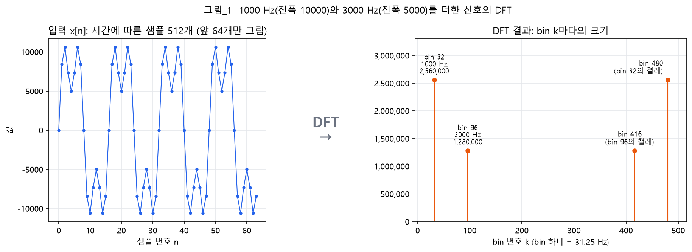

**그림 읽는 법**: 왼쪽은 1000 Hz(진폭 10000)와 3000 Hz(진폭 5000)를 더한 소리를 시간 순서로 찍은 샘플이다. 모양만 봐서는 무엇이 섞였는지 알기 어렵다. 이 샘플 512개를 DFT에 넣으면 오른쪽처럼 **bin 512개**가 나오고, bin마다 "그 주파수 성분이 얼마나 큰가"가 보인다. 1000 Hz는 bin 32, 3000 Hz는 bin 96에 솟는다. bin 480과 416은 켤레 대칭으로 생기는 짝이다(§5.3).


| 단계 | 한 줄 설명 |
|---|---|
| 샘플 | 소리의 파형을 1초에 16,000번 숫자로 찍은 값 |
| DFT | bin k마다 "bin k의 주파수로 진동하는 코사인, 사인"을 샘플에 곱해 모두 더한다 (이 문서의 주제) |
| bin | DFT 결과 하나. bin k는 k × 31.25 Hz의 성분이다 |
| 크기 | bin의 두 합(코사인 합, 사인 합)으로 구한 그 주파수 성분의 크기 |

### 0.2 답해야 할 질문

| 질문 | 답 | 절 |
|---|---|---|
| bin k는 무엇인가 | 한 블록 동안 k주기 진동하는 성분. k × 31.25 Hz | 1부 §2 |
| 그 성분이 얼마나 있는지 어떻게 재는가 | 입력에 bin k의 기준 코사인, 기준 사인을 각각 같은 자리끼리 곱해 모두 더한다 | 2부 §3 ~ §4 |
| 왜 그 주파수만 남는가 | 곱의 공식으로 풀면 주파수가 같을 때만 진동하지 않는 부분(DC)이 생긴다. 진동하는 부분은 더하면 0이다 | 2부 §5 |
| 결과는 왜 숫자 두 개(코사인 합, 사인 합)인가 | 입력 성분의 위상에 따라 코사인 쪽, 사인 쪽으로 나뉘어 들어가기 때문이다 | 2부 §6 |
| 코드의 두 겹 반복은 무엇인가 | 줄(k) × 열(n)의 표 한 장 | 3부 §7 |
| 03과 교과서의 e^(−j…)는 무엇인가 | cos와 sin 두 개를 한 번에 적은 줄임 표기. 코드는 cos와 sin으로 계산한다 | 4부 §9.3 |

---

# 1부. 준비 — 샘플과 회전하는 복소수

## 1. 샘플, 사인파, cos와 sin

### 1.1 샘플과 샘플링 주파수

마이크는 소리(공기 압력의 오르내림)를 전압으로 바꾸고, 컴퓨터는 그것을 **일정한 간격으로 찍은 숫자**로만 다룬다. 찍은 숫자 하나가 **샘플**이다. 1초에 찍는 횟수가 **샘플링 주파수**이고 이 프로젝트는 16,000이다.

이 프로젝트는 샘플 **512개**를 한 블록으로 DFT(나중에는 FFT)에 넣는다. 블록의 길이를 글로 세우면 이렇다.

```
블록 길이 = 샘플 개수 × 샘플 사이 간격
         = 512 × (1 ÷ 16,000 초)
         = 0.032 초 = 32 ms
```

블록의 샘플 수를 **N**이라 부른다. 이 프로젝트에서 N = 512다. 블록 안의 샘플 번호를 **n**(0 ~ N−1), n번째 샘플 값을 **x[n]**으로 쓴다.

### 1.2 사인파는 회전하는 복소수의 허수부다

모든 소리는 **사인파**라는 가장 단순한 파형 여러 개를 더한 것으로 볼 수 있다. 사인파 하나는 **일정한 속도로 회전하는 복소수**(복소 평면에서 원점을 중심으로 도는 벡터)로 그릴 수 있다.

- 복소수의 **크기**가 진폭(파형의 최댓값)이다
- 복소수가 **1초에 회전하는 바퀴 수**가 주파수(Hz)다
- 매 순간 복소수의 **허수부**가 그 순간의 신호 값이다

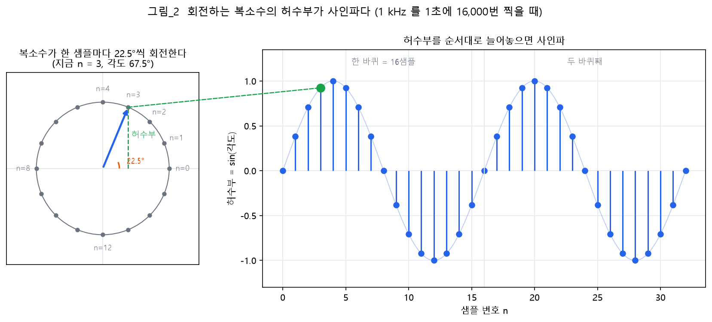

**그림 읽는 법**: 왼쪽 원의 회색 점 16개가 샘플을 찍는 자리다. 1 kHz를 1초에 16,000번 찍으면 한 샘플 지날 때마다 복소수가 22.5°씩 돌고, 16샘플에 한 바퀴를 돈다. 지금 파란 복소수는 n = 3(각도 67.5°)이다. 그 허수부(초록 점선)를 오른쪽에 순서대로 늘어놓은 것이 샘플열이고, 그 모양이 사인파다.

> [!TIP]
> "샘플을 찍는다" = "회전하는 복소수를 62.5 µs(1 ÷ 16,000초)마다 읽는다"로 생각하면 이 문서의 내용이 모두 이 그림 위에서 설명된다.

### 1.3 cos와 sin — 복소수의 실수부와 허수부

복소 평면(가로축이 실수부, 세로축이 허수부인 평면)에서 크기 A인 복소수가 실수축과 각도 α를 이룬다. 이 복소수는 두 숫자로 적을 수 있다.

- **실수부**: 실수축 방향의 좌표
- **허수부**: 허수축 방향의 좌표

이 두 값을 복소수의 크기로 나눈 비율이 cos와 sin이다.

```
cos α = 실수부 ÷ 크기      →  실수부 = A × cos α
sin α = 허수부 ÷ 크기      →  허수부 = A × sin α
```

| 각도 α | cos α (실수부 비율) | sin α (허수부 비율) | 복소수의 방향 |
|---|---|---|---|
| 0° | 1 | 0 | 실수축 방향. 전체가 실수부 |
| 30° | 0.866 | 0.5 | 실수축에 가깝다 |
| 45° | 0.707 | 0.707 | 실수부와 허수부가 같다 |
| 60° | 0.5 | 0.866 | 허수축에 가깝다 |
| 90° | 0 | 1 | 허수축 방향. 전체가 허수부 |

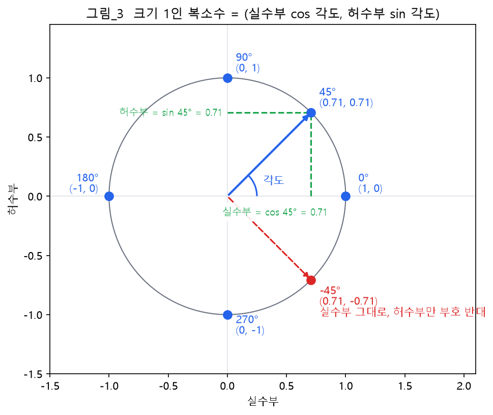

**그림 읽는 법**: 크기 1인 복소수라면 그 값은 그대로 **(실수부 cos 각도, 허수부 sin 각도)**다. 빨간 복소수는 각도에 −를 붙인 것(시계 방향으로 45°)이다. 실수축 아래로 뒤집혀서 **실수부는 그대로, 허수부만 부호가 바뀐다.**

```
cos(−α) =  cos α      (실수부는 그대로)
sin(−α) = −sin α      (허수부는 부호만 반대)
```

이 두 줄은 §4에서 쓴다. §1.2의 사인파 값은 허수부이므로 `진폭 × sin(각도)`다.

---

## 2. 한 샘플 동안 도는 각도

### 2.1 글로 세우기

**걸음 1 — 한 샘플 동안 몇 바퀴 도는가**

복소수는 1초에 f바퀴 돈다. 그 1초 동안 샘플은 16,000개 찍힌다. 그러니 샘플 한 개 간격 동안 도는 바퀴 수는 이렇다.

```
한 샘플 동안 도는 바퀴 수 = 1초에 도는 바퀴 수 ÷ 1초에 찍는 샘플 수
                      = f ÷ 16,000
```

**걸음 2 — 바퀴 수를 각도로 바꾸기**

한 바퀴는 360°다. 바퀴 수에 360°를 곱하면 각도다.

```
한 샘플 동안 도는 각도 = (f ÷ 16,000) × 360°
```

1 kHz면 `(1,000 ÷ 16,000) × 360° = 0.0625바퀴 × 360° = 22.5°`다. 그림_2와 같다.

### 2.2 DFT의 말로 바꾸기 — bin k는 "N샘플 동안 k주기 진동"

DFT는 주파수를 Hz 대신 **bin 번호 k**로 말한다. bin k는 **"한 블록(N샘플) 동안 정확히 k바퀴 도는 복소수"**, 곧 **k주기 진동하는 파형**이다.

**걸음 1 — 한 샘플 동안 도는 바퀴 수**: N샘플 동안 k바퀴이므로 한 샘플 동안 `k ÷ N`바퀴다.

**걸음 2 — 한 샘플 동안 도는 각도**: `(k ÷ N) × 360°`다.

**걸음 3 — n번째 샘플까지 돈 각도**: 0번에서 출발해 n샘플 지났으므로 n배다.

```
n번째 샘플의 각도 = 360° × k × n ÷ N
```

| N | bin k | 한 샘플 동안 도는 각도 | 주파수 (N = 512일 때) |
|---|---|---|---|
| 8 | 1 | 45° | — |
| 8 | 2 | 90° | — |
| 8 | 3 | 135° | — |
| 512 | 32 | 22.5° | 1,000 Hz |
| 512 | 96 | 67.5° | 3,000 Hz |

bin 32가 1 kHz와 같은 22.5°인 것은 우연이 아니다. bin의 주파수를 글로 세우면 이렇다.

```
bin k의 주파수 = 1초에 도는 바퀴 수
            = 한 블록 동안 도는 바퀴 수 ÷ 한 블록의 길이
            = k ÷ 0.032 초
            = k × 31.25 Hz
```

bin 하나의 폭이 31.25 Hz다(16,000 ÷ 512와 같다, [08](08_참고%20공식.md) 참고_2).

### 2.3 라디안

수학과 Python은 각도를 도(°) 대신 **라디안**으로 쓴다. 한 바퀴 360°가 **2π 라디안**이다(π ≈ 3.14159). 그래서 §2.2의 각도는 라디안으로 이렇다.

```
n번째 샘플의 각도 = 2π × k × n ÷ N   (라디안)
```

이 문서에서는 이 각도를 줄여서 **각도(k, n)**이라고 부른다. Python의 `math.cos`, `math.sin`은 라디안을 받고, π는 `math.pi`다.

---

# 2부. DFT를 cos와 sin으로 세우기

## 3. bin k의 기준 사인파 두 개

bin k의 성분이 입력에 얼마나 있는지 재려면, bin k의 주파수로 진동하는 **기준 신호**가 필요하다. 이것을 **기준 사인파**라 부른다(03의 DFT 사인파). 기준 사인파는 두 개다.

```
기준 코사인:  cos(각도(k, n)) = cos(2π × k × n ÷ N)
기준 사인:    sin(각도(k, n)) = sin(2π × k × n ÷ N)
```

§1.3으로 보면, bin k의 주파수로 회전하는 크기 1인 복소수의 **실수부**가 기준 코사인이고 **허수부**가 기준 사인이다.

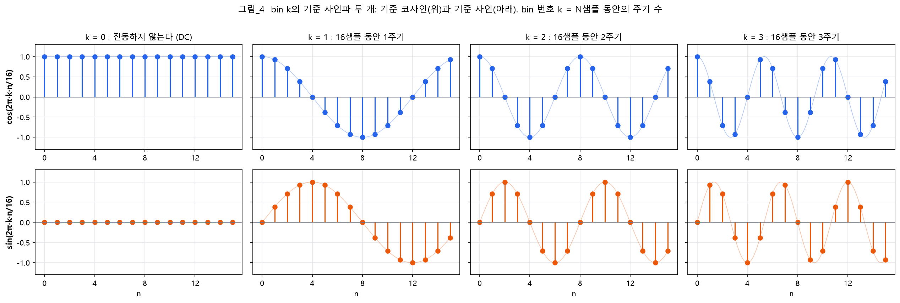

**그림 읽는 법**: N = 16일 때 bin k = 0 ~ 3의 기준 사인파다. 위가 기준 코사인, 아래가 기준 사인이다. k = 0은 진동하지 않는다(코사인은 늘 1, 사인은 늘 0). k = 1은 16샘플 동안 1주기, k = 2는 2주기, k = 3은 3주기 진동한다. **bin 번호 = 한 블록 동안의 주기 수**다.

두 개가 필요한 까닭은 §6에서 본다. 짧게 말하면, 입력 성분의 위상에 따라 코사인 모양일 수도, 사인 모양일 수도, 그 사이일 수도 있어서 둘 다 재야 한다.

---

## 4. DFT의 식을 글로 세우기

**걸음 1 — 코사인 합**

입력 x[n]과 bin k의 기준 코사인을 **같은 자리끼리 곱해 모두 더한다.**

```
코사인 합 C[k] = x[0] × cos(각도(k, 0))
             + x[1] × cos(각도(k, 1))
             + ...
             + x[N−1] × cos(각도(k, N−1))
```

**걸음 2 — 사인 합**

기준 사인으로도 똑같이 한다.

```
사인 합 S[k] = x[0] × sin(각도(k, 0)) + x[1] × sin(각도(k, 1)) + ... + x[N−1] × sin(각도(k, N−1))
```

**걸음 3 — 기호로 옮기기**

Σ는 "n을 0부터 N−1까지 바꿔 가며 모두 더한다"는 기호다.

```
C[k] = Σ (n = 0 ~ N−1)  x[n] × cos(2π × k × n ÷ N)
S[k] = Σ (n = 0 ~ N−1)  x[n] × sin(2π × k × n ÷ N)
```

**걸음 4 — bin k의 결과로 묶기**

bin k의 결과 X[k]는 두 합을 한 쌍으로 묶은 것이다. **실수부에 코사인 합, 허수부에 사인 합에 −를 붙인 값**을 둔다.

```
X[k] = (실수부 C[k], 허수부 −S[k])
```

- 허수부에 −를 붙이는 것은 DFT의 **정의**다. 03 공식_2와 테스트 벡터의 기대값이 이 정의로 계산되어 있다. 그래서 −를 빠뜨리면 시험에서 "허수부의 부호가 반대다"가 나온다(§9.2)
- 그림으로 보면 한 항 `(x[n] × cos(각도), −x[n] × sin(각도))`는 **크기 x[n], 각도 −각도(k, n)인 복소수**다(§1.3의 cos(−α), sin(−α)). 모두 더하는 것은 실수부끼리, 허수부끼리 더하는 것, 곧 **벡터를 차례로 이어 붙이는 것**(벡터 합)이다(§7, 그림_9, 그림_10)

**걸음 5 — Python에서 한 쌍을 담는 법**

Python에는 실수부와 허수부 두 숫자를 한 값에 담는 **복소수** 자료형이 있다. `complex(실수부, 허수부)`로 만들고, `z.real`이 실수부, `z.imag`가 허수부다. 화면에는 `실수부+허수부j` 모양으로 찍힌다. 여기서 j는 허수 단위이고, 뒤의 값이 허수부라는 표시다. 시험의 기대값도 복소수로 적혀 있다(예: `(-414.214-7242.641j)` = 실수부 −414.214, 허수부 −7242.641).

```
X[k] = complex(C[k], −S[k])
```

이것이 [03](03_지식과%20공식.md) 공식_2와 같은 식이다(대응은 §9.3).

---

## 5. 왜 bin k의 주파수만 남는가 — 곱의 공식

### 5.1 곱의 공식 세우기

두 파형을 곱한 것을 다루려면 **곱을 더하기로 바꾸는 공식**이 필요하다. 고등학교 삼각함수의 덧셈 공식에서 나온다.

**걸음 1 — 덧셈 공식 두 줄**

```
cos(a − b) = cos a × cos b + sin a × sin b
cos(a + b) = cos a × cos b − sin a × sin b
```

**걸음 2 — 두 줄을 더한다**

뒷항 `sin a × sin b`는 위에서는 +, 아래에서는 −라서 **서로 지워진다.** 앞항은 두 번 남는다.

```
cos(a − b) + cos(a + b) = 2 × cos a × cos b
```

**걸음 3 — 2로 나눈다**

```
cos a × cos b = cos(a − b) ÷ 2  +  cos(a + b) ÷ 2
```

글로 읽으면 이렇다: **두 코사인의 곱 = "주파수 차이"로 진동하는 반쪽 + "주파수 합"으로 진동하는 반쪽.**

숫자 확인(a = 60°, b = 30°): 왼쪽 `0.5 × 0.866 = 0.433`, 오른쪽 `cos 30° ÷ 2 + cos 90° ÷ 2 = 0.433 + 0 = 0.433`.

같은 방법으로 두 줄을 **빼면** 사인끼리의 곱, 사인 덧셈 공식으로는 코사인과 사인의 곱이 나온다. §6에서 쓴다.

```
sin a × sin b = cos(a − b) ÷ 2  −  cos(a + b) ÷ 2
cos a × sin b = sin(a + b) ÷ 2  −  sin(a − b) ÷ 2
```

(a = 60°, b = 30°에서 각각 0.433, 0.25로 양쪽이 같다.)

### 5.2 정수 주기 진동하는 파형은 모두 더하면 0이다

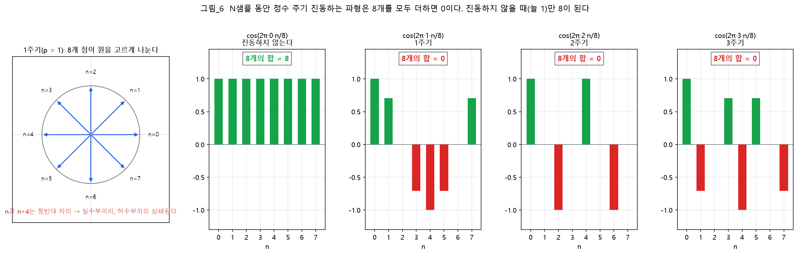

**그림 읽는 법**: N = 8일 때, 한 블록 동안 p주기 진동하는 코사인 8개의 값을 모두 더했다. p = 0은 진동하지 않고 늘 1이라 합이 **8**이다. p = 1, 2, 3은 양수와 음수가 같은 만큼 있어 합이 **0**이다. 왼쪽 원은 p = 1의 8개 자리다. n과 n + 4가 정반대 자리라서, 짝끼리 실수부도 허수부도 지워진다.

| p (한 블록 동안 주기 수) | 0 | 1 | 2 | 3 | 4 | 5 | 6 | 7 | 8 |
|---|---|---|---|---|---|---|---|---|---|
| cos 8개의 합 | **8** | 0 | 0 | 0 | 0 | 0 | 0 | 0 | **8** |
| sin 8개의 합 | 0 | 0 | 0 | 0 | 0 | 0 | 0 | 0 | 0 |

**규칙**: 한 블록 동안 **정수 주기 진동하는** 코사인과 사인은 N개를 모두 더하면 **0**이다. 예외는 주기 수가 0 또는 N의 배수일 때다. 그때는 샘플마다 한 바퀴씩 돌아 제자리라 코사인이 늘 1이고, 합이 **N**이다(표의 p = 8).

### 5.3 합치기 — 같은 주파수만 남는다

입력이 한 블록 동안 m주기 진동하는 코사인 `x[n] = cos(2π × m × n ÷ N)`이라 하고, bin k의 코사인 합을 구한다.

**걸음 1 — 곱을 쓴다**

```
x[n] × 기준 코사인 = cos(2π × m × n ÷ N) × cos(2π × k × n ÷ N)
```

**걸음 2 — 곱의 공식(§5.1)으로 바꾼다**

```
          = cos(2π × (m − k) × n ÷ N) ÷ 2      반쪽 ①: m − k 번 진동
          + cos(2π × (m + k) × n ÷ N) ÷ 2      반쪽 ②: m + k 번 진동
```

**걸음 3 — N개를 모두 더한다 (§5.2)**

두 반쪽 모두 한 블록 동안 정수 주기 진동하므로 합이 0이다. **주기 수가 0(또는 N)인 반쪽만** 늘 ½이라 N × ½ = **N ÷ 2**가 남는다.

**걸음 4 — 결론**

| 분석하는 bin k | 반쪽 ① (m − k번) | 반쪽 ② (m + k번) | 코사인 합 C[k] |
|---|---|---|---|
| k = m (같은 주파수) | **0번 → 늘 ½** | 2m번 → 합 0 | **N ÷ 2** |
| k = N − m (켤레 대칭 bin) | 2m − N번 → 합 0 | **N번 → 늘 ½** | **N ÷ 2** |
| 그 밖 | 합 0 | 합 0 | **0** |

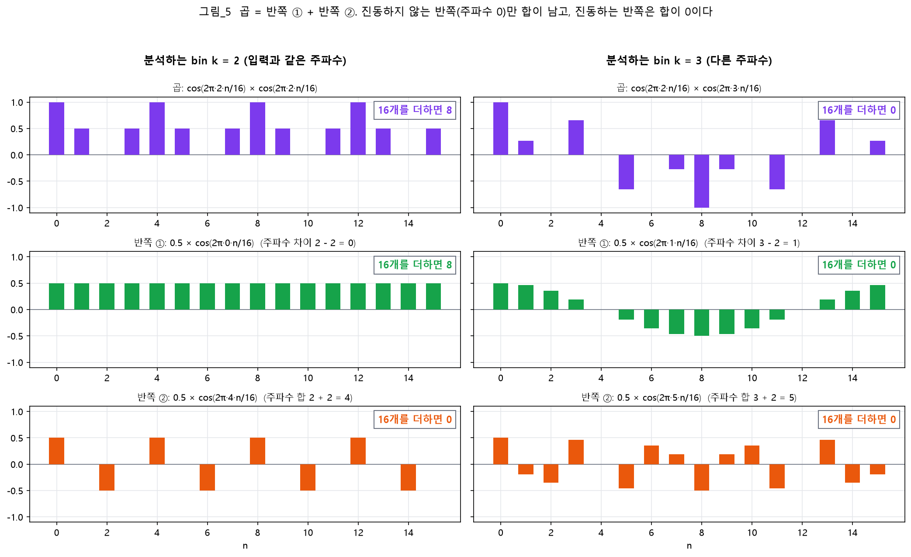

**그림 읽는 법**: 입력은 16샘플 동안 2주기 진동하는 코사인(m = 2)이다. 왼쪽은 bin 2로 잰 것이다. 곱(보라)을 곱의 공식으로 나누면 반쪽 ①이 **진동하지 않아(늘 0.5)**이라 16개의 합이 **8**이고, 반쪽 ②(4주기 진동)는 합이 0이다. 오른쪽은 bin 3으로 잰 것이다. 반쪽 ①(1주기 진동)과 반쪽 ②(5주기 진동)가 모두 진동하므로 합이 **0**이다.

**숫자로 확인** (N = 16, m = 2): C[2] = 8, C[3] = 0, C[14] = 8. bin 14 = 16 − 2가 켤레 대칭 bin이다.

이것이 [03](03_지식과%20공식.md) §3의 **직교성**을 cos와 sin으로 본 것이다. 곱해서 더하는 계산이 **같은 주파수만 골라내는** 까닭이다. 그림_1에서 봉우리가 둘씩(bin 32와 480, bin 96과 416) 나온 것은 걸음 4의 표 둘째 줄 때문이다([08](08_참고%20공식.md) 참고_1).

---

## 6. 코사인 합과 사인 합이 나눠 맡는 것

### 6.1 코사인 입력 — 코사인 합에만 쌓인다

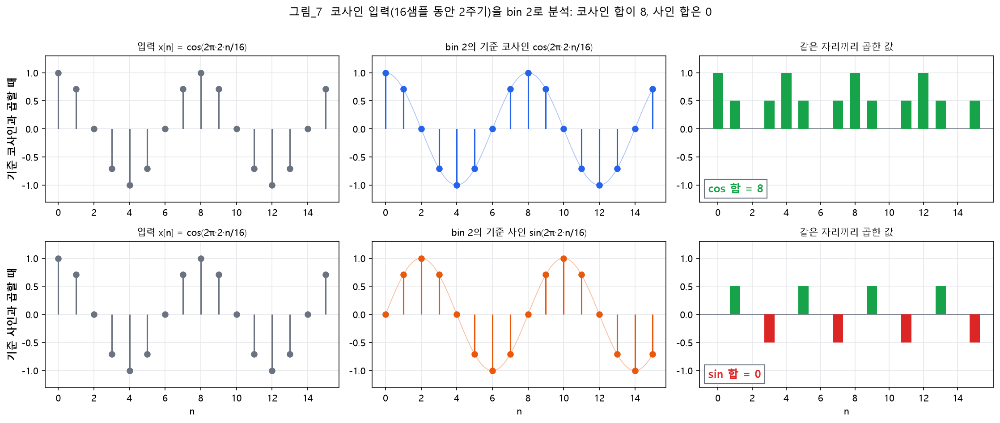

**그림 읽는 법**: 입력은 16샘플 동안 2주기 진동하는 코사인이다. 윗줄은 bin 2의 기준 코사인과 곱한 것이다. 입력이 양수일 때 파형도 양수, 음수일 때 파형도 음수라 곱이 **모두 0 이상**이고, 더하면 **8**이다. 아랫줄은 bin 2의 기준 사인과 곱한 것이다. 양수와 음수가 번갈아 **0**이 된다.

코사인과 사인의 곱은 §5.1의 셋째 공식으로 **사인 반쪽 둘**이 된다. 사인은 주기 수가 0이어도 늘 0이라(그림_4의 k = 0 아래), 어느 반쪽도 합이 남지 않는다. 그래서 **코사인 입력은 사인 합에 들어가지 않는다.**

### 6.2 사인 입력 — 사인 합에만 쌓인다

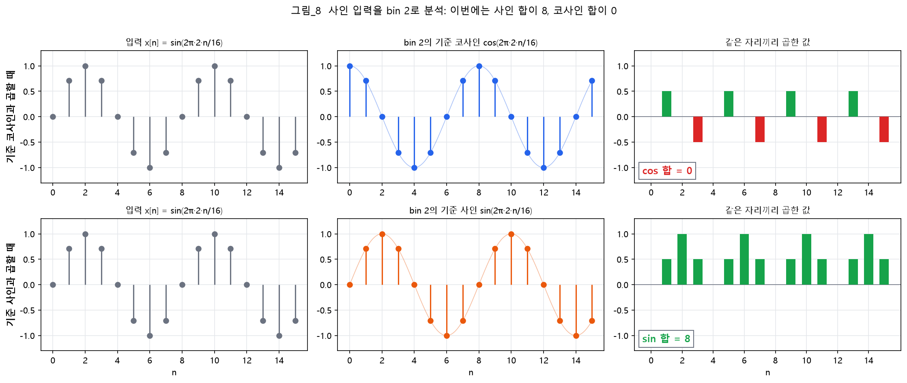

**그림 읽는 법**: 입력을 사인으로 바꾸면 반대가 된다. 기준 코사인과 곱한 합이 **0**이고, 기준 사인과 곱한 합이 **8**이다.

그래서 bin 2의 결과는 X[2] = (실수부 0, 허수부 −8)이다. 허수부가 −인 까닭은 §4 걸음 4의 정의다. 03 §3.1에서 "사인은 bin 32에 −256j"라고 적은 것이 이것이다(실수부 0, 허수부 −256).

### 6.3 그 사이 — 두 합에 나뉘어 들어가고, 크기는 그대로다

입력의 위상이 코사인보다 45° 늦으면(`cos(2π × 2 × n ÷ 16 − 45°)`), 두 합에 나뉘어 들어간다.

| 입력 | 코사인 합 C[2] | 사인 합 S[2] | 크기 √(C² + S²) |
|---|---|---|---|
| 코사인 (0° 늦음) | 8 | 0 | 8 |
| 45° 늦은 코사인 | 5.657 | 5.657 | **8** |
| 사인 (90° 늦음) | 0 | 8 | 8 |

**읽는 법**: 두 합의 **나뉜 비율**은 위상(한 주기 중 어디서 시작하는가)을 알려 주고, 두 합으로 만든 **크기**는 위상과 상관없이 그 주파수 성분의 진폭을 알려 준다. 결과가 숫자 두 개인 까닭이다. 크기는 실수부 C, 허수부 S인 복소수의 크기다(피타고라스).

### 6.4 크기 = 진폭 × N ÷ 2

진폭 A인 코사인이면 §5.3의 N ÷ 2에 A가 곱해진다. 그림_1의 1 kHz(진폭 10000)는 bin 32에서 **10000 × 256(= 512 ÷ 2) = 2,560,000**, 3 kHz(진폭 5000)는 bin 96에서 1,280,000이다.

---

# 3부. 코드의 모양과 결과 읽기

## 7. 두 겹 반복 = 표 한 장

### 7.1 줄은 k, 열은 n

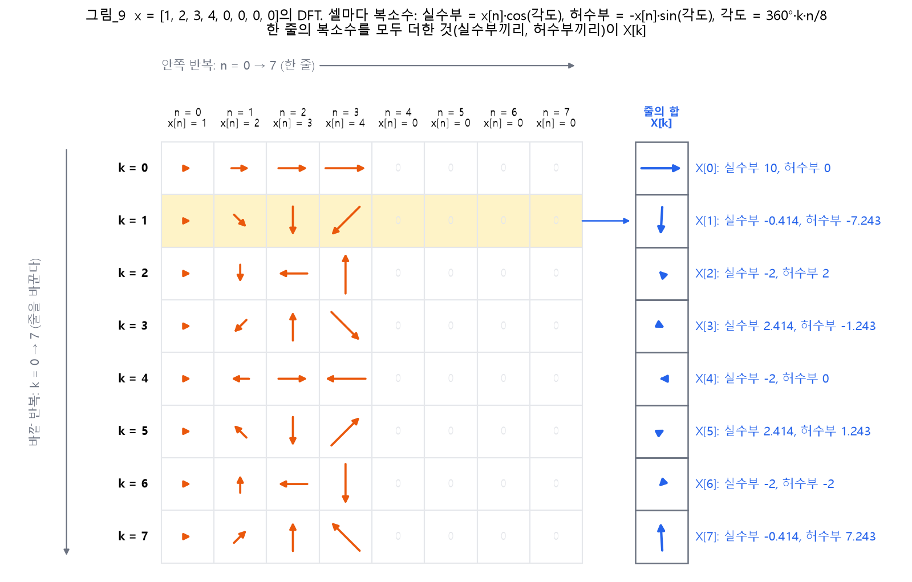

**그림 읽는 법**: 입력은 x = [1, 2, 3, 4, 0, 0, 0, 0]이다(시험 `test_dft_small`의 입력을 1000으로 나눈 것). 셀 하나의 주황 벡터가 한 항 `(실수부 x[n] × cos(각도), 허수부 −x[n] × sin(각도))`이다. 크기는 x[n], 각도는 −(45° × k × n)이다. 한 줄의 복소수를 모두 더한 것(실수부끼리, 허수부끼리)이 오른쪽 파란 셀의 X[k]다.

| 그림에서 | 식에서 | 코드에서 |
|---|---|---|
| 셀 하나의 복소수 | x[n] × cos(각도(k, n)), −x[n] × sin(각도(k, n)) | 안쪽 반복 안에서 만드는 **항 하나** |
| 한 줄을 왼쪽에서 오른쪽으로 지나감 | Σ (n = 0 ~ 7) | 안쪽 반복 `for n` |
| 줄을 바꿈 | k = 0 ~ 7 | 바깥 반복 `for k` |
| 오른쪽 파란 셀 | X[k] = (C[k], −S[k]) | `X.append(total)` |

**줄 두 개를 읽어 보기**

- **k = 0 줄**: 각도가 모두 0°라 cos = 1, sin = 0이다. 항이 전부 실수축 방향이고, 그냥 더한 1 + 2 + 3 + 4 = **10**이 X[0]이다. bin 0은 늘 입력의 합이다
- **k = 4 줄**: 각도가 0°, 180°, 360°, 540°라 cos가 1, −1, 1, −1이다. 1 − 2 + 3 − 4 = **−2**가 X[4]의 실수부다

오른쪽 값은 03 §3.1의 8점 표와 같고, 시험의 기대값은 이 값의 1000배다.

### 7.2 한 줄을 더하는 모습 (k = 1)

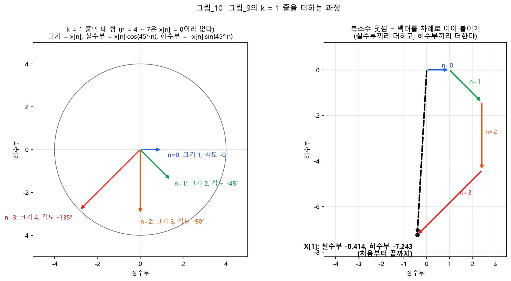

**그림 읽는 법**: 왼쪽은 k = 1 줄의 네 항이다(n = 4 ~ 7은 x[n] = 0이라 없다). 오른쪽은 그것을 차례로 이어 붙인 모습(벡터 합)이다. 처음(원점)에서 끝까지 잇는 검은 점선이 X[1]이다.

| 안쪽 반복 | 이번 항의 실수부 x[n] × cos(45° × n) | 이번 항의 허수부 −x[n] × sin(45° × n) | 더한 뒤 (실수부, 허수부) |
|---|---|---|---|
| 시작 | — | — | (0, 0) |
| n = 0 | 1 × 1 = 1 | −1 × 0 = 0 | (1, 0) |
| n = 1 | 2 × 0.7071 = 1.4142 | −2 × 0.7071 = −1.4142 | (2.4142, −1.4142) |
| n = 2 | 3 × 0 = 0 | −3 × 1 = −3 | (2.4142, −4.4142) |
| n = 3 | 4 × (−0.7071) = −2.8284 | −4 × 0.7071 = −2.8284 | (−0.4142, −7.2426) |
| n = 4 ~ 7 | x[n] = 0이라 0 | 0 | (−0.4142, −7.2426) = **X[1]** |

안쪽 반복이 끝났을 때의 합이 X[1]이다. 시험의 기대값 `(-414.214-7242.641j)`는 이것의 1000배다.

### 7.3 코드 틀의 흐름

`src/dft.py`의 `dft`가 도는 차례다.

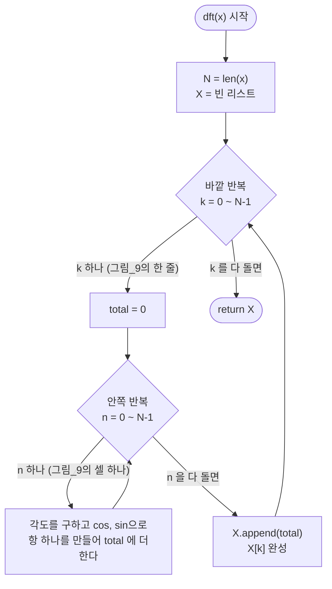

---

## 8. 결과 읽기

| 알고 싶은 것 | 보는 법 | 근거 |
|---|---|---|
| bin k가 몇 Hz인가 | k × 31.25 Hz | §2.2, [08](08_참고%20공식.md) 참고_2 |
| 그 주파수 성분이 얼마나 큰가 | 크기 √(실수부² + 허수부²). Python의 `abs(X[k])`와 같지만, 이 프로젝트는 C로 옮길 것을 생각해 풀어 쓴다(`src/dft.py`의 `magnitude`, 04 §0.4) | §6.3 |
| 그 주파수가 어디서 시작하는가(위상) | 실수부와 허수부의 비율. Python에서는 `math.atan2(허수부, 실수부)` 또는 `cmath.phase(X[k])` | §6.3 |
| bin 0 | 입력을 모두 더한 값 | §7.1의 k = 0 줄 |
| bin N − k | bin k와 크기가 같다(켤레 대칭) | §5.3, [08](08_참고%20공식.md) 참고_1 |
| bin의 중심에 맞는 사인파의 크기 | 진폭 × N ÷ 2 | §6.4 |

테스트 벡터의 입력으로 읽어 보면 이렇다.

| 시험 항목 | 입력 | 결과 | 읽는 법 |
|---|---|---|---|
| `fft/impulse` | 0번 샘플만 10000 | 모든 bin이 10000 | 항이 n = 0 하나뿐이고, 각도(k, 0)은 늘 0°라 cos = 1, sin = 0 |
| `fft/dc` | 모든 샘플이 1000 | bin 0만 512000 | 입력이 진동하지 않는다(m = 0). bin 0은 합 1000 × 512, 다른 bin은 §5.2에 따라 0 |
| `fft/sine_1khz` | 1000 Hz, 진폭 10000 | bin 32와 480이 크다 | §5.3, §6.2 |

---

# 4부. 코드와 확인

## 9. 코드 틀과 시험

### 9.1 안쪽 반복에서 하는 일

`dft`의 안쪽 반복은 그림_9의 **셀 하나**, 곧 한 항을 만들어 `total`에 더한다. 순서를 글로 적으면 이렇다.

1. 각도(k, n) = 2π × k × n ÷ N을 구한다
2. 실수부 = x[n] × cos(각도), 허수부 = −x[n] × sin(각도)를 구한다
3. 그 한 쌍을 `total`에 더한다

`src/dft.py`의 `dft`(2026-09-30 `src/main.py`에서 옮김)는 이 순서대로 채워져 있고, 줄마다 로직을 설명하는 주석이 달려 있다. 쓰는 방법은 둘이고, 사본에서 둘 다 시험을 통과했다. 처음에는 방법 ①로 채웠다가, 복소수 연산을 실수부와 허수부로 풀어 쓰는 규칙(04 §0.4, 2026-09-30 사용자 결정)에 따라 **방법 ②**로 바꿨다.

| 방법 | 모양 | 틀과의 관계 |
|---|---|---|
| ① 한 쌍을 복소수로 만들어 `total`에 더한다 | 항마다 `complex(실수부, 허수부)`를 더한다 | 틀 그대로 |
| ② 코사인 합과 사인 합을 따로 쌓는다 | 합 두 개를 따로 두고, 안쪽 반복이 끝나면 `complex(C, −S)`를 넣는다 | `total = 0` 한 줄을 두 합으로, `X.append(total)`을 바꾼다 |

| 식의 조각 | Python | 근거 |
|---|---|---|
| π | `math.pi` (`import math`) | [05](05_Python%20문법%20길잡이.md) §13 |
| cos, sin (라디안) | `math.cos(각도)`, `math.sin(각도)` | 같음 |
| (실수부, 허수부) 한 쌍 | `complex(실수부, 허수부)` | 05 §12.1 |
| 합에 더하기 | `total = total + 값` 또는 `total += 값` | 05 §5.1 |

### 9.2 확인

프로젝트 폴더에서 실행한다.

```powershell
python -m pytest -v -k dft
```

- `test_dft_small`(길이 8)부터 맞춘다. 기대값은 §7.1 오른쪽 값의 1000배다
- `test_dft`는 길이 512짜리 다섯 개(§8의 표 등)다
- `idft`를 채우기 전에는 `test_idft`와 `test_dft_idft_roundtrip`이 함께 실패한다

틀렸을 때 나오는 힌트([06](06_테스트%20벡터%20사용법.md) §4.5):

| 힌트 | 뜻 | 먼저 볼 곳 |
|---|---|---|
| 결과가 전부 0이다 | 항을 하나도 더하지 않았다 | 항을 `total`에 더하는가 |
| 허수부의 부호가 반대다 / 순서가 뒤집혀 있다 | 허수부의 부호가 반대다 | 허수부에 −를 붙였는가(§4 걸음 4) |
| 크기가 기대값의 1/N배다 | N으로 나눴다 | DFT에서는 나누지 않는다. 1/N은 역 DFT에만 둔다 |
| 모든 자리가 기대값의 몇 배다 | 곱하는 상수가 틀렸다 | 2π, 곱하거나 나누는 상수 |

### 9.3 03과 교과서의 표기와의 대응

03과 교과서는 §4의 식을 한 줄로 이렇게 적는다.

```
X[k] = Σ (n = 0 ~ N−1)  x[n] · e^(−j·2π·k·n/N)
```

`e^(−j·각도)`는 **"실수부 cos(각도), 허수부 −sin(각도)인 한 쌍"을 한 기호로 적은 줄임**이다. 이 관계를 오일러 공식이라 한다.

| 이 문서 | 03, 교과서 |
|---|---|
| 실수부 cos(각도), 허수부 sin(각도) | e^(j·각도) |
| 실수부 cos(각도), 허수부 −sin(각도) | e^(−j·각도) |
| X[k] = (실수부 C[k], 허수부 −S[k]) | X[k] = Σ x[n] · e^(−j·2π·k·n/N) |

- 두 줄은 **같은 식**이다. 줄임 표기를 풀면 §4의 코사인 합과 사인 합이 된다
- 컴퓨터는 e^(…)를 따로 계산하지 않는다. **cos와 sin을 구해 실수부, 허수부로 쓴다.** Python의 `cmath.exp(1j * 각도)`도 결과가 `complex(math.cos(각도), math.sin(각도))`와 끝자리까지 같다(검산_2)
- 줄임 표기가 왜 거듭제곱 모양인지는 이 프로젝트의 구현에 필요하지 않다. 궁금하면 03 공식_1의 도출을 본다

---

## 10. 요약

| 부 | 절 | 내용 |
|---|---|---|
| 1부 준비 | §1 | 샘플 = 회전하는 복소수의 허수부를 62.5 µs마다 읽은 값. cos, sin = 크기 1인 복소수의 실수부, 허수부. 각도에 −를 붙이면 허수부만 부호가 바뀐다 |
| | §2 | bin k = N샘플 동안 k주기 진동. 각도(k, n) = 2π × k × n ÷ N. bin k = k × 31.25 Hz |
| 2부 DFT | §3 | bin k의 기준 사인파은 둘: cos(각도(k, n)), sin(각도(k, n)) |
| | §4 | 코사인 합 C[k] = Σ x[n] × cos, 사인 합 S[k] = Σ x[n] × sin. X[k] = (실수부 C[k], 허수부 −S[k]) = `complex(C, −S)` |
| | §5 | 곱의 공식: cos a × cos b = cos(a − b) ÷ 2 + cos(a + b) ÷ 2. 정수 주기 진동하는 파형의 합은 0이라, 주파수가 같을 때(과 켤레 대칭 bin)만 N ÷ 2가 남는다 |
| | §6 | 코사인 입력은 코사인 합에, 사인 입력은 사인 합에 쌓인다. 크기 √(C² + S²)는 위상과 상관없다. 크기 = 진폭 × N ÷ 2 |
| 3부 코드 모양 | §7 | 바깥 반복 = 줄(k), 안쪽 반복 = 열(n), 줄의 합 = X[k] |
| | §8 | 크기 = abs, bin 0 = 합, bin N − k = 켤레 대칭 |
| 4부 확인 | §9 | 안쪽 반복 = 각도 → cos, sin → 한 쌍을 더하기. `python -m pytest -v -k dft`. e^(−j…)는 cos와 −sin 한 쌍의 줄임 |

---

## 부록. 용어 풀이

| 용어 | 풀이 |
|---|---|
| 샘플 | 연속된 소리 파형을 일정 간격으로 찍은 숫자 하나 |
| 샘플링 주파수 | 1초에 샘플을 찍는 횟수. 이 프로젝트는 16,000 |
| N | 한 번에 DFT에 넣는 샘플 수. 이 프로젝트는 512 |
| 주파수 (Hz) | 1초에 파형이 반복되는 횟수. 높을수록 고음 |
| 사인파 | 가장 단순한 파형. 일정한 속도로 회전하는 복소수의 허수부 |
| 진폭 | 파형의 최댓값. 복소수의 크기 |
| 위상 | 파형이 한 주기 중 어디서 시작하는가(각도) |
| 라디안, π | 각도를 재는 다른 단위. 한 바퀴 360° = 2π 라디안 (π ≈ 3.14159) |
| cos, sin | 크기 1인 복소수의 실수부(cos), 허수부(sin) |
| 덧셈 공식 | cos(a ± b), sin(a ± b)를 풀어 쓰는 고등학교 공식 |
| 곱의 공식 | 두 cos(또는 sin)의 곱을 "주파수 차이"와 "주파수 합"으로 진동하는 두 반쪽의 합으로 바꾸는 공식. 덧셈 공식 두 줄을 더하거나 빼서 얻는다 |
| bin (주파수 bin) | DFT 결과 하나. bin k는 한 블록 동안 k주기 진동하는 성분 = k × 31.25 Hz |
| 기준 사인파 | 이 문서에서 bin k의 cos(2π·k·n/N), sin(2π·k·n/N)을 부르는 이름 |
| 코사인 합, 사인 합 | 입력에 기준 사인파을 같은 자리끼리 곱해 모두 더한 값. C[k], S[k] |
| DFT | bin마다 코사인 합과 사인 합을 구해 X[k] = (C[k], −S[k])로 묶는 계산 ([03](03_지식과%20공식.md) 공식_2) |
| FFT | DFT와 같은 값을 훨씬 빠르게 내는 계산 방법 (04 단계_3). 그림 설명은 [10](10_FFT%20그림%20설명.md) |
| 직교성 | 주파수가 다른 파형끼리 곱해 모두 더하면 0이 되는 성질 (§5) |
| 스펙트럼 | bin마다의 크기를 늘어놓은 모양 (그림_1 오른쪽) |
| 크기 | 실수부 C, 허수부 S인 복소수의 크기 √(C² + S²). Python에서 `abs(X[k])` |
| 켤레 대칭 | 실수 입력이면 bin N − k가 bin k와 크기가 같은 것 (§5.3) |
| 복소수 (Python) | 실수부(`real`)와 허수부(`imag`) 두 숫자를 한 값에 담는 Python의 자료형. `complex(실수부, 허수부)`로 만들고 `실수부+허수부j` 모양으로 찍힌다 |
| e^(−j…) | 03과 교과서의 표기. 실수부 cos, 허수부 −sin 한 쌍의 줄임 (§9.3) |
| 테스트 벡터 | 입력과 맞는 결과를 미리 계산해 둔 값. 만든 함수가 맞는지 비교한다 ([06](06_테스트%20벡터%20사용법.md)) |
