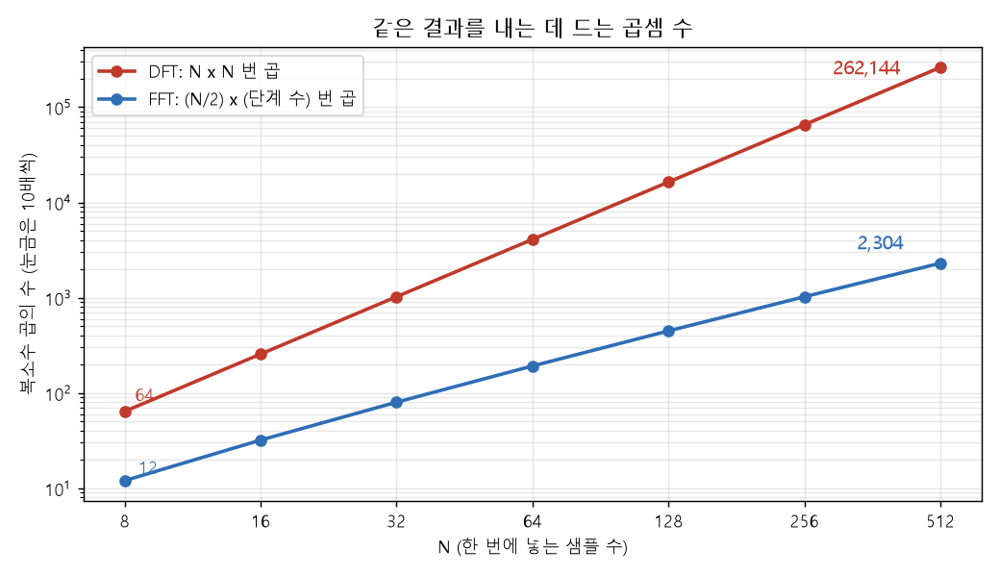
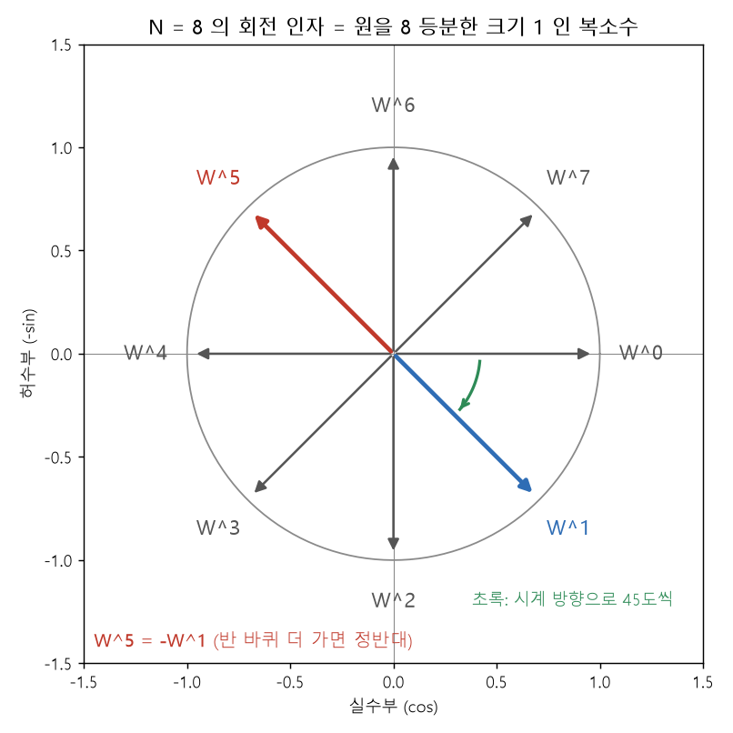
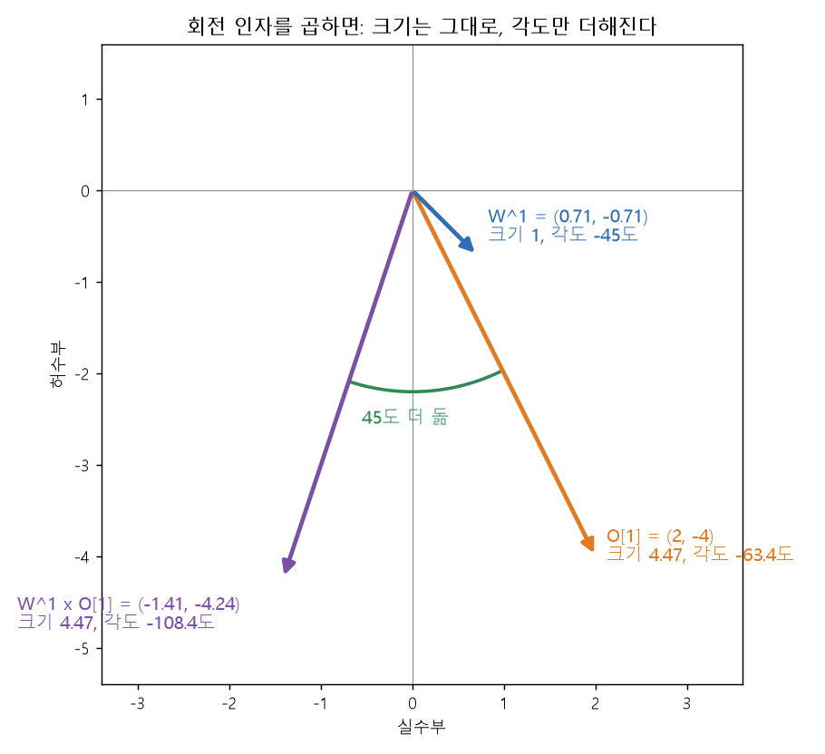
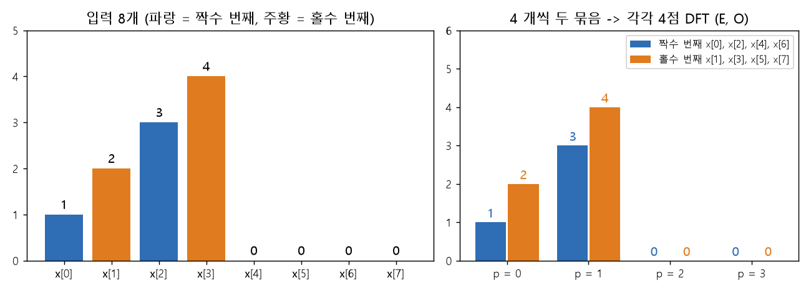
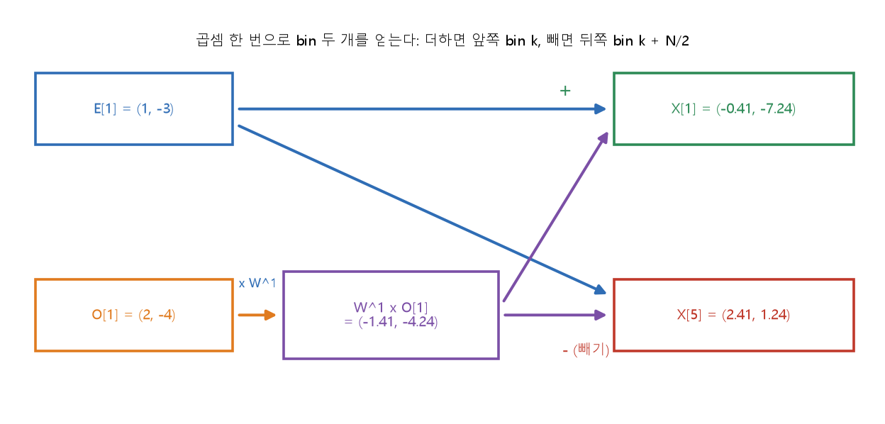
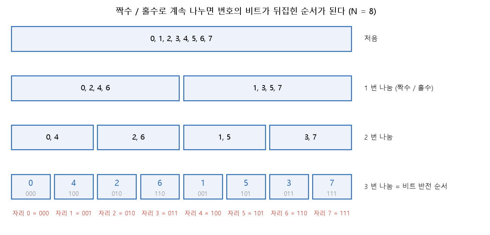
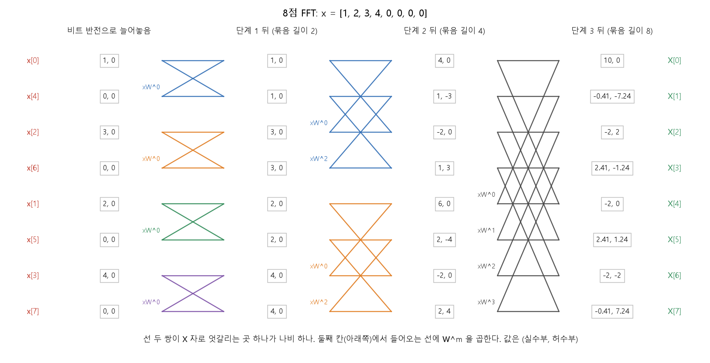
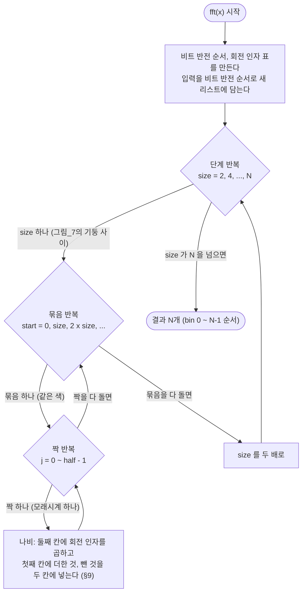

# 10. FFT 그림 설명 — 반씩 나누어 빠르게

**TL;DR**: FFT는 DFT와 같은 값을 곱셈 100분의 1쯤으로 낸다(512점: 262,144 → 2,304). 회전 인자 = 원을 N등분한 크기 1인 복소수, 복소수 곱 = 각도 더하기(1부). 짝수 번째와 홀수 번째로 나누면 곱셈 한 번(나비)으로 bin 두 개가 나오고, 되풀이한 순서가 비트 반전이다(2부). 코드 틀의 세 겹 반복(3부), 켤레로 만드는 IFFT(4부), 시험(5부). 지수 표기는 쓰지 않는다.

> [!NOTE]
> **[09_DFT 그림 설명.md](09_DFT%20그림%20설명.md)를 먼저 읽는다.** 이 문서는 09의 복소수, cos와 sin, 각도(k, n), X[k] = (실수부 C[k], 허수부 −S[k])를 그대로 쓴다. 용어는 처음 나올 때 한 줄로 풀고, 더 긴 풀이는 맨 아래 [부록. 용어 풀이](#부록-용어-풀이)에 모았다. 공식은 **글로 먼저 세운 뒤** 기호로 옮긴다. 03과 교과서의 표기와의 대응은 §12에 한 번만 둔다.
>
> **근거**
> - 식의 원문: [03_지식과 공식.md](03_지식과%20공식.md) 공식_4 ~ 공식_8(§4, §5). 출처는 J. O. Smith, *Mathematics of the DFT*, "Decimation in Time"
> - 확인 값과 자주 하는 실수: [04_구현 가이드라인.md](04_구현%20가이드라인.md) 단계_3, 단계_4
> - 복소수 연산을 실수부와 허수부로 풀어 쓰는 규칙: 04 §0.4 "복소수 연산" 행 (2026-09-30 사용자 결정)
> - 그림 7장은 계산으로 그렸다(matplotlib). 그림과 표의 수치는 [첨부_이력_FFT 그림 검산 출력.txt](../tasks/가이드/20260928_1728_pr-guide-and-setup/첨부_이력_FFT%20그림%20검산%20출력.txt)에 있고, 아래에서 "검산_N"으로 가리킨다
> - §2 ~ §10의 수학은 일반 수학에 대한 필자 서술이며, 표의 수치는 모두 계산해 확인했다

---

## 0. 무엇을 하려는가

### 0.1 FFT가 하는 일

FFT는 새로운 변환이 아니다. **DFT를 계산하는 빠른 방법**이다. 넣는 것(샘플 N개)과 나오는 것(bin N개)이 DFT와 같고, 값도 같다. 512점 난수 입력에서 `src/dft.py`의 `dft`와 FFT의 결과 차이는 5.0e-12였다(검산_6).



**그림 읽는 법**: 가로축은 한 번에 넣는 샘플 수 N, 세로축은 복소수 곱셈의 수다. 세로축 눈금은 하나가 10배다. DFT(빨강)는 bin N개마다 N번 곱하므로 N × N번이다. FFT(파랑)는 (N ÷ 2) × (단계 수)번이다(§6.1). N이 커질수록 두 선이 벌어진다. N = 512에서 262,144번과 2,304번, **114분의 1**이다.

| N = 512 | DFT | FFT | 근거 |
|---|---|---|---|
| 복소수 곱셈 수 | 262,144 | 2,304 | 03 공식_6, 검산_6 |
| 이 PC에서 한 번 (순수 Python) | 0.17초 | 3.4 ms | 검산_6. FFT는 Claude가 검산용으로 만든 사본으로 잰 값 |
| 프레임 1,031개(04 단계_6)에 쓰면 | 약 175초 | 약 3.5초 | 위 두 값 × 1,031 (계산 추정) |

시간으로는 50배 빠르다. 곱셈 수의 비(114배)보다 작은 것은 곱셈 말고도 반복문과 리스트를 다루는 시간이 들기 때문이다(해석).

### 0.2 답해야 할 질문

| 질문 | 답 | 절 |
|---|---|---|
| 회전 인자는 무엇인가 | 한 바퀴를 N등분한 각도를 가진 크기 1인 복소수. DFT에서 샘플에 곱하는 복소수는 모두 이 가운데 하나다 | 1부 §2 |
| 복소수 곱은 무엇인가 | 각도를 더하는 것. 풀어 쓰면 (실수부 ac − bd, 허수부 ad + bc) | 1부 §3 |
| 왜 빨라지는가 | 짝수 번째와 홀수 번째로 나누면 반 길이 DFT 두 개가 되고, 곱셈 한 번(나비)으로 bin 두 개가 나온다 | 2부 §4 ~ §5 |
| 비트 반전은 왜 하는가 | 계속 반으로 나눈 끝의 순서가 번호의 비트를 뒤집은 순서다 | 2부 §6 |
| 코드의 세 겹 반복은 무엇인가 | 단계(묶음 길이) × 묶음 × 묶음 안의 짝 | 3부 §7 |
| IFFT는 어떻게 만드는가 | 켤레 → FFT → 켤레 → N으로 나누기 | 4부 §10 |

---

# 1부. 준비 — 회전 인자와 복소수 곱

## 1. 09에서 가져올 것

| 09에서 | 내용 |
|---|---|
| §1.3 | 크기 1인 복소수는 (실수부 cos 각도, 허수부 sin 각도)다. 각도에 −를 붙이면 허수부만 부호가 바뀐다 |
| §2.3 | 각도(k, n) = 2π × k × n ÷ N (라디안) |
| §4 | X[k] = (실수부 C[k], 허수부 −S[k]). 곧 크기가 x[n]이고 각도가 −각도(k, n)인 복소수 N개의 **합** |
| §4 걸음 5 | 실수부와 허수부 한 쌍은 Python의 `complex(실수부, 허수부)`에 담고, `.real`, `.imag`로 꺼낸다 |

이 문서도 복소수를 **(실수부, 허수부)**로 적는다. 예를 들어 (1, −3)은 실수부 1, 허수부 −3이고, Python으로는 `complex(1, -3)`이다.

---

## 2. 회전 인자 — 원을 N등분한 크기 1인 복소수

### 2.1 글로 세우기

**걸음 1 — 한 바퀴를 N등분한다**

한 눈금은 360° ÷ N이다. N = 8이면 45°, N = 512이면 0.703°다.

**걸음 2 — 시계 방향으로 m눈금 회전한 복소수**

크기 1인 복소수를 실수축의 양의 방향에서 **시계 방향으로** m눈금 회전시킨 것을 **W^m**이라 부른다. 이것이 **회전 인자**(twiddle factor)다. 시계 방향은 각도에 −를 붙인 것이므로, 09 §1.3에 따라 허수부에 −가 붙는다.

```
W^m = (실수부 cos(2π × m ÷ N), 허수부 −sin(2π × m ÷ N))
```

N을 밝혀야 할 때는 W_N^m으로 적는다(W_8^1은 8등분한 원의 1눈금).

**걸음 3 — DFT에서 곱하는 복소수는 모두 회전 인자다**

09 §4에서 X[k]를 만드는 항의 각도는 −각도(k, n) = −2π × k × n ÷ N이었다. 시계 방향으로 **k × n눈금** 회전한 회전 인자다.

```
X[k] = Σ (n = 0 ~ N−1)  x[n] × W^(k × n)
```

x[n]은 실수라서 여기의 ×는 회전 인자의 크기를 x[n]배 하는 것이다. k × n이 N을 넘으면 한 바퀴를 넘어 다시 돈다.



**그림 읽는 법**: N = 8의 회전 인자 8개다. W^0은 실수축의 양의 방향(실수부 1, 허수부 0)이고, 한 눈금씩 시계 방향으로 45° 돈다(초록 표시). W^2는 아래(실수부 0, 허수부 −1)다. 파란 W^1과 빨간 W^5는 정반대를 가리킨다. W^5 = −W^1이다.

| m | W_8^m (실수부, 허수부) | 각도 |
|---|---|---|
| 0 | (1, 0) | 0° |
| 1 | (0.7071, −0.7071) | −45° |
| 2 | (0, −1) | −90° |
| 3 | (−0.7071, −0.7071) | −135° |
| 4 | (−1, 0) | −180° |
| 5 | (−0.7071, 0.7071) | −225° |
| 6 | (0, 1) | −270° |
| 7 | (0.7071, 0.7071) | −315° |

근거: 검산_1. 03 §4.1의 표와 같다.

### 2.2 회전 인자의 세 가지 성질

번호는 03 §4.1의 성질 번호를 그대로 쓴다.

| 성질 | 글로 | 식 | N = 8로 확인 | 쓰는 곳 |
|---|---|---|---|---|
| 성질_2 한 바퀴 | N눈금 더 가면 제자리 | W^(m + N) = W^m | W^9 = W^1 | §5 걸음 1 |
| 성질_3 반 바퀴 | N/2눈금 더 가면 **정반대**. 실수부와 허수부의 부호가 모두 바뀐다 | W^(m + N/2) = −W^m | W^5 = (−0.7071, 0.7071) = −W^1 | §5 걸음 2 |
| 성질_4 두 눈금씩 | N등분한 원에서 2눈금씩 가는 것 = N/2등분한 원에서 1눈금씩 가는 것 | W_N^(2 × m) = W_(N/2)^m | W_8^2 = (0, −1) = W_4^1 | §4 걸음 2, §8 |

성질_4의 까닭(유도): 각도가 2π × 2m ÷ N = 2π × m ÷ (N ÷ 2)이다. 8등분한 원의 2눈금(90°)은 4등분한 원의 1눈금(90°)과 같은 회전 인자다.

세 성질 모두 N = 8의 모든 m에서 맞는 것을 계산으로 확인했다(검산_1).

---

## 3. 복소수 곱 = 각도 더하기

FFT는 "회전 인자를 곱한다"는 계산을 쓴다. 이것이 무엇인지 먼저 세운다.

### 3.1 글로 세우기

**걸음 1 — 원하는 것**

각도 α인 크기 1인 복소수와 각도 β인 크기 1인 복소수가 있다. 두 각도를 **더한** 각도 α + β인 복소수를 두 복소수의 실수부, 허수부만으로 구하고 싶다.

**걸음 2 — 덧셈 공식** (09 §5.1에서 쓴 고등학교 공식)

```
cos(α + β) = cos α × cos β − sin α × sin β
sin(α + β) = sin α × cos β + cos α × sin β
```

**걸음 3 — 실수부, 허수부로 적기**

첫째 복소수를 (실수부 a, 허수부 b) = (cos α, sin α), 둘째 복소수를 (실수부 c, 허수부 d) = (cos β, sin β)라 하면 걸음 2는 이렇다.

```
각도 α + β 인 복소수 = (실수부 a × c − b × d,  허수부 a × d + b × c)
```

이것이 **복소수 곱**이다. Python의 `(a + bj) * (c + dj)`가 계산하는 것이 이것이다.

**걸음 4 — 크기가 1이 아닐 때**

크기 L인 복소수는 크기 1인 복소수의 실수부와 허수부를 L배 한 것이다. 걸음 3의 식에 넣으면 결과도 L배가 된다. 그래서 곱하면 **각도는 더해지고 크기는 곱해진다.** 회전 인자(크기 1)를 곱하면 **크기는 그대로, 각도만 더해진다.** W^m을 곱하는 것은 시계 방향으로 m눈금 회전시키는 것이다.

숫자 확인(α = 50°, β = 30°): 걸음 3의 식으로 구한 복소수가 (0.1736, 0.9848)이고, cos 80°, sin 80°와 같다(검산_2).

### 3.2 숫자로 해 보기 — W_8^1 × (2, −4)

§5에서 쓰는 곱이다. 회전 인자 W_8^1 = (0.7071, −0.7071)에 복소수 (2, −4)를 곱한다.

| 기호 | 값 |
|---|---|
| a, b (회전 인자의 실수부, 허수부) | 0.7071, −0.7071 |
| c, d (곱해지는 복소수의 실수부, 허수부) | 2, −4 |
| 실수부 a × c − b × d | 1.4142 − 2.8284 = **−1.4142** |
| 허수부 a × d + b × c | −2.8284 − 1.4142 = **−4.2426** |



**그림 읽는 법**: 주황 복소수 (2, −4)는 크기 4.47, 각도 −63.4°다. 파란 회전 인자 W^1은 크기 1, 각도 −45°다. 둘을 곱한 보라 복소수 (−1.41, −4.24)는 크기가 **4.47 그대로**이고 각도가 −63.4° − 45° = **−108.4°**다. 주황 복소수를 시계 방향으로 45° 회전시킨 것이다(초록 호). numpy의 복소수 곱과 같다(검산_2).

### 3.3 코드에서는 — C로 옮길 모양

Python은 `*`로 이 곱을 알아서 해 준다. 이 프로젝트는 C로 옮길 것을 생각해 **걸음 3의 식을 풀어 쓴다**(04 §0.4). C의 복소수 지원은 컴파일러마다 다르기 때문이다.

| 계산 | 풀어 쓴 모양 |
|---|---|
| 곱 (a, b) × (c, d) | 실수부 a × c − b × d, 허수부 a × d + b × c |
| 더하기 (a, b) + (c, d) | 실수부 a + c, 허수부 b + d |
| 빼기 (a, b) − (c, d) | 실수부 a − c, 허수부 b − d |
| 실수 N으로 나누기 | 실수부 ÷ N, 허수부 ÷ N |
| 크기 | √(실수부² + 허수부²) |

`complex(실수부, 허수부)`는 두 값을 **담는 데만** 쓰고, 꺼낼 때는 `.real`, `.imag`를 쓴다. `src/dft.py`의 `idft`와 `magnitude`가 이 모양이다.

---

# 2부. FFT 세우기

## 4. 짝수 번째와 홀수 번째로 나누기

§2.1 걸음 3의 X[k]를 두 덩어리로 나눈다.

**걸음 1 — 더하는 항을 짝수 번과 홀수 번으로 나눈다**

n이 짝수인 항(n = 2p)과 홀수인 항(n = 2p + 1)으로 나눈다. p는 0부터 N/2 − 1까지다.

```
X[k] = (짝수 번 덩어리) + (홀수 번 덩어리)

짝수 번 덩어리 = Σ (p)  x[2p] × W^(k × 2p)
홀수 번 덩어리 = Σ (p)  x[2p + 1] × W^(k × (2p + 1))
```

**걸음 2 — 짝수 번 덩어리는 반 길이 DFT다**

회전 인자 W_N^(k × 2p)는 성질_4로 W_(N/2)^(k × p)다. 그러면 짝수 번 덩어리는 "짝수 번째 샘플 N/2개의 N/2점 DFT"다. 이것을 **E[k]**라 부른다.

```
E[k] = Σ (p = 0 ~ N/2−1)  x[2p] × W_(N/2)^(k × p)
```

**걸음 3 — 홀수 번 덩어리는 반 길이 DFT를 한 번 더 돌린 것이다**

k × (2p + 1)눈금은 k × 2p눈금을 간 뒤 k눈금을 더 간 것이다. 각도 더하기는 곱이므로(§3) 회전 인자 W^(k × 2p)와 W^k의 곱이다. W^k는 p와 상관없으니 합 밖으로 꺼낸다. 남은 합은 걸음 2와 같은 모양으로 "홀수 번째 샘플 N/2개의 N/2점 DFT"이고, 이것을 **O[k]**라 부른다.

```
홀수 번 덩어리 = W^k × O[k],     O[k] = Σ (p = 0 ~ N/2−1)  x[2p + 1] × W_(N/2)^(k × p)
```

**걸음 4 — 합친다**

```
X[k] = E[k] + W^k × O[k]
```

글로 읽으면: **bin k = (짝수 번째의 bin k) + (홀수 번째의 bin k를 시계 방향으로 k눈금 회전시킨 것)**. 홀수 번째 샘플은 짝수 번째보다 한 샘플씩 늦으므로, 그만큼 더 회전시켜 맞추는 것이다(해석).



**그림 읽는 법**: 왼쪽은 입력 8개 x = [1, 2, 3, 4, 0, 0, 0, 0]이다(시험 `test_fft_small`의 입력을 1000으로 나눈 것, 09 §7과 같다). 파랑이 짝수 번째, 주황이 홀수 번째다. 오른쪽처럼 네 개씩 두 묶음으로 나누면 짝수 번째는 [1, 3, 0, 0], 홀수 번째는 [2, 4, 0, 0]이다. 각각 4점 DFT를 하면 E와 O다.

**숫자로 해 보기** (N = 8, 검산_3)

| k | E[k] (짝수 번째 [1, 3, 0, 0]의 4점 DFT) | O[k] (홀수 번째 [2, 4, 0, 0]의 4점 DFT) |
|---|---|---|
| 0 | (4, 0) | (6, 0) |
| 1 | (1, −3) | (2, −4) |
| 2 | (−2, 0) | (−2, 0) |
| 3 | (1, 3) | (2, 4) |

E[1]을 손으로: 4등분한 원의 1눈금은 W_4^1 = (0, −1)이다. E[1] = 1 × W_4^0 + 3 × W_4^1 = (1, 0) + (0, −3) = **(1, −3)**.

---

## 5. 뒤쪽 절반은 곱셈 없이 — 나비

§4 걸음 4는 k = 0 ~ N/2 − 1에서 X[k]를 준다. 뒤쪽 절반 X[k + N/2]는 **새로 곱하지 않고** 얻는다.

**걸음 1 — E와 O는 bin 번호 N/2마다 되풀이된다**

E와 O는 N/2점 DFT다. bin 번호가 N/2 늘면 회전 인자가 한 바퀴를 더 돌아 제자리다(성질_2를 N/2등분한 원에 쓴 것). 그래서 E[k + N/2] = E[k], O[k + N/2] = O[k]다.

**걸음 2 — 회전 인자는 정반대가 된다**

성질_3으로 W^(k + N/2) = −W^k다.

**걸음 3 — 걸음 4의 식에 k + N/2를 넣는다**

```
X[k]       = E[k] + W^k × O[k]
X[k + N/2] = E[k] − W^k × O[k]          k = 0 ~ N/2 − 1
```

**W^k × O[k]를 한 번 곱해 두고, E[k]에 더하면 앞쪽 bin, 빼면 뒤쪽 bin**이 나온다. 곱셈 한 번으로 bin 두 개다. 이 한 덩어리 계산을 그림 모양을 따서 **나비**(butterfly)라 부른다.



**그림 읽는 법**: N = 8, k = 1의 나비다. O[1] = (2, −4)에 회전 인자 W^1을 곱한 (−1.41, −4.24)가 보라 상자다(§3.2의 곱). 이것을 E[1] = (1, −3)에 더하면 X[1] = (−0.41, −7.24), 빼면 X[5] = (2.41, 1.24)다.

**숫자로 해 보기** (N = 8, 검산_3)

| k | W^k × O[k] | X[k] = E + W^k × O | X[k + 4] = E − W^k × O |
|---|---|---|---|
| 0 | (6, 0) | X[0] = (10, 0) | X[4] = (−2, 0) |
| 1 | (−1.4142, −4.2426) | X[1] = (−0.4142, −7.2426) | X[5] = (2.4142, 1.2426) |
| 2 | (0, 2) | X[2] = (−2, 2) | X[6] = (−2, −2) |
| 3 | (1.4142, −4.2426) | X[3] = (2.4142, −1.2426) | X[7] = (−0.4142, 7.2426) |

bin 8개 모두 09 §7의 DFT 결과, numpy의 FFT와 같다. X[1]은 09 §7.2에서 네 항을 더해 구한 (−0.4142, −7.2426)과 같다.

---

## 6. 계속 반으로 — 단계와 비트 반전

### 6.1 길이 1까지 나누기

E와 O도 DFT이므로 **같은 방법으로 또 반으로 나눌 수 있다.** 계속 나누면 길이 1에 닿는다. 길이 1인 DFT는 입력 그대로다. 항이 하나뿐이고 회전 인자가 W^0 = (1, 0)이기 때문이다(X[0] = x[0] × W^0 = x[0]).

그래서 계산은 **아래에서 위로** 한다. 길이 1짜리들을 나비로 합쳐 길이 2를 만들고, 길이 2 둘을 합쳐 4, … 끝에 N이 된다. 합치는 한 번을 **단계**라 부른다.

| 항목 | 식 | N = 8 | N = 512 | 근거 |
|---|---|---|---|---|
| 단계 수 | 2를 몇 번 곱하면 N인가 | 3 | 9 | 03 공식_6 |
| 단계마다 나비 수 | 값 N개가 둘씩 짝지어지므로 N ÷ 2 | 4 | 256 | 같음 |
| 전체 나비 수 = 곱셈 수 | (N ÷ 2) × 단계 수 | 12 | 2,304 | 같음, 검산_4, 검산_6 |

### 6.2 비트 반전 순서

맨 아래 단계에서 짝이 되는 두 값은 원래 입력에서 멀리 떨어져 있다. 그래서 FFT는 시작 전에 입력을 **다시 늘어놓는다.**



**그림 읽는 법**: 0 ~ 7을 짝수 번째 / 홀수 번째로 나누고(2줄), 나뉜 묶음을 또 그 안에서 짝수 번째 / 홀수 번째로 나눈다(3줄, 4줄). 맨 아래 줄이 길이 1짜리들이 놓이는 순서 0, 4, 2, 6, 1, 5, 3, 7이다. 파란 숫자 아래 회색 이진수와 빨간 "자리"의 이진수를 견주면 **비트의 순서가 앞뒤로 뒤집혀** 있다. 자리 1(001)에는 번호 4(100)가, 자리 3(011)에는 번호 6(110)이 온다.

비트가 뒤집히는 까닭(유도, 03 §4.4):

1. 첫 번째 나눔은 번호의 **맨 아래 비트**(짝수 0, 홀수 1)로 앞 절반과 뒤 절반을 가른다. 그래서 번호의 맨 아래 비트가 놓이는 자리의 **맨 위 비트**가 된다
2. 두 번째 나눔은 묶음 안에서 다시 짝수 번째 / 홀수 번째로 가른다. 이것은 번호의 **아래에서 둘째 비트**다. 이것이 자리의 둘째 비트가 된다
3. 끝까지 되풀이하면 번호의 비트가 아래에서부터 차례로 자리의 위에서부터 채워진다. 곧 **비트 순서가 뒤집힌다**

| 자리 | 자리의 이진수 | 뒤집은 이진수 | 그 자리에 오는 입력 번호 |
|---|---|---|---|
| 0 | 000 | 000 | 0 |
| 1 | 001 | 100 | 4 |
| 2 | 010 | 010 | 2 |
| 3 | 011 | 110 | 6 |
| 4 | 100 | 001 | 1 |
| 5 | 101 | 101 | 5 |
| 6 | 110 | 011 | 3 |
| 7 | 111 | 111 | 7 |

N = 512는 9비트다. 번호 1, 2, 3, 4, 255는 자리 256, 128, 384, 64, 510으로 간다(검산_5). 비트 반전은 **두 번 하면 제자리**다(검산_5). 그래서 "자리 → 번호"로 읽어도 "번호 → 자리"로 읽어도 같은 수열이 나온다.

이렇게 늘어놓으면 모든 단계에서 짝이 **"묶음의 앞쪽 절반의 칸"과 "묶음 길이의 절반만큼 떨어진 칸"**이 되고, 마지막 단계가 끝나면 결과가 bin 0 ~ N−1 순서로 나온다(03 §4.4).

---

# 3부. 코드의 모양

## 7. 8점 흐름도 = 세 겹 반복



**그림 읽는 법**: 왼쪽 기둥은 입력 x = [1, 2, 3, 4, 0, 0, 0, 0]을 비트 반전 순서로 늘어놓은 것이다(빨간 x[번호]). 기둥 사이가 단계 하나다. 선 네 개가 모래시계 모양으로 엇갈리는 곳 하나가 **나비 하나**다. 둘째 칸(아래쪽)에서 나오는 선에 회전 인자 W^m을 곱한 뒤(글자 xW^m), 첫째 칸(위쪽)에는 더하고 둘째 칸에는 뺀다. 같은 색이 한 묶음이다. 오른쪽 기둥이 X[0] ~ X[7]이고 §5의 표와 같다. 칸 안의 값은 (실수부, 허수부)다.

**단계마다 따라가기** (검산_4)

| 순서 | 자리 0 | 자리 1 | 자리 2 | 자리 3 | 자리 4 | 자리 5 | 자리 6 | 자리 7 |
|---|---|---|---|---|---|---|---|---|
| 비트 반전으로 늘어놓음 | (1, 0) | (0, 0) | (3, 0) | (0, 0) | (2, 0) | (0, 0) | (4, 0) | (0, 0) |
| 단계 1 뒤 (묶음 길이 2) | (1, 0) | (1, 0) | (3, 0) | (3, 0) | (2, 0) | (2, 0) | (4, 0) | (4, 0) |
| 단계 2 뒤 (묶음 길이 4) | (4, 0) | (1, −3) | (−2, 0) | (1, 3) | (6, 0) | (2, −4) | (−2, 0) | (2, 4) |
| 단계 3 뒤 (묶음 길이 8) | (10, 0) | (−0.4142, −7.2426) | (−2, 2) | (2.4142, −1.2426) | (−2, 0) | (2.4142, 1.2426) | (−2, −2) | (−0.4142, 7.2426) |

단계 2 뒤의 앞 네 칸은 §4의 E, 뒤 네 칸은 O와 같다. 단계 2까지가 반 길이 DFT 두 개를 만든 것이고, 단계 3이 §5의 나비 네 개다. numpy의 FFT와의 최대 차이는 1.1e-15였다(검산_4).

**그림과 코드 틀** (`src/main.py`의 `fft`)

| 그림에서 | 코드 틀에서 | N = 8일 때 |
|---|---|---|
| 맨 왼쪽 기둥 | 비트 반전 순서로 늘어놓은 **새 리스트** (입력은 고치지 않는다) | x[0], x[4], x[2], x[6], x[1], x[5], x[3], x[7] |
| 기둥 사이 하나 (단계) | `while size <= N` 한 바퀴. `size` = 묶음 길이 | size = 2, 4, 8 |
| 같은 색 한 덩어리 (묶음) | `for start in range(0, N, size)` | size = 4이면 start = 0, 4 |
| 모래시계 하나 (나비) | `for j in range(half)`. 짝은 칸 start + j와 칸 start + j + half | size = 4, start = 4이면 (4, 6), (5, 7) |
| 글자 xW^m | 회전 인자 표의 j × (N ÷ size)번 (§8) | size = 4이면 W^0, W^2 |

| 단계 | 묶음 길이 size | 묶음 수 N ÷ size | 짝의 간격 half | 쓰는 회전 인자 W_8^m의 m |
|---|---|---|---|---|
| 1 | 2 | 4 | 1 | 0 |
| 2 | 4 | 2 | 2 | 0, 2 |
| 3 | 8 | 1 | 4 | 0, 1, 2, 3 |

근거: 03 §4.3의 표, 검산_7.



---

## 8. 회전 인자 표

**걸음 1 — 단계마다 쓰는 회전 인자**

묶음 길이 size인 단계는 길이 size짜리 DFT를 만든다. 그래서 size등분한 원의 회전 인자 W_size^j를 쓴다(j = 0 ~ half − 1).

**걸음 2 — 모두 N등분한 원의 회전 인자로 바꾼다**

성질_4를 되풀이하면 size등분한 원의 1눈금 = N등분한 원의 (N ÷ size)눈금이다. 그래서 W_size^j = W_N^(j × N ÷ size)다.

**걸음 3 — 표는 N/2개면 된다**

j는 half − 1 = size ÷ 2 − 1까지이므로 j × N ÷ size는 N ÷ 2보다 작다. 그래서 **W_N^0 ~ W_N^(N/2 − 1)의 N/2개**를 한 번 만들어 두면 모든 단계에서 골라 쓸 수 있다. 윈도우처럼 한 번만 만들어 모든 프레임에 쓴다(04 단계_7 할 일 1).

| N = 512의 표 | 실수부 cos(2π × k ÷ 512) | 허수부 −sin(2π × k ÷ 512) |
|---|---|---|
| k = 0 | 1 | 0 |
| k = 1 | 0.999924701839 | −0.012271538286 |
| k = 64 | 0.707106781187 | −0.707106781187 |
| k = 128 | 0 | −1 |
| k = 192 | −0.707106781187 | −0.707106781187 |

근거: 검산_7, 03 §4.3. 시험 `test_twiddle_table`은 표가 256개인지와 k = 0, 64, 128을 본다.

---

## 9. 나비 하나를 실수부와 허수부로 — C로 옮길 모양

§5의 나비를 §3.3의 규칙대로 실수부와 허수부로 풀면 이렇다. 짝의 **첫째 칸**(앞쪽 절반, 칸 start + j, 코드의 `first`)에 E 쪽 값이, **둘째 칸**(칸 start + j + half, 코드의 `second`)에 O 쪽 값이 들어 있다.

| 기호 | 뜻 |
|---|---|
| (a_re, a_im) | 첫째 칸의 값 (실수부, 허수부) |
| (b_re, b_im) | 둘째 칸의 값 |
| (w_re, w_im) | 이번 짝에 쓰는 회전 인자 (§8의 표에서 고른 것) |

1. 회전 인자 × 둘째 칸 (§3.1 걸음 3의 식):
   ```
   t_re = w_re × b_re − w_im × b_im
   t_im = w_re × b_im + w_im × b_re
   ```
2. 첫째 칸에 넣을 값: (a_re + t_re, a_im + t_im)
3. 둘째 칸에 넣을 값: (a_re − t_re, a_im − t_im)

> [!WARNING]
> 2와 3은 **첫째 칸의 처음 값**으로 계산한다. 첫째 칸을 먼저 바꾸고 그 바뀐 값으로 3을 하면 둘째 칸이 틀린다(유도).

그림_7에서 단계 2, 첫 묶음(자리 0 ~ 3)의 두 번째 짝을 따라가면 이렇다.

| 짝 | 첫째 칸 (a) | 둘째 칸 (b) | 회전 인자 | t = 회전 인자 × b | 첫째 칸 ← a + t | 둘째 칸 ← a − t |
|---|---|---|---|---|---|---|
| 자리 1과 3 (j = 1) | (1, 0) | (3, 0) | W_8^2 = (0, −1) | (0 × 3 − (−1) × 0, 0 × 0 + (−1) × 3) = (0, −3) | (1, −3) | (1, 3) |

단계 2 뒤의 자리 1, 3과 같다.

---

# 4부. IFFT

## 10. FFT로 되돌리기

### 10.1 역 DFT의 회전 인자는 반시계 방향이다

역 DFT(03 공식_3)는 X[k]에 **반시계 방향**으로 회전하는 크기 1인 복소수 (실수부 cos(각도), 허수부 **+**sin(각도))를 곱해 모두 더하고 N으로 나눈다. `src/dft.py`의 `idft`에서 허수부에 −를 붙이지 않은 것이 이것이다. FFT는 시계 방향 회전 인자만 쓴다. 그래서 **켤레**를 써서 방향을 바꾼다.

### 10.2 켤레 — 허수부 부호 바꾸기

(실수부, 허수부)의 **켤레**(conjugate)는 (실수부, −허수부)다. 실수축에 대해 대칭인 복소수다.

| 켤레의 규칙 | 까닭 |
|---|---|
| 켤레를 두 번 하면 제자리 | 허수부의 부호를 두 번 바꾼다 |
| 시계 방향 회전 인자의 켤레 = 반시계 방향 회전 인자 | 허수부 −sin의 부호가 바뀌어 +sin이 된다(09 §1.3) |
| 켤레(A + B) = 켤레 A + 켤레 B | 더하기는 허수부끼리 따로 한다 |
| 켤레(A × B) = 켤레 A × 켤레 B | 아래 풀이 |

곱의 규칙 풀이(유도): A = (a, b), B = (c, d)라 하면 §3.1 걸음 3으로 A × B = (ac − bd, ad + bc)이고, 그 켤레는 (ac − bd, −ad − bc)다. 켤레 A × 켤레 B = (a, −b) × (c, −d) = (ac − (−b)(−d), a(−d) + (−b)c) = (ac − bd, −ad − bc). 같다. 숫자로도 확인했다(검산_8).

### 10.3 글로 세우기

**걸음 1 — 한 항을 켤레 두 번으로 적는다**

```
X[k] × 반시계 회전 인자  =  켤레( 켤레 X[k] × 시계 회전 인자 )
```

오른쪽을 곱의 규칙으로 풀면 켤레(켤레 X[k]) × 켤레(시계 회전 인자) = X[k] × 반시계 회전 인자다.

**걸음 2 — 모두 더해도 같다** (더하기의 규칙)

```
Σ X[k] × 반시계 회전 인자  =  켤레( Σ 켤레 X[k] × 시계 회전 인자 )  =  켤레( FFT(켤레 X) )
```

괄호 안은 켤레 X를 입력으로 넣은 DFT, 곧 **FFT**다.

**걸음 3 — N으로 나눈다**

```
x = 켤레( FFT( 켤레 X ) ) ÷ N
```

말로 하면: **① 켤레 → ② FFT → ③ 켤레 → ④ N으로 나누기**(실수부와 허수부를 각각). 이미 만든 `fft`를 그대로 한 번 부른다.

**숫자로 해 보기**: §7의 8점 결과(단계 3 뒤)에 ① ~ ④를 하면 (1, 0), (2, 0), (3, 0), (4, 0), (0, 0), (0, 0), (0, 0), (0, 0)으로 입력이 돌아온다(검산_8).

### 10.4 다른 방법과 알아 둘 것

| 항목 | 내용 | 근거 |
|---|---|---|
| 다른 방법 | 회전 인자 표의 허수부 부호만 바꾼(반시계 방향) 회전 인자로 FFT와 같은 절차를 돌리고 N으로 나눈다 | 03 공식_8 아래 |
| 두 방법의 차이 | 켤레 방법은 `fft`를 그대로 다시 쓴다. 부호 방법은 표나 나비를 한 벌 더 둔다 | 04 단계_4 할 일 |
| 결과의 허수부 | 입력이 실수였으면 되돌린 값의 허수부는 아주 작은 값(1e-11쯤)만 남는다. 실수부만 쓴다 | 03 §5 NOTE |

---

# 5부. 확인

## 11. 시험과 자주 하는 실수

프로젝트 폴더에서 실행한다.

```powershell
.venv\Scripts\python.exe -m pytest -v tests\test_main.py
```

| 차례 | 시험 | 보는 것 | 이 문서 |
|---|---|---|---|
| 1 | `test_bit_reverse_order` | 길이 8 → 0, 4, 2, 6, 1, 5, 3, 7. 길이 512의 1, 2, 3, 4, 255번 → 256, 128, 384, 64, 510 | §6.2 |
| 2 | `test_twiddle_table` | 길이 512의 표가 256개, 0, 64, 128번 | §8 |
| 3 | `test_fft_small` | 길이 8 한 개. 기대값은 §7 오른쪽 값의 1000배 | §7 |
| 4 | `test_fft` | 길이 512 다섯 개 (임펄스, 직류, 사인, 잡음, 말소리 닮은 신호) | 09 §8 |
| 5 | `test_ifft` | 길이 512 다섯 개 | §10 |
| 6 | `test_fft_ifft_roundtrip` | FFT 뒤 IFFT를 하면 입력으로 돌아온다 | §10 |

위에서부터 차례로 맞춘다. 채우기 전에는 6개 모두 실패하고 "길이가 다르다", "결과가 전부 0 이다" 힌트가 나온다.

**자주 하는 실수** (04 단계_3, 단계_4)

| 증상 | 의심할 곳 | 이 문서 |
|---|---|---|
| 결과가 X[(N − k) mod N]으로 나온다 (앞뒤가 뒤집힌 모양) | 회전 인자의 허수부 부호가 +다(반시계). FFT의 회전 인자는 시계 방향 | §2.1 걸음 2 |
| 값들은 맞는 것 같은데 자리가 뒤섞여 있다 | 비트 반전을 빼먹었거나 두 번 했다 | §6.2 |
| 길이 8은 맞는데 512가 틀리다 | 표에서 고르는 간격(N ÷ size), 비트 수(9) | §8, §6.2 |
| 입력 리스트의 값이 바뀌어 있다 | 새 리스트를 만들지 않고 입력을 고쳤다 | §7 표 첫 줄 |
| 나비의 둘째 칸만 틀린다 | 첫째 칸을 먼저 바꾼 뒤 그 값으로 뺐다 | §9 WARNING |
| IFFT 결과가 입력의 N배다 | N으로 나누지 않았다 | §10.3 걸음 3 |
| IFFT 결과가 x[(N − n) mod N]으로 나온다 (시간이 뒤집힌 모양) | 켤레를 빼먹고 FFT를 그대로 썼다 | §10.1 |

---

## 12. 03과 교과서의 표기와의 대응

| 이 문서 | 03, 교과서 |
|---|---|
| 회전 인자 W^m = (실수부 cos(2π × m ÷ N), 허수부 −sin(2π × m ÷ N)) | W_N^m = e^(−j·2π·m/N) (공식_4) |
| 복소수 곱 (ac − bd, ad + bc) | (a + jb)(c + jd) |
| X[k] = E[k] + W^k × O[k], X[k + N/2] = E[k] − W^k × O[k] | 공식_5 버터플라이 |
| 단계 수, 나비 수 | 공식_6 |
| 비트 반전 순서 | 공식_7 |
| 켤레 (실수부, −허수부) | X* |
| 켤레 → FFT → 켤레 → N으로 나누기 | 공식_8 |

`e^(−j·각도)`는 09 §9.3처럼 "실수부 cos(각도), 허수부 −sin(각도)인 복소수"의 줄임이다. 컴퓨터는 cos와 sin을 구해 실수부, 허수부로 쓴다.

---

## 13. 요약

| 부 | 절 | 내용 |
|---|---|---|
| 0 | §0 | FFT = DFT를 빠르게 계산하는 방법. 결과가 같다. 512점: 곱셈 262,144 → 2,304 |
| 1부 준비 | §2 | 회전 인자 W^m = 원을 N등분해 시계 방향으로 m눈금 회전한 크기 1인 복소수 = (cos, −sin). DFT = Σ x[n] × W^(k × n). 성질: N눈금 더 가면 제자리, N/2눈금 더 가면 정반대, N등분의 2눈금 = N/2등분의 1눈금 |
| | §3 | 복소수 곱 = 각도 더하기 = (ac − bd, ad + bc). 덧셈 공식에서 나온다. 회전 인자를 곱하면 크기는 그대로이고 회전만 한다. 코드는 이 식을 풀어 쓴다 |
| 2부 FFT | §4 | 짝수 번째와 홀수 번째로 나누면 X[k] = E[k] + W^k × O[k] |
| | §5 | X[k + N/2] = E[k] − W^k × O[k]. 곱셈 한 번으로 bin 두 개 = 나비 |
| | §6 | 길이 1까지 되풀이, 단계 log₂N개, 단계마다 나비 N/2개. 시작 전에 비트 반전 순서로 늘어놓는다 |
| 3부 코드 모양 | §7 | while size(단계) × for start(묶음) × for j(짝). 짝은 start + j와 start + j + half |
| | §8 | 회전 인자 표 N/2개. 단계마다 j × (N ÷ size)번을 고른다 |
| | §9 | 나비: t = 회전 인자 × 둘째 칸, 첫째 칸 ← a + t, 둘째 칸 ← a − t. 첫째 칸의 처음 값으로 계산 |
| 4부 IFFT | §10 | 켤레 → FFT → 켤레 → N으로 나누기. 켤레 = 허수부 부호 바꾸기 |
| 5부 확인 | §11 | `pytest -v tests\test_main.py`. 비트 반전 → 표 → 8점 → 512점 → IFFT 차례 |

---

## 부록. 용어 풀이

| 용어 | 풀이 |
|---|---|
| FFT (고속 푸리에 변환) | DFT와 같은 값을 빠르게 내는 계산 방법. 이 프로젝트는 길이가 2의 거듭제곱일 때의 radix-2 방식을 쓴다 |
| radix-2 | 길이를 계속 **둘로** 나누는 방식 |
| 회전 인자 (twiddle factor) | 크기가 1이고 한 바퀴를 N등분한 각도만큼 시계 방향으로 회전한 복소수 W^m |
| 복소수 곱 | 두 (실수부, 허수부) 쌍으로 (ac − bd, ad + bc)를 만드는 계산. 각도는 더해지고 크기는 곱해진다. Python 복소수의 `*` |
| E[k], O[k] | 짝수 번째 샘플들만, 홀수 번째 샘플들만 모아 한 반 길이 DFT |
| 나비 (butterfly) | 두 칸의 값으로 "더한 것"과 "뺀 것" 두 값을 만드는 한 덩어리 계산. 곱셈은 한 번 |
| 단계 (stage) | 반 길이 결과 둘을 나비로 합쳐 두 배 길이로 만드는 한 번. N = 512이면 9단계 |
| 묶음 | 한 단계 안에서 따로 합쳐지는 칸들. 길이가 size다 |
| 비트 반전 | 번호를 정해진 자릿수의 이진수로 적고 앞뒤를 뒤집은 수. FFT 시작 전에 입력을 이 순서로 늘어놓는다 |
| 켤레 (conjugate) | (실수부, 허수부)를 (실수부, −허수부)로 바꾼 것. 실수축에 대해 대칭 |
| IFFT | 역 FFT. bin N개에서 샘플 N개로 되돌린다 |
| log₂N | 2를 몇 번 곱하면 N이 되는가. N = 512이면 9 |
| 덧셈 공식 | cos(α + β), sin(α + β)를 풀어 쓰는 고등학교 공식 (09 §5.1) |
| e^(−j…) | 03과 교과서의 표기. 실수부 cos, 허수부 −sin인 복소수의 줄임 (§12, 09 §9.3) |
