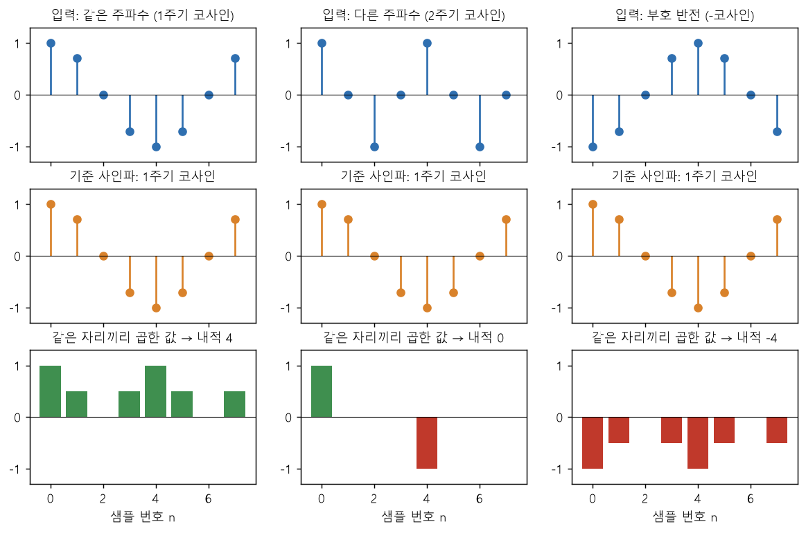
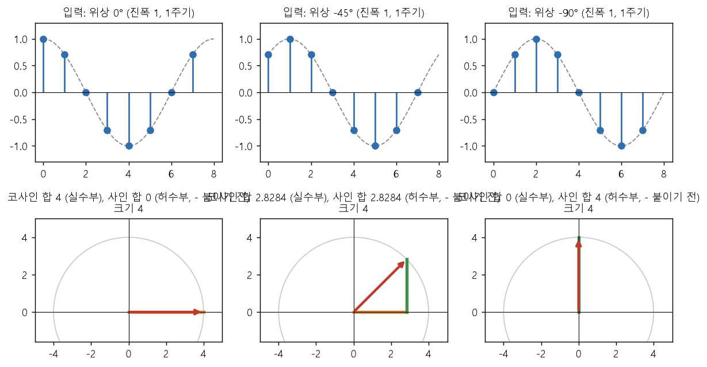
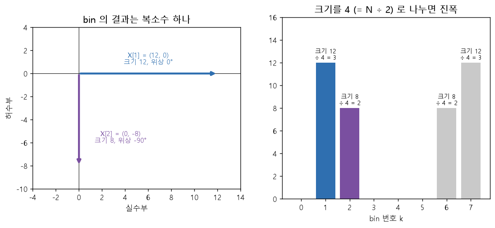

# 11-2. DFT — 내적으로 성분의 양을 구한다

**TL;DR**: 입력과 기준 사인파의 내적이 그 주파수 성분의 양이다(§4). 위상을 모르니 기준은 코사인과 사인 둘이고(§5), 두 내적으로 만든 복소수 X[k]의 크기가 진폭, 각도가 위상을 알려 준다(§6). `dft` 코드의 각 줄이 무엇을 구하는지 표로 따라간다(§7).

> [!NOTE]
> [11 개념 흐름 설명](11_개념%20흐름%20설명.md)의 2부(§4 ~ §7)다. 읽는 법, 근거, 예제(§0.1), 용어 풀이는 11에 있다. "검산_N"은 [첨부_이력_개념 흐름 검산 출력.txt](../tasks/가이드/20260928_1728_pr-guide-and-setup/첨부_이력_개념%20흐름%20검산%20출력.txt)의 번호다. 다른 부의 절은 11의 목차에서 찾는다.
>
> 이전: [11-1_사인파와 복소수](11-1_사인파와%20복소수.md) · 다음: [11-3_역 DFT](11-3_역%20DFT.md)

---

## 4. 내적 — 곱해서 더하면 왜 "얼마나 들어 있는가"가 되는가

**왜 필요한가**

입력에 bin k의 사인파가 얼마나 들어 있는지를 **숫자 하나**로 내는 방법이 필요하다.

**무엇을 하는가**

입력과 기준 사인파를 **같은 자리끼리 곱해서 모두 더한다.** 이 계산이 **내적**(inner product)이고, 두 수열이 얼마나 닮았는지를 나타내는 값이다(03 공식_2의 도출에 인용된 정의).



**그림 읽는 법**: 세 열 모두 기준은 "1주기 코사인"이다. 맨 윗줄 입력만 다르다. 아랫줄이 같은 자리끼리 곱한 값이고(초록은 양수, 빨강은 음수), 그 8개를 더한 것이 제목의 내적이다. 아래 표 다섯 줄 가운데 처음 세 줄을 그렸다.

**결과의 의미** (해석, 숫자는 검산_3)

| 입력 | 곱한 값 8개 | 내적 | 읽는 법 |
|---|---|---|---|
| 기준과 같은 코사인 | 1, 0.5, 0, 0.5, 1, 0.5, 0, 0.5 | **4** | 둘의 부호가 늘 같다. 양수끼리 곱해도, 음수끼리 곱해도 양수라 계속 누적된다 |
| 다른 주파수 (2주기) | 1, 0, 0, 0, −1, 0, 0, 0 | **0** | 부호가 같은 구간과 다른 구간이 같은 만큼 있어 상쇄된다 |
| 부호 반전 (위상 180°) | −1, −0.5, 0, −0.5, −1, −0.5, 0, −0.5 | **−4** | 부호가 늘 반대다 |
| 같은 코사인, 진폭 2배 | 2, 1, 0, 1, 2, 1, 0, 1 | **8** | 내적도 두 배다 |
| DC (모든 샘플이 1. 진동하지 않는 값, §6.4) | 기준 사인파 그대로 | **0** | 기준 사인파의 양수와 음수가 상쇄된다 |

- 내적이 **크다** = 그 주파수의 코사인 성분이 **많이 들어 있다**
- 내적이 **0** = 그 주파수의 코사인 성분이 **없다** (위상이 다른 성분은 §5에서 다룬다)
- 내적은 **진폭에 비례**한다. 그래서 "닮았는가"만이 아니라 "얼마나 들어 있는가"를 나타낸다

같은 코사인일 때 내적이 8이 아니라 4인 이유는, 곱한 값이 cos²이고 그 평균이 0.5이기 때문이다(cos² = 0.5 + 0.5 × cos(2배 각도)이고 뒤의 항은 모두 더하면 0이다). 8개 × 0.5 = 4, 즉 **N ÷ 2**다([09](09_DFT%20그림%20설명.md) §5.3).

**섞여 있어도 분리된다**

예제 x에는 성분_1(1주기, 진폭 3)과 성분_2(2주기, 진폭 2)가 섞여 있다. x와 "1주기 코사인"의 내적은 **12**다(검산_5의 bin 1).

```
x 와 기준의 내적 = (성분_1 과 기준의 내적) + (성분_2 와 기준의 내적)
               =  3 × 4                    +  0
               =  12
```

성분_2는 주파수가 달라서 0이 되고, 성분_1만 남는다. 주파수가 다른 기준 사인파끼리는 내적이 0이 되는 성질이 **직교성**(orthogonality)이다(03 §3). 단 bin k와 bin N − k의 기준 코사인은 값이 같아서 예외이고, 이것이 §6.4의 켤레 대칭이다(유도).

**한 줄 요약**: 입력과 기준 사인파의 내적을 구하면 같은 주파수 성분만 누적되고 다른 주파수는 상쇄되어, 그 주파수 성분의 양이 숫자로 나온다.

---

## 5. 기준 사인파는 왜 코사인과 사인 둘인가

**왜 필요한가**

§4는 기준을 코사인 하나로 구했다. 그런데 입력 성분의 **위상**은 미리 알 수 없다. 기준 코사인 하나로만 구하면 검출하지 못하는 성분이 생긴다. 위상이 무엇이든 같은 주파수의 사인파는 코사인과 사인을 알맞은 비율로 더한 것이므로(cos의 덧셈 공식), 기준이 둘이면 충분하다.



**그림 읽는 법**: 윗줄은 진폭이 1로 같고 위상만 다른 입력 셋이다. 아랫줄은 그 입력과 기준 코사인의 내적(주황), 기준 사인의 내적(초록)이다. 두 값을 실수부와 허수부로 놓으면 빨간 복소수가 된다. 이 그림은 사인 합에 −를 붙이기 전이라 각도의 부호가 입력 위상과 반대다(§6.1).

**무엇을 하는가**

기준 둘로 따로 구한다. 기준 코사인과의 내적을 **코사인 합**, 기준 사인과의 내적을 **사인 합**이라 부른다(09의 이름).

**결과의 의미** (검산_4)

| 입력의 위상 | 코사인 합 | 사인 합 | 두 값으로 만든 복소수의 크기 |
|---|---|---|---|
| 0° (코사인) | 4 | 0 | 4 |
| −45° (45° 지연) | 2.8284 | 2.8284 | 4 |
| −90° (사인) | **0** | 4 | 4 |
| −135° | −2.8284 | 2.8284 | 4 |
| −180° (부호 반전) | −4 | 0 | 4 |

- 셋째 줄: 사인 입력은 기준 코사인과의 내적이 **0**이다. 진폭 1인 성분이 분명히 있는데 "없다"고 나온다. 기준 사인이 있어야 검출된다
- **크기는 언제나 4**다. 위상이 무엇이든 진폭 1에 해당하는 4(= N ÷ 2)가 나온다
- 두 값의 **비율**이 위상을 알려 준다

즉 두 값을 따로 보지 않고 **복소수 하나로 묶어서** 읽는다. 크기가 진폭(× N ÷ 2)을 준다. 각도는 위상과 크기가 같고 부호가 반대다(위상 −45° 입력이 그림에서 +45°에 놓인다). DFT는 허수부에 −를 붙여 이 부호를 맞춘다(§6.1).

**한 줄 요약**: 입력 성분의 위상을 모르니 기준 코사인과 기준 사인 둘로 내적을 구하고, 그 두 값으로 만든 복소수의 크기가 진폭을, 각도가 위상을 알려 준다(각도의 부호는 §6.1에서 맞춘다).

---

## 6. 결과 X[k]는 무엇인가

### 6.1 X[k] = 복소수 하나

bin k의 결과는 이렇게 묶는다([09](09_DFT%20그림%20설명.md) §4 걸음 4, 03 공식_2).

```
X[k] = (실수부: 코사인 합,  허수부: 사인 합에 − 를 붙인 값)
```

허수부에 −를 붙이는 것은 DFT의 정의다. 03은 이 −를 내적에서 기준 쪽의 켤레를 쓰는 데서 얻는다(03 공식_2의 도출). 그 결과로 X[k]의 각도가 입력 성분의 위상과 같아진다(유도): 입력이 `A × cos(각도 + φ)`이면 코사인 합은 `A × N ÷ 2 × cos φ`, 사인 합은 `−A × N ÷ 2 × sin φ`이고, 사인 합에 −를 붙이면 각도가 φ인 복소수가 된다. 45° 지연된(위상 −45°) 입력은 X[1] = (2.8284, −2.8284)이고 각도가 −45°다(검산_4). 크기는 −를 붙여도 그대로다.



**그림 읽는 법**: 왼쪽은 예제의 X[1]과 X[2]를 복소 평면에 그린 것이다. 오른쪽은 bin마다의 크기다.

### 6.2 예제의 결과 전체

`src/dft.py`의 `dft`에 x를 넣은 결과다(검산_5).

| bin k | X[k] (실수부, 허수부) | 크기 | 크기 ÷ 4 | 위상 |
|---|---|---|---|---|
| 0 | (0, 0) | 0 | 0 | — |
| 1 | (12, 0) | 12 | **3** | 0° |
| 2 | (0, −8) | 8 | **2** | −90° |
| 3 | (0, 0) | 0 | 0 | — |
| 4 | (0, 0) | 0 | 0 | — |
| 5 | (0, 0) | 0 | 0 | — |
| 6 | (0, 8) | 8 | 2 | 90° |
| 7 | (12, 0) | 12 | 3 | 0° |

### 6.3 읽는 법

| 보는 것 | 구하는 법 | 의미 | 예제 |
|---|---|---|---|
| bin 번호 k | — | N샘플 동안 k주기인 사인파. 주파수로는 k × 샘플링 주파수 ÷ N (k = 0 ~ N ÷ 2. 그 뒤의 bin은 켤레 짝이다, 08 참고_2) | bin 1, bin 2에만 값이 있다 |
| 크기 | √(실수부² + 허수부²) | 그 성분이 얼마나 들어 있는가. **진폭 × N ÷ 2** | 12 = 3 × 4, 8 = 2 × 4 |
| 진폭 | 크기 ÷ (N ÷ 2) | 사인파의 최댓값 | 3과 2. 처음에 넣은 값이다 |
| 위상 | 복소수의 각도. `atan2(허수부, 실수부)` | 한 주기 중 어디에서 시작하는가. 0°면 코사인, −90°면 사인 | bin 1은 0°, bin 2는 −90° |
| 0인 bin | — | 그 주파수 성분은 없다 | bin 0, 3, 4, 5 |

**숫자 8개만 보고 처음에 섞은 것을 알아냈다.** bin 1에서 "1주기, 진폭 3, 위상 0°", bin 2에서 "2주기, 진폭 2, 위상 −90°"가 읽힌다. §0.1의 표와 같다.

512점 실제 계산에서는 N ÷ 2가 256이고, bin k는 k × 31.25 Hz다(16,000 ÷ 512, 08 참고_2). 예를 들어 bin 32의 크기가 2,560,000이면 1,000 Hz 성분이 진폭 10,000으로 들어 있다는 의미다([09](09_DFT%20그림%20설명.md) §6.4).

> [!NOTE]
> "크기 = 진폭 × N ÷ 2"는 입력이 실수이고, 사인파의 주파수가 **bin의 중심에 정확히 맞고**(N샘플 동안 정수 주기), bin 0과 bin N ÷ 2가 아닐 때의 값이다. bin 0(DC)과 bin N ÷ 2는 켤레 짝이 따로 없어서 크기가 진폭 × N이다(유도, 08 참고_1). 중심에 맞지 않으면 여러 bin에 나뉘어 들어간다(§10).

### 6.4 bin 0과 켤레 대칭

| bin | 의미 | 근거 |
|---|---|---|
| bin 0 | DC 성분(진동하지 않는 일정한 값). 각도가 늘 0°라 기준 코사인은 모두 1, 기준 사인은 모두 0이다. 그래서 X[0]은 **샘플을 모두 더한 값**이고 허수부가 0이다. 예제는 0이다 | 검산_5, [09](09_DFT%20그림%20설명.md) §7.1 |
| bin N − k | bin k의 **켤레**(conjugate)다. 입력이 실수이면 실수부는 같고 허수부는 부호만 반대다. bin 6 = (0, 8)과 bin 2 = (0, −8), bin 7과 bin 1이 그렇다. 이 성질이 켤레 대칭이다 | 08 참고_1 |

켤레 쪽 bin은 새로운 정보가 아니다. 실수 코사인은 반시계 방향으로 회전하는 복소수와 시계 방향으로 회전하는 복소수를 반씩 더한 것이다(03 공식_2의 손계산 설명). 앞의 것이 bin k에, 뒤의 것이 bin N − k에 나타난다. 즉 한 성분의 양이 두 bin에 **절반씩** 적힌 것이고, 그래서 짝이 있는 bin의 크기는 진폭 × N이 아니라 진폭 × N ÷ 2다(해석). 이 절반 둘이 §8에서 다시 합쳐진다.

**한 줄 요약**: X[k]는 복소수 하나이고, 크기를 N ÷ 2로 나누면(bin 0과 N ÷ 2는 N으로) bin k 성분의 진폭, 각도는 그 성분의 위상이다.

---

## 7. 코드의 각 줄은 무엇을 구하는가

`src/dft.py`의 `dft`에서 안쪽 반복의 다섯 줄이 §3 ~ §6을 그대로 한다. 변수 `w_re`, `w_im`은 크기 1인 복소수(코드 주석의 회전 인자)의 실수부와 허수부다.

| 코드 | 무엇을 구하는가 | 왜 구하는가 |
|---|---|---|
| `angle = (2 * math.pi * k * n) / N` | bin k의 기준 사인파가 샘플 n에서 갖는 각도 | 기준 사인파의 n번째 값을 만들려고 (§3.2) |
| `w_re = math.cos(angle)` | 크기 1인 복소수의 실수부. 기준 코사인의 n번째 값 | 기준 코사인과의 내적을 구하려고 (§4) |
| `w_im = -math.sin(angle)` | 그 복소수의 허수부에 −를 붙인 값. 기준 사인의 n번째 값에 −를 붙인 것 | 기준 사인과의 내적을 구하려고 (§5). −는 정의다 (§6.1) |
| `total_re += x[n].real * w_re - x[n].imag * w_im` | 샘플과 기준 코사인의 곱을 누적한다 | 코사인 합 = X[k]의 실수부 |
| `total_im += x[n].real * w_im + x[n].imag * w_re` | 샘플과 기준 사인의 곱을 누적한다 | 사인 합에 −를 붙인 값 = X[k]의 허수부 |

복소수 곱은 `(a, b) × (c, d) = (ac − bd, ad + bc)`다. 입력이 실수이면 `x[n].imag`가 0이라, 두 줄은 `x[n] × w_re`, `x[n] × w_im`을 누적하는 것과 같다. `idft`와 줄마다 비교되도록 복소수 곱의 형태로 적어 둔 것이다.

**bin 1을 구하는 안쪽 반복** (검산_5)

| n | x[n] | 각도 | (w_re, w_im) | 이번에 더하는 값 | 누적 (total_re, total_im) |
|---|---|---|---|---|---|
| 0 | 3 | 0° | (1, 0) | (3, 0) | (3, 0) |
| 1 | 4.1213 | 45° | (0.7071, −0.7071) | (2.9142, −2.9142) | (5.9142, −2.9142) |
| 2 | 0 | 90° | (0, −1) | (0, 0) | (5.9142, −2.9142) |
| 3 | −4.1213 | 135° | (−0.7071, −0.7071) | (2.9142, 2.9142) | (8.8284, 0) |
| 4 | −3 | 180° | (−1, 0) | (3, 0) | (11.8284, 0) |
| 5 | −0.1213 | 225° | (−0.7071, 0.7071) | (0.0858, −0.0858) | (11.9142, −0.0858) |
| 6 | 0 | 270° | (0, 1) | (0, 0) | (11.9142, −0.0858) |
| 7 | 0.1213 | 315° | (0.7071, 0.7071) | (0.0858, 0.0858) | **(12, 0)** |

- 실수부는 누적되어 12가 된다. 12는 성분_1의 몫 3 × 4이고, 성분_2의 몫은 상쇄되어 0이다(§4)
- 허수부는 누적되었다가 상쇄되어 0이 된다. 성분_1은 위상이 0°라 기준 사인과의 내적이 0이고, 성분_2는 주파수가 달라 0이기 때문이다
- 바깥 반복은 이 일을 bin 0부터 7까지 반복한다. bin마다 기준 사인파의 주파수만 다르다

**한 줄 요약**: 안쪽 반복은 bin k의 기준 사인파 값을 샘플마다 만들어 샘플에 곱해 누적하고, 누적된 두 값이 X[k]의 실수부와 허수부다.

---

이전: [11-1_사인파와 복소수](11-1_사인파와%20복소수.md) · 다음: [11-3_역 DFT](11-3_역%20DFT.md)
