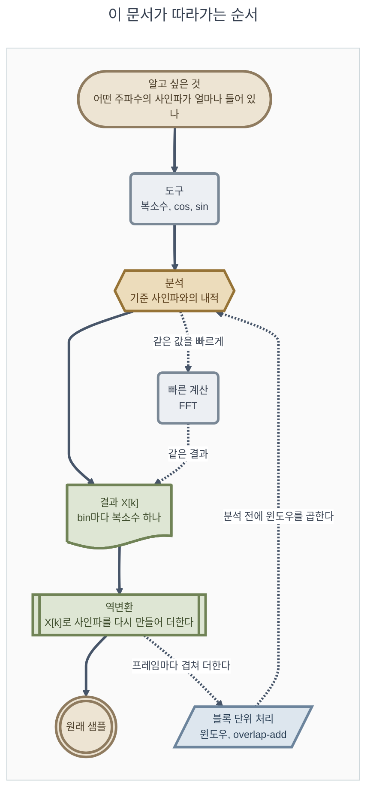

# 11. 개념 흐름 설명 — 왜 구하고 결과가 무엇을 의미하는가

**TL;DR**: 계산 방법이 아니라 이유와 의미를 따라가는 문서다. 알고 싶은 것은 "어떤 주파수의 사인파가 얼마나 들어 있는가"다. 입력과 기준 사인파의 내적이 그 양이고(DFT), 위상을 모르니 기준은 코사인과 사인 둘이며, 그 두 내적이 복소수 X[k]의 실수부와 허수부(부호 반전)다. X[k]로 사인파를 다시 만들어 더하면 원래 샘플이다(역 DFT). 이어서 FFT, 윈도우, overlap-add를 왜 하는지까지 적는다.

> [!NOTE]
> **읽는 법.** 절마다 같은 순서로 적었다: **왜 필요한가 → 무엇을 하는가 → 결과의 의미 → 숫자로 확인 → 한 줄 요약**. "한 줄 요약"만 이어 읽어도 전체가 이어진다. 본문은 다섯 문서(11-1 ~ 11-5)로 나눴다(§0.2). 유도 과정(식을 세우는 걸음)은 [09](09_DFT%20그림%20설명.md)와 [10](10_FFT%20그림%20설명.md)에 있고, 이 문서는 그 걸음마다의 **이유와 의미**를 적는다.
>
> **용어.** 공식 용어를 쓴다: 사인파, 주파수, 진폭, 위상, 복소수(실수부, 허수부, 크기), 주파수 bin, 내적. 09와 10도 같은 용어를 쓴다. 풀이는 맨 아래 [부록](#부록-용어-풀이)에 있다.
>
> **근거**
> - 식과 그 도출: [03_지식과 공식.md](03_지식과%20공식.md) 공식_2(DFT), 공식_3(역 DFT), 직교성, 공식_9(윈도우), 공식_13 ~ 공식_15(overlap-add와 복원). 내적으로 DFT를 정의하는 것은 03 공식_2의 도출에 인용된 J. O. Smith, *Mathematics of the DFT*, "The DFT"다
> - 용어의 출처(2026-10-01에 열어 확인): J. O. Smith, *Mathematics of the DFT* — "Sinusoids"(진폭, 주파수, 위상), "The Complex Plane"(복소 평면, 직교 좌표와 극좌표), "Phasor"(진폭과 위상을 담은 복소수를 phasor라 부른다), "Frequencies in the Cracks"(spectral leakage, sidelobe, 윈도우로 양 끝을 0으로 줄인다). `https://ccrma.stanford.edu/~jos/mdft/`
> - bin 번호와 주파수, 켤레 대칭: [08_참고 공식.md](08_참고%20공식.md) 참고_1, 참고_2
> - 1.5의 값(프레임 16, 버퍼 512, 대칭형 Hanning): [02_1.5 FFT 경로 사양.md](02_1.5%20FFT%20경로%20사양.md) §1, §3
> - 코드: `src/dft.py`의 `dft`, `idft`, `src/main.py`의 `fft`, `hanning_window`, `restore_overlap` (2026-10-01 현재)
> - 그림 8장은 계산으로 그렸다(matplotlib). 그림과 표의 숫자는 모두 [첨부_이력_개념 흐름 검산 출력.txt](../tasks/가이드/20260928_1728_pr-guide-and-setup/첨부_이력_개념%20흐름%20검산%20출력.txt)에 있고, 아래에서 "검산_N"으로 가리킨다
> - "(해석)"이라고 적은 문장은 식과 숫자를 말로 풀어 읽은 필자의 설명이다. "(유도)"는 앞의 식에서 계산으로 따라 나온 것이다

---

## 0. 전체 흐름

| 순서 | 질문 | 답 한 줄 | 절 |
|---|---|---|---|
| 1 | 무엇을 알고 싶은가 | 샘플 안에 어떤 주파수의 사인파가 얼마나 들어 있는가 | §1 |
| 2 | 사인파 하나를 무엇으로 정하는가 | 주파수, 진폭, 위상 세 가지. 진폭과 위상은 복소수 하나에 담는다 | §2 |
| 3 | cos와 sin은 왜 구하는가 | 복소수를 더할 수 있는 형태(실수부, 허수부)로 바꾸려고. 그리고 기준 사인파를 만들려고 | §3 |
| 4 | 얼마나 들어 있는지 어떻게 구하는가 | 입력과 기준 사인파의 내적(같은 자리끼리 곱해서 모두 더한 값) | §4 |
| 5 | 기준 사인파는 왜 둘인가 | 입력 성분의 위상을 모르기 때문이다 | §5 |
| 6 | 결과 X[k]는 무엇인가 | bin k 성분의 진폭과 위상을 담은 복소수 하나 | §6 |
| 7 | 코드의 각 줄은 무엇을 구하는가 | 크기 1인 복소수를 만들고, 샘플에 곱하고, 누적한다 | §7 |
| 8 | 어떻게 복원하는가 | bin마다 X[k]로 사인파를 다시 만들어 모두 더한다 | §8 |
| 9 | FFT는 무엇이 다른가 | 결과는 같고 계산 순서만 다르다 | §9 |
| 10 | 윈도우는 왜 곱하는가 | 잘라낸 블록 양 끝의 불연속 때문에 생기는 누설(leakage)을 줄이려고 (일반 설명. 이 프로젝트는 1.5가 곱하기 때문에 곱한다) | §10 |
| 11 | overlap은 무엇이고 왜 나누는가 | 1.5는 16샘플씩 이동하며 분석해 이웃 버퍼가 겹친다. 그래서 윈도우로 작아진 샘플도 다른 프레임에서는 가운데에 놓이고, 겹쳐 더한 뒤 윈도우 합으로 나누면 복원된다 | §11 |

### 0.1 이 문서의 예제

끝까지 샘플 8개(N = 8)짜리 예제 하나를 쓴다. 사인파 두 개를 더해서 만들었다(검산_1).

| | N샘플 동안의 주기 수 | 진폭 | 위상 | 샘플 8개 |
|---|---|---|---|---|
| 성분_1 | 1주기 | 3 | 0° (코사인. 최댓값에서 시작) | 3, 2.1213, 0, −2.1213, −3, −2.1213, 0, 2.1213 |
| 성분_2 | 2주기 | 2 | −90° (사인. 0에서 증가하며 시작) | 0, 2, 0, −2, 0, 2, 0, −2 |
| **입력 x** | | | 둘을 더한 것 | **3, 4.1213, 0, −4.1213, −3, −0.1213, 0, 0.1213** |

위상은 사인파를 `진폭 × cos(각도 + 위상)`으로 적었을 때의 값이다. 사인은 코사인을 90° 늦춘 것이라 위상이 −90°다.

- **사인파**는 코사인 모양과 사인 모양을 모두 가리키는 이름이다. 둘은 위상만 90° 다르다. 함수를 가리킬 때는 "코사인", "사인"이라고 쓴다
- **기호**: N은 샘플 개수(예제는 8), n은 샘플 번호(0 ~ N−1), k는 bin 번호(0 ~ N−1), x[n]은 n번째 샘플, X[k]는 bin k의 결과다

이 문서의 목표는 **입력 x의 숫자 8개만 보고 "1주기짜리 진폭 3과 2주기짜리 진폭 2가 들어 있다"를 알아내는 것**, 그리고 그 답으로 x를 다시 만드는 것이다.

### 0.2 나눈 문서

| 문서 | 절 | 내용 |
|---|---|---|
| [11-1_사인파와 복소수](11-1_사인파와%20복소수.md) | §1 ~ §3 | 사인파와 복소수 — 무엇을 알고 싶고, 무엇으로 구하는가 |
| [11-2_DFT](11-2_DFT.md) | §4 ~ §7 | DFT — 내적으로 성분의 양을 구한다 |
| [11-3_역 DFT](11-3_역%20DFT.md) | §8 | 역 DFT — 복원한다 |
| [11-4_FFT 윈도우 overlap-add](11-4_FFT%20윈도우%20overlap-add.md) | §9 ~ §11 | FFT, 윈도우, overlap-add |
| [11-5_요약과 점검](11-5_요약과%20점검.md) | §12 ~ §14 | 요약과 점검 — 설명해 보기 |

---

## 부록. 용어 풀이

| 용어 | 풀이 | 코드 |
|---|---|---|
| 사인파 (sinusoid) | 주파수 하나로 진동하는 가장 단순한 신호 | — |
| 주파수 (frequency) | 얼마나 빨리 진동하는가. 이 문서에서는 N샘플 동안의 주기 수 | `k` |
| 진폭 (amplitude) | 사인파의 최댓값 | — |
| 위상 (phase) | 한 주기 중 어디에서 시작하는가(각도) | — |
| 복소수 (complex number) | 실수부와 허수부 두 숫자를 묶은 값. 복소 평면의 벡터 하나 | `complex(실수부, 허수부)` |
| 실수부, 허수부 | 복소 평면의 가로축 값, 세로축 값 | `.real`, `.imag` |
| 크기 (magnitude) | √(실수부² + 허수부²) | — |
| phasor (페이저) | 사인파의 진폭과 위상을 담은 복소수 | — |
| 주파수 bin | DFT 결과 하나. bin k는 N샘플 동안 k주기인 성분 | `k` |
| 기준 사인파 | bin k의 주파수로 진동하는 진폭 1인 코사인과 사인. 03의 DFT 사인파 s_k의 실수부와 허수부 | `w_re`, `w_im` |
| 내적 (inner product) | 두 수열을 같은 자리끼리 곱해서 모두 더한 값 | `total_re`(코사인 합), `total_im`(사인 합에 −) |
| 직교성 (orthogonality) | 주파수가 다른 기준 사인파끼리는 내적이 0인 성질 | — |
| DC 성분 | 진동하지 않는 일정한 값. bin 0 | `k = 0` |
| 켤레 (conjugate), 켤레 대칭 | 허수부의 부호만 바꾼 복소수. 실수 입력이면 bin N − k가 bin k의 켤레다 | — |
| 블록, 버퍼 | 한 번에 DFT에 넣는 샘플 N개. 버퍼는 그것을 담은 배열 | `block`, `buffer` |
| 프레임 | 새 샘플 16개를 넣고 FFT를 한 번 하는 단위 | `frame_count`, `m` |
| 스펙트럼 | bin마다의 X[k] 값이나 그 크기를 늘어놓은 것 | `X` |
| 스펙트럼 누설 (spectral leakage) | bin의 중심에 맞지 않는 성분이 여러 bin에 나타나는 현상 | — |
| main lobe, sidelobe | 스펙트럼에서 가운데의 가장 큰 봉우리, 거기서 떨어진 작은 봉우리들 | — |
| 극좌표, 직교 좌표 | 복소수를 (크기, 각도)로 적는 방법, (실수부, 허수부)로 적는 방법 | — |
| 시간 영역, 주파수 영역 | 샘플 순서로 적은 것, bin 순서로 적은 것 | — |
| overlap, overlap-add | 이웃 프레임의 버퍼가 겹치는 것. 역변환 결과를 원래 위치에 겹쳐 더하는 것 | `restore_overlap`, `added` |
| 위치별 윈도우 합 | 한 샘플 위치에 겹친 윈도우 값 32개의 합. 03의 W[r] | `sums` |
