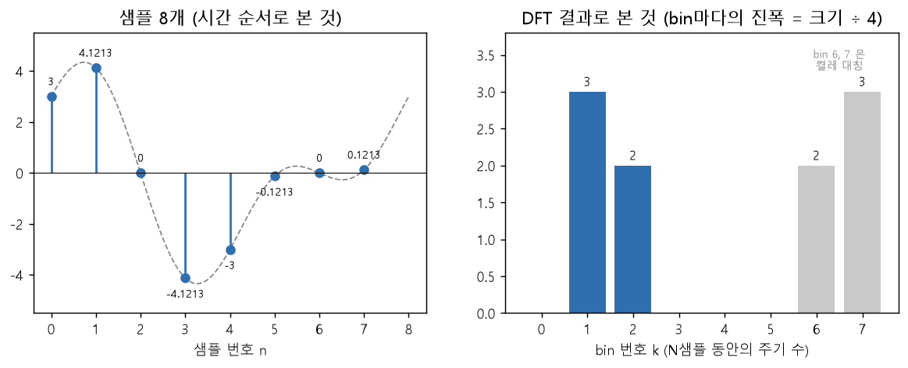
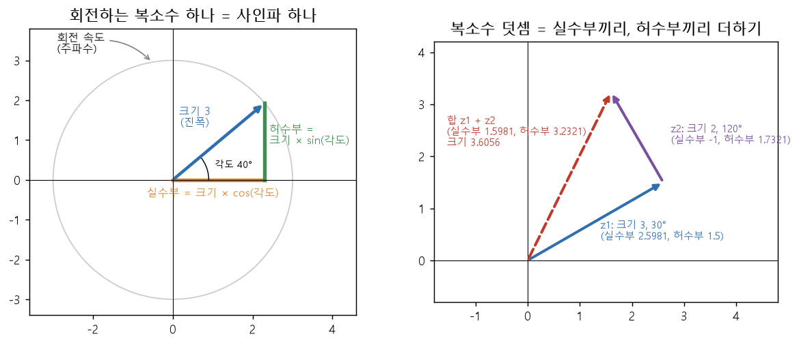
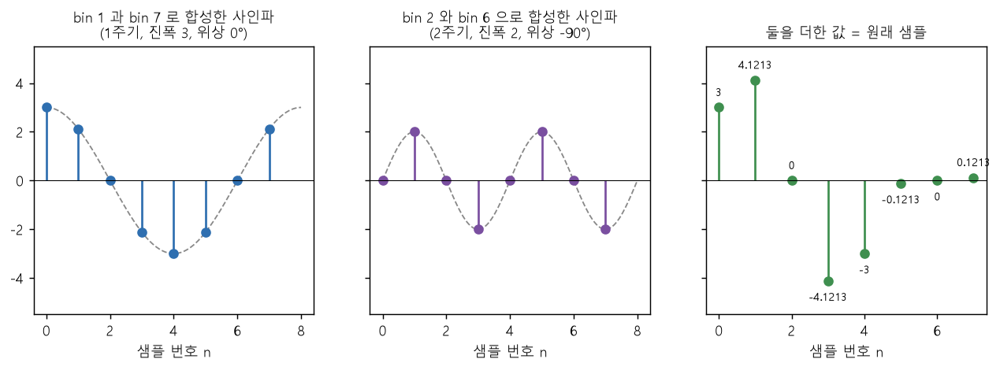
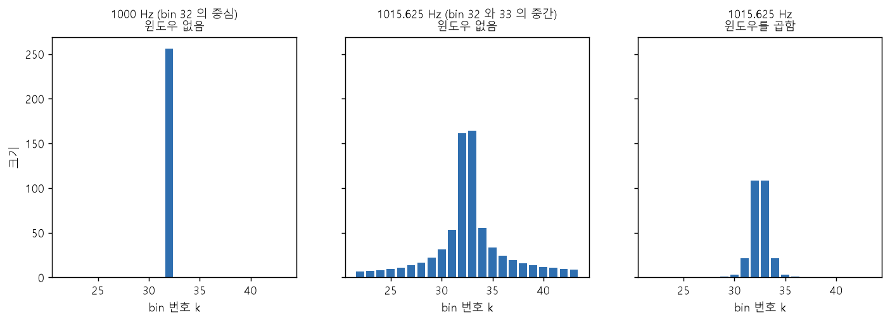
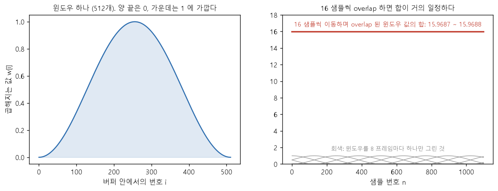

# 11. 개념 흐름 설명 — 왜 구하고 결과가 무엇을 의미하는가

**TL;DR**: 계산 방법이 아니라 이유와 의미를 따라가는 문서다. 알고 싶은 것은 "어떤 주파수의 사인파가 얼마나 들어 있는가"다. 입력과 기준 사인파의 내적이 그 양이고(DFT), 위상을 모르니 기준은 코사인과 사인 둘이며, 그 두 내적이 복소수 X[k]의 실수부와 허수부(부호 반전)다. X[k]로 사인파를 다시 만들어 더하면 원래 샘플이다(역 DFT). 이어서 FFT, 윈도우, overlap-add를 왜 하는지까지 적는다.

> [!NOTE]
> **읽는 법.** 절마다 같은 순서로 적었다: **왜 필요한가 → 무엇을 하는가 → 결과의 의미 → 숫자로 확인 → 한 줄 요약**. "한 줄 요약"만 이어 읽어도 전체가 이어진다. 유도 과정(식을 세우는 걸음)은 [09](09_DFT%20그림%20설명.md)와 [10](10_FFT%20그림%20설명.md)에 있고, 이 문서는 그 걸음마다의 **이유와 의미**를 적는다.
>
> **용어.** 공식 용어를 쓴다: 사인파, 주파수, 진폭, 위상, 복소수(실수부, 허수부, 크기), 주파수 bin, 내적. 09와 10도 같은 용어를 쓴다. 풀이는 맨 아래 [부록](#부록-용어-풀이)에 있다.
>
> **근거**
> - 식과 그 도출: [03_지식과 공식.md](03_지식과%20공식.md) 공식_2(DFT), 공식_3(역 DFT), 직교성, 공식_9(윈도우), 공식_13 ~ 공식_15(overlap-add와 복원). 내적으로 DFT를 정의하는 것은 03 공식_2의 도출에 인용된 J. O. Smith, *Mathematics of the DFT*, "The DFT"다
> - 용어의 출처(2026-10-01에 열어 확인): J. O. Smith, *Mathematics of the DFT* — "Sinusoids"(진폭, 주파수, 위상), "The Complex Plane"(복소 평면, 직교 좌표와 극좌표), "Phasor"(진폭과 위상을 담은 복소수를 phasor라 부른다), "Frequencies in the Cracks"(spectral leakage, sidelobe, 윈도우로 양 끝을 0으로 줄인다). `https://ccrma.stanford.edu/~jos/mdft/`
> - bin 번호와 주파수, 켤레 대칭: [08_참고 공식.md](08_참고%20공식.md) 참고_1, 참고_2
> - 1.5의 값(프레임 16, 버퍼 512, 대칭형 Hanning): [02_1.5 FFT 경로 사양.md](02_1.5%20FFT%20경로%20사양.md) §1, §3
> - 코드: `src/dft.py`의 `dft`, `idft`, `src/main.py`의 `fft`, `hanning_window`, `restore_overlap` (2026-10-01 현재)
> - 그림 8장은 계산으로 그렸다(matplotlib). 그림과 표의 숫자는 모두 [첨부_이력_개념 흐름 검산 출력.txt](../tasks/가이드/20260928_1728_pr-guide-and-setup/첨부_이력_개념%20흐름%20검산%20출력.txt)에 있고, 아래에서 "검산_N"으로 가리킨다
> - "(해석)"이라고 적은 문장은 식과 숫자를 말로 풀어 읽은 필자의 설명이다. "(유도)"는 앞의 식에서 계산으로 따라 나온 것이다

---

## 0. 전체 흐름


| 순서 | 질문 | 답 한 줄 | 절 |
|---|---|---|---|
| 1 | 무엇을 알고 싶은가 | 샘플 안에 어떤 주파수의 사인파가 얼마나 들어 있는가 | §1 |
| 2 | 사인파 하나를 무엇으로 정하는가 | 주파수, 진폭, 위상 세 가지. 진폭과 위상은 복소수 하나에 담는다 | §2 |
| 3 | cos와 sin은 왜 구하는가 | 복소수를 더할 수 있는 형태(실수부, 허수부)로 바꾸려고. 그리고 기준 사인파를 만들려고 | §3 |
| 4 | 얼마나 들어 있는지 어떻게 구하는가 | 입력과 기준 사인파의 내적(같은 자리끼리 곱해서 모두 더한 값) | §4 |
| 5 | 기준 사인파는 왜 둘인가 | 입력 성분의 위상을 모르기 때문이다 | §5 |
| 6 | 결과 X[k]는 무엇인가 | bin k 성분의 진폭과 위상을 담은 복소수 하나 | §6 |
| 7 | 코드의 각 줄은 무엇을 구하는가 | 크기 1인 복소수를 만들고, 샘플에 곱하고, 누적한다 | §7 |
| 8 | 어떻게 복원하는가 | bin마다 X[k]로 사인파를 다시 만들어 모두 더한다 | §8 |
| 9 | FFT는 무엇이 다른가 | 결과는 같고 계산 순서만 다르다 | §9 |
| 10 | 윈도우는 왜 곱하는가 | 잘라낸 블록 양 끝의 불연속 때문에 생기는 누설(leakage)을 줄이려고 (일반 설명. 이 프로젝트는 1.5가 곱하기 때문에 곱한다) | §10 |
| 11 | overlap은 무엇이고 왜 나누는가 | 1.5는 16샘플씩 이동하며 분석해 이웃 버퍼가 겹친다. 그래서 윈도우로 작아진 샘플도 다른 프레임에서는 가운데에 놓이고, 겹쳐 더한 뒤 윈도우 합으로 나누면 복원된다 | §11 |

### 0.1 이 문서의 예제

끝까지 샘플 8개(N = 8)짜리 예제 하나를 쓴다. 사인파 두 개를 더해서 만들었다(검산_1).

| | N샘플 동안의 주기 수 | 진폭 | 위상 | 샘플 8개 |
|---|---|---|---|---|
| 성분_1 | 1주기 | 3 | 0° (코사인. 최댓값에서 시작) | 3, 2.1213, 0, −2.1213, −3, −2.1213, 0, 2.1213 |
| 성분_2 | 2주기 | 2 | −90° (사인. 0에서 증가하며 시작) | 0, 2, 0, −2, 0, 2, 0, −2 |
| **입력 x** | | | 둘을 더한 것 | **3, 4.1213, 0, −4.1213, −3, −0.1213, 0, 0.1213** |

위상은 사인파를 `진폭 × cos(각도 + 위상)`으로 적었을 때의 값이다. 사인은 코사인을 90° 늦춘 것이라 위상이 −90°다.

- **사인파**는 코사인 모양과 사인 모양을 모두 가리키는 이름이다. 둘은 위상만 90° 다르다. 함수를 가리킬 때는 "코사인", "사인"이라고 쓴다
- **기호**: N은 샘플 개수(예제는 8), n은 샘플 번호(0 ~ N−1), k는 bin 번호(0 ~ N−1), x[n]은 n번째 샘플, X[k]는 bin k의 결과다

이 문서의 목표는 **입력 x의 숫자 8개만 보고 "1주기짜리 진폭 3과 2주기짜리 진폭 2가 들어 있다"를 알아내는 것**, 그리고 그 답으로 x를 다시 만드는 것이다.

---

# 1부. 무엇을 알고 싶고, 무엇으로 구하는가

## 1. 알고 싶은 것 — 어떤 주파수의 사인파가 얼마나 들어 있는가



**그림 읽는 법**: 왼쪽은 예제의 샘플 8개다. 오른쪽은 같은 것을 DFT로 본 것이다. bin 1에 진폭 3, bin 2에 진폭 2가 있다. 회색 bin 6, 7은 켤레 대칭으로 생기는 짝이다(§6.4).

**왜 필요한가**

샘플은 **시간 순서로 적은 값**이다(시간 영역). 왼쪽 그림의 숫자 8개만 봐서는 무엇이 섞였는지 알 수 없다. 1.5는 FFT를 하고 그 결과의 크기로 밴드 대표값을 뽑는다(02 §2 순서 6, 7). FFT 결과는 bin마다의 주파수 성분이다(02 §7). **주파수**는 1초에 진동하는 횟수(Hz)이고, 높을수록 고음이다(09 부록).

**무엇을 하는가**

샘플 N개를 **주파수 bin N개**로 바꾼다(주파수 영역). bin k는 "N샘플 동안 정확히 k주기 진동하는 사인파"의 자리다([09](09_DFT%20그림%20설명.md) §2.2, 08 참고_2). bin마다 그 사인파가 얼마나 들어 있는지를 적는다.

**결과의 의미**

- 같은 신호를 **다른 기준으로 적은 것**이다. 샘플은 "몇 번째 시점의 값이 얼마", bin은 "몇 주기짜리 사인파가 얼마"다
- 정보를 버리지 않는다. 샘플 N개에서 bin N개가 나오고, bin N개로 샘플 N개를 정확히 복원할 수 있다(§8, 03 공식_3의 도출)

**한 줄 요약**: DFT는 시간 순서로 적은 숫자(시간 영역)를 주파수 순서로 적은 숫자(주파수 영역)로 바꾸는 변환이다.

---

## 2. 사인파 하나를 정하는 세 가지 — 주파수, 진폭, 위상

**왜 필요한가**

"얼마나 들어 있는가"를 답하려면 먼저 **사인파 하나를 무엇으로 나타낼지** 정해야 한다. 사인파 하나는 세 가지로 정해진다(J. O. Smith, "Sinusoids").

| 정하는 것 | 의미 | 예제의 성분_1 |
|---|---|---|
| 주파수 (frequency) | 얼마나 빨리 진동하는가. 여기서는 N샘플 동안의 주기 수 (Hz로는 k × 샘플링 주파수 ÷ N, §6.3) | 1주기 |
| 진폭 (amplitude) | 최댓값 | 3 |
| 위상 (phase) | 한 주기 중 어디에서 시작하는가. 각도로 적는다 | 0° (최댓값에서 시작) |

**무엇을 하는가**

**복소수**는 숫자 두 개(실수부, 허수부)를 묶은 값이다. 가로축이 실수부, 세로축이 허수부인 평면(복소 평면)에 점 하나로 찍힌다(J. O. Smith, "The Complex Plane"). 원점에서 그 점까지의 거리가 **크기**, 실수축에서 잰 방향이 **각도**다.

사인파의 세 가지를 **복소 평면에서 회전하는 복소수 하나**로 나타낸다. 그림은 [09](09_DFT%20그림%20설명.md) §1.2에 있다.

| 복소수의 | 사인파의 |
|---|---|
| 크기 (magnitude) | 진폭 |
| N샘플 동안 회전하는 바퀴 수 | 주파수 |
| 처음(n = 0)의 각도 | 위상 |

이 복소수는 n이 1 늘 때마다 같은 각도만큼 회전한다. **샘플 n의 값은 그때의 실수부다**(§0.1에서 위상을 cos 기준으로 적었기 때문이다). 예: 크기 3인 복소수가 0°에서 출발해 한 샘플에 45°씩 회전하면 실수부는 3, 2.1213, 0, −2.1213, …이고, 이것이 성분_1이다(검산_1). 09는 같은 그림에서 샘플 값을 허수부(sin)로 읽는다. 읽는 축만 다르다.



**그림 읽는 법**: 왼쪽은 크기 3인 복소수가 각도 40°에 있는 순간이다. 그때의 실수부(주황)와 허수부(초록)가 표시되어 있다. 오른쪽은 복소수 두 개를 더하는 모습이다(§3).

**결과의 의미**

DFT는 **주파수를 미리 정해 놓고**(bin 0, 1, 2, …), bin마다 나머지 둘(진폭, 위상)을 구한다. 그래서 bin 하나의 답은 **복소수 하나**면 된다. 회전을 빼고 진폭(크기)과 위상(처음 각도)만 담은 복소수를 **phasor**(페이저)라고 부른다(J. O. Smith, "Phasor"). §6의 X[k]는 이 phasor에 N ÷ 2를 곱한 값이다(유도, 검산_5: 12 = 3 × 4).

**한 줄 요약**: 사인파 하나는 주파수, 진폭, 위상으로 정해지고, 주파수를 bin 번호로 정해 두면 진폭과 위상은 복소수 하나에 담긴다.

---

## 3. cos와 sin은 왜 구하는가

cos와 sin은 이 프로젝트에서 **두 가지 일**을 한다. 둘을 나눠서 보면 헷갈리지 않는다.

### 3.1 첫째 — 복소수를 더할 수 있는 형태로 바꾼다

**왜 필요한가**

복소수를 적는 방법은 둘이다. "크기 3, 각도 30°"처럼 적는 **극좌표**(polar)와, "실수부 2.5981, 허수부 1.5"처럼 적는 **직교 좌표**(rectangular)다. 극좌표 그대로는 **더할 수가 없다.** 크기끼리, 각도끼리 더하면 틀린다.

| 더하는 방법 | 결과 | 맞는가 |
|---|---|---|
| 크기끼리, 각도끼리 더한다: (3, 30°) + (2, 120°) | 크기 5, 각도 150° | 틀리다 |
| 실수부끼리, 허수부끼리 더한다 | 실수부 1.5981, 허수부 3.2321 → 크기 3.6056, 각도 63.69° | 맞다 (그림_2 오른쪽) |

DFT도 역 DFT도 복소수를 N개씩(512점이면 512개씩) **더하는** 계산이다(03 공식_2, 공식_3). 더하려면 **실수부와 허수부**로 바꿔야 한다.

**무엇을 하는가**

크기와 각도를 실수부와 허수부로 바꾸는 식이 cos와 sin이다([09](09_DFT%20그림%20설명.md) §1.3).

```
실수부 = 크기 × cos(각도)
허수부 = 크기 × sin(각도)
```

그림_2 오른쪽의 z1은 크기 3, 각도 30°다. `실수부 = 3 × cos 30° = 3 × 0.866 = 2.5981`, `허수부 = 3 × sin 30° = 3 × 0.5 = 1.5`다(검산_2).

**결과의 의미**

cos와 sin 값 자체는 **−1에서 1 사이의 비율**이다.

| 값 | 의미 |
|---|---|
| cos(각도) = 1 | 복소수가 실수축의 양의 방향을 향한다. 크기가 전부 실수부다 |
| cos(각도) = 0 | 실수축과 직각이다. 실수부가 없다 |
| cos(각도) = −1 | 실수축의 음의 방향을 향한다 |
| sin(각도) | 같은 것을 허수축에 대해 말한 것 |

즉 **cos는 "크기 중 실수부로 가는 비율", sin은 "크기 중 허수부로 가는 비율"**이다(해석).

코드에서 복소수 하나는 `complex(실수부, 허수부)`에 담고, `.real`이 실수부, `.imag`가 허수부다.

### 3.2 둘째 — 기준 사인파를 만든다

**왜 필요한가**

§4에서 입력에 "bin k의 사인파가 얼마나 들어 있는지" 구하려면, **bin k의 주파수로 진동하는 기준 신호**가 숫자로 있어야 한다. 이 문서는 이것을 **기준 사인파**라고 부른다. 03과 J. O. Smith는 DFT 사인파(DFT sinusoid) s_k라고 부른다(03 공식_2의 도출).

**무엇을 하는가**

크기 1인 복소수를 bin k의 주파수로 회전시키면서, 샘플 시점마다 실수부와 허수부를 읽는다.

```
샘플 n에서의 각도 = 360° × k × n ÷ N
실수부를 차례로 읽은 것 = cos(각도) 를 n = 0, 1, 2, ... 순서로 늘어놓은 것 = 기준 코사인
허수부를 차례로 읽은 것 = sin(각도) 를 n = 0, 1, 2, ... 순서로 늘어놓은 것 = 기준 사인
```

N = 8, bin 1이면 각도가 0°, 45°, 90°, …이고 기준 코사인은 `1, 0.7071, 0, −0.7071, −1, −0.7071, 0, 0.7071`이다(검산_3).

**결과의 의미**

n이 N이 되면 각도가 360° × k, 즉 k바퀴다. 그래서 `cos(360° × k × n ÷ N)`은 "N샘플 동안 k주기 진동하는, 진폭 1인 사인파의 n번째 값"이다. 코드의 `angle`이 이 각도다. 코드는 도(°) 대신 라디안을 써서 360°가 2π이고, `math.cos(angle)`이 그 값이다.

### 3.3 두 일이 만나는 곳

`dft`의 항 하나는 샘플 x[n]에 (cos 각도, −sin 각도)를 곱한 복소수다. 이런 복소수 N개를 더해야 X[k]가 나온다. 더하려면 실수부 `x[n] × cos`, 허수부 `−x[n] × sin`으로 적어야 하고(§3.1), 곱하는 cos와 sin은 bin k의 기준 사인파의 n번째 값이다(§3.2). 그래서 코드의 `w_re`, `w_im`은 같은 숫자가 두 일을 한다(해석).

**한 줄 요약**: cos와 sin은 크기와 각도를 실수부와 허수부로 바꾸는 비율이고, 회전하는 복소수의 실수부와 허수부를 차례로 읽으면 기준 코사인과 기준 사인이 된다.

---

# 2부. DFT — 내적으로 성분의 양을 구한다

## 4. 내적 — 곱해서 더하면 왜 "얼마나 들어 있는가"가 되는가

**왜 필요한가**

입력에 bin k의 사인파가 얼마나 들어 있는지를 **숫자 하나**로 내는 방법이 필요하다.

**무엇을 하는가**

입력과 기준 사인파를 **같은 자리끼리 곱해서 모두 더한다.** 이 계산이 **내적**(inner product)이고, 두 수열이 얼마나 닮았는지를 나타내는 값이다(03 공식_2의 도출에 인용된 정의).


**그림 읽는 법**: 세 열 모두 기준은 "1주기 코사인"이다. 맨 윗줄 입력만 다르다. 아랫줄이 같은 자리끼리 곱한 값이고(초록은 양수, 빨강은 음수), 그 8개를 더한 것이 제목의 내적이다. 아래 표 다섯 줄 가운데 처음 세 줄을 그렸다.

**결과의 의미** (해석, 숫자는 검산_3)

| 입력 | 곱한 값 8개 | 내적 | 읽는 법 |
|---|---|---|---|
| 기준과 같은 코사인 | 1, 0.5, 0, 0.5, 1, 0.5, 0, 0.5 | **4** | 둘의 부호가 늘 같다. 양수끼리 곱해도, 음수끼리 곱해도 양수라 계속 누적된다 |
| 다른 주파수 (2주기) | 1, 0, 0, 0, −1, 0, 0, 0 | **0** | 부호가 같은 구간과 다른 구간이 같은 만큼 있어 상쇄된다 |
| 부호 반전 (위상 180°) | −1, −0.5, 0, −0.5, −1, −0.5, 0, −0.5 | **−4** | 부호가 늘 반대다 |
| 같은 코사인, 진폭 2배 | 2, 1, 0, 1, 2, 1, 0, 1 | **8** | 내적도 두 배다 |
| DC (모든 샘플이 1. 진동하지 않는 값, §6.4) | 기준 사인파 그대로 | **0** | 기준 사인파의 양수와 음수가 상쇄된다 |

- 내적이 **크다** = 그 주파수의 코사인 성분이 **많이 들어 있다**
- 내적이 **0** = 그 주파수의 코사인 성분이 **없다** (위상이 다른 성분은 §5에서 다룬다)
- 내적은 **진폭에 비례**한다. 그래서 "닮았는가"만이 아니라 "얼마나 들어 있는가"를 나타낸다

같은 코사인일 때 내적이 8이 아니라 4인 이유는, 곱한 값이 cos²이고 그 평균이 0.5이기 때문이다(cos² = 0.5 + 0.5 × cos(2배 각도)이고 뒤의 항은 모두 더하면 0이다). 8개 × 0.5 = 4, 즉 **N ÷ 2**다([09](09_DFT%20그림%20설명.md) §5.3).

**섞여 있어도 분리된다**

예제 x에는 성분_1(1주기, 진폭 3)과 성분_2(2주기, 진폭 2)가 섞여 있다. x와 "1주기 코사인"의 내적은 **12**다(검산_5의 bin 1).

```
x 와 기준의 내적 = (성분_1 과 기준의 내적) + (성분_2 와 기준의 내적)
               =  3 × 4                    +  0
               =  12
```

성분_2는 주파수가 달라서 0이 되고, 성분_1만 남는다. 주파수가 다른 기준 사인파끼리는 내적이 0이 되는 성질이 **직교성**(orthogonality)이다(03 §3). 단 bin k와 bin N − k의 기준 코사인은 값이 같아서 예외이고, 이것이 §6.4의 켤레 대칭이다(유도).

**한 줄 요약**: 입력과 기준 사인파의 내적을 구하면 같은 주파수 성분만 누적되고 다른 주파수는 상쇄되어, 그 주파수 성분의 양이 숫자로 나온다.

---

## 5. 기준 사인파는 왜 코사인과 사인 둘인가

**왜 필요한가**

§4는 기준을 코사인 하나로 구했다. 그런데 입력 성분의 **위상**은 미리 알 수 없다. 기준 코사인 하나로만 구하면 검출하지 못하는 성분이 생긴다. 위상이 무엇이든 같은 주파수의 사인파는 코사인과 사인을 알맞은 비율로 더한 것이므로(cos의 덧셈 공식), 기준이 둘이면 충분하다.


**그림 읽는 법**: 윗줄은 진폭이 1로 같고 위상만 다른 입력 셋이다. 아랫줄은 그 입력과 기준 코사인의 내적(주황), 기준 사인의 내적(초록)이다. 두 값을 실수부와 허수부로 놓으면 빨간 복소수가 된다. 이 그림은 사인 합에 −를 붙이기 전이라 각도의 부호가 입력 위상과 반대다(§6.1).

**무엇을 하는가**

기준 둘로 따로 구한다. 기준 코사인과의 내적을 **코사인 합**, 기준 사인과의 내적을 **사인 합**이라 부른다(09의 이름).

**결과의 의미** (검산_4)

| 입력의 위상 | 코사인 합 | 사인 합 | 두 값으로 만든 복소수의 크기 |
|---|---|---|---|
| 0° (코사인) | 4 | 0 | 4 |
| −45° (45° 지연) | 2.8284 | 2.8284 | 4 |
| −90° (사인) | **0** | 4 | 4 |
| −135° | −2.8284 | 2.8284 | 4 |
| −180° (부호 반전) | −4 | 0 | 4 |

- 셋째 줄: 사인 입력은 기준 코사인과의 내적이 **0**이다. 진폭 1인 성분이 분명히 있는데 "없다"고 나온다. 기준 사인이 있어야 검출된다
- **크기는 언제나 4**다. 위상이 무엇이든 진폭 1에 해당하는 4(= N ÷ 2)가 나온다
- 두 값의 **비율**이 위상을 알려 준다

즉 두 값을 따로 보지 않고 **복소수 하나로 묶어서** 읽는다. 크기가 진폭(× N ÷ 2)을 준다. 각도는 위상과 크기가 같고 부호가 반대다(위상 −45° 입력이 그림에서 +45°에 놓인다). DFT는 허수부에 −를 붙여 이 부호를 맞춘다(§6.1).

**한 줄 요약**: 입력 성분의 위상을 모르니 기준 코사인과 기준 사인 둘로 내적을 구하고, 그 두 값으로 만든 복소수의 크기가 진폭을, 각도가 위상을 알려 준다(각도의 부호는 §6.1에서 맞춘다).

---

## 6. 결과 X[k]는 무엇인가

### 6.1 X[k] = 복소수 하나

bin k의 결과는 이렇게 묶는다([09](09_DFT%20그림%20설명.md) §4 걸음 4, 03 공식_2).

```
X[k] = (실수부: 코사인 합,  허수부: 사인 합에 − 를 붙인 값)
```

허수부에 −를 붙이는 것은 DFT의 정의다. 03은 이 −를 내적에서 기준 쪽의 켤레를 쓰는 데서 얻는다(03 공식_2의 도출). 그 결과로 X[k]의 각도가 입력 성분의 위상과 같아진다(유도): 입력이 `A × cos(각도 + φ)`이면 코사인 합은 `A × N ÷ 2 × cos φ`, 사인 합은 `−A × N ÷ 2 × sin φ`이고, 사인 합에 −를 붙이면 각도가 φ인 복소수가 된다. 45° 지연된(위상 −45°) 입력은 X[1] = (2.8284, −2.8284)이고 각도가 −45°다(검산_4). 크기는 −를 붙여도 그대로다.


**그림 읽는 법**: 왼쪽은 예제의 X[1]과 X[2]를 복소 평면에 그린 것이다. 오른쪽은 bin마다의 크기다.

### 6.2 예제의 결과 전체

`src/dft.py`의 `dft`에 x를 넣은 결과다(검산_5).

| bin k | X[k] (실수부, 허수부) | 크기 | 크기 ÷ 4 | 위상 |
|---|---|---|---|---|
| 0 | (0, 0) | 0 | 0 | — |
| 1 | (12, 0) | 12 | **3** | 0° |
| 2 | (0, −8) | 8 | **2** | −90° |
| 3 | (0, 0) | 0 | 0 | — |
| 4 | (0, 0) | 0 | 0 | — |
| 5 | (0, 0) | 0 | 0 | — |
| 6 | (0, 8) | 8 | 2 | 90° |
| 7 | (12, 0) | 12 | 3 | 0° |

### 6.3 읽는 법

| 보는 것 | 구하는 법 | 의미 | 예제 |
|---|---|---|---|
| bin 번호 k | — | N샘플 동안 k주기인 사인파. 주파수로는 k × 샘플링 주파수 ÷ N (k = 0 ~ N ÷ 2. 그 뒤의 bin은 켤레 짝이다, 08 참고_2) | bin 1, bin 2에만 값이 있다 |
| 크기 | √(실수부² + 허수부²) | 그 성분이 얼마나 들어 있는가. **진폭 × N ÷ 2** | 12 = 3 × 4, 8 = 2 × 4 |
| 진폭 | 크기 ÷ (N ÷ 2) | 사인파의 최댓값 | 3과 2. 처음에 넣은 값이다 |
| 위상 | 복소수의 각도. `atan2(허수부, 실수부)` | 한 주기 중 어디에서 시작하는가. 0°면 코사인, −90°면 사인 | bin 1은 0°, bin 2는 −90° |
| 0인 bin | — | 그 주파수 성분은 없다 | bin 0, 3, 4, 5 |

**숫자 8개만 보고 처음에 섞은 것을 알아냈다.** bin 1에서 "1주기, 진폭 3, 위상 0°", bin 2에서 "2주기, 진폭 2, 위상 −90°"가 읽힌다. §0.1의 표와 같다.

512점 실제 계산에서는 N ÷ 2가 256이고, bin k는 k × 31.25 Hz다(16,000 ÷ 512, 08 참고_2). 예를 들어 bin 32의 크기가 2,560,000이면 1,000 Hz 성분이 진폭 10,000으로 들어 있다는 의미다([09](09_DFT%20그림%20설명.md) §6.4).

> [!NOTE]
> "크기 = 진폭 × N ÷ 2"는 입력이 실수이고, 사인파의 주파수가 **bin의 중심에 정확히 맞고**(N샘플 동안 정수 주기), bin 0과 bin N ÷ 2가 아닐 때의 값이다. bin 0(DC)과 bin N ÷ 2는 켤레 짝이 따로 없어서 크기가 진폭 × N이다(유도, 08 참고_1). 중심에 맞지 않으면 여러 bin에 나뉘어 들어간다(§10).

### 6.4 bin 0과 켤레 대칭

| bin | 의미 | 근거 |
|---|---|---|
| bin 0 | DC 성분(진동하지 않는 일정한 값). 각도가 늘 0°라 기준 코사인은 모두 1, 기준 사인은 모두 0이다. 그래서 X[0]은 **샘플을 모두 더한 값**이고 허수부가 0이다. 예제는 0이다 | 검산_5, [09](09_DFT%20그림%20설명.md) §7.1 |
| bin N − k | bin k의 **켤레**(conjugate)다. 입력이 실수이면 실수부는 같고 허수부는 부호만 반대다. bin 6 = (0, 8)과 bin 2 = (0, −8), bin 7과 bin 1이 그렇다. 이 성질이 켤레 대칭이다 | 08 참고_1 |

켤레 쪽 bin은 새로운 정보가 아니다. 실수 코사인은 반시계 방향으로 회전하는 복소수와 시계 방향으로 회전하는 복소수를 반씩 더한 것이다(03 공식_2의 손계산 설명). 앞의 것이 bin k에, 뒤의 것이 bin N − k에 나타난다. 즉 한 성분의 양이 두 bin에 **절반씩** 적힌 것이고, 그래서 짝이 있는 bin의 크기는 진폭 × N이 아니라 진폭 × N ÷ 2다(해석). 이 절반 둘이 §8에서 다시 합쳐진다.

**한 줄 요약**: X[k]는 복소수 하나이고, 크기를 N ÷ 2로 나누면(bin 0과 N ÷ 2는 N으로) bin k 성분의 진폭, 각도는 그 성분의 위상이다.

---

## 7. 코드의 각 줄은 무엇을 구하는가

`src/dft.py`의 `dft`에서 안쪽 반복의 다섯 줄이 §3 ~ §6을 그대로 한다. 변수 `w_re`, `w_im`은 크기 1인 복소수(코드 주석의 회전 인자)의 실수부와 허수부다.

| 코드 | 무엇을 구하는가 | 왜 구하는가 |
|---|---|---|
| `angle = (2 * math.pi * k * n) / N` | bin k의 기준 사인파가 샘플 n에서 갖는 각도 | 기준 사인파의 n번째 값을 만들려고 (§3.2) |
| `w_re = math.cos(angle)` | 크기 1인 복소수의 실수부. 기준 코사인의 n번째 값 | 기준 코사인과의 내적을 구하려고 (§4) |
| `w_im = -math.sin(angle)` | 그 복소수의 허수부에 −를 붙인 값. 기준 사인의 n번째 값에 −를 붙인 것 | 기준 사인과의 내적을 구하려고 (§5). −는 정의다 (§6.1) |
| `total_re += x[n].real * w_re - x[n].imag * w_im` | 샘플과 기준 코사인의 곱을 누적한다 | 코사인 합 = X[k]의 실수부 |
| `total_im += x[n].real * w_im + x[n].imag * w_re` | 샘플과 기준 사인의 곱을 누적한다 | 사인 합에 −를 붙인 값 = X[k]의 허수부 |

복소수 곱은 `(a, b) × (c, d) = (ac − bd, ad + bc)`다. 입력이 실수이면 `x[n].imag`가 0이라, 두 줄은 `x[n] × w_re`, `x[n] × w_im`을 누적하는 것과 같다. `idft`와 줄마다 비교되도록 복소수 곱의 형태로 적어 둔 것이다.

**bin 1을 구하는 안쪽 반복** (검산_5)

| n | x[n] | 각도 | (w_re, w_im) | 이번에 더하는 값 | 누적 (total_re, total_im) |
|---|---|---|---|---|---|
| 0 | 3 | 0° | (1, 0) | (3, 0) | (3, 0) |
| 1 | 4.1213 | 45° | (0.7071, −0.7071) | (2.9142, −2.9142) | (5.9142, −2.9142) |
| 2 | 0 | 90° | (0, −1) | (0, 0) | (5.9142, −2.9142) |
| 3 | −4.1213 | 135° | (−0.7071, −0.7071) | (2.9142, 2.9142) | (8.8284, 0) |
| 4 | −3 | 180° | (−1, 0) | (3, 0) | (11.8284, 0) |
| 5 | −0.1213 | 225° | (−0.7071, 0.7071) | (0.0858, −0.0858) | (11.9142, −0.0858) |
| 6 | 0 | 270° | (0, 1) | (0, 0) | (11.9142, −0.0858) |
| 7 | 0.1213 | 315° | (0.7071, 0.7071) | (0.0858, 0.0858) | **(12, 0)** |

- 실수부는 누적되어 12가 된다. 12는 성분_1의 몫 3 × 4이고, 성분_2의 몫은 상쇄되어 0이다(§4)
- 허수부는 누적되었다가 상쇄되어 0이 된다. 성분_1은 위상이 0°라 기준 사인과의 내적이 0이고, 성분_2는 주파수가 달라 0이기 때문이다
- 바깥 반복은 이 일을 bin 0부터 7까지 반복한다. bin마다 기준 사인파의 주파수만 다르다

**한 줄 요약**: 안쪽 반복은 bin k의 기준 사인파 값을 샘플마다 만들어 샘플에 곱해 누적하고, 누적된 두 값이 X[k]의 실수부와 허수부다.

---

# 3부. 역 DFT — 복원한다

## 8. X[k]로 사인파를 다시 만들어 더한다

**왜 필요한가**

이 프로젝트의 목표는 완전 복원(perfect reconstruction)이다. bin N개로 원래 샘플 N개를 되찾아야 한다.

**무엇을 하는가**

X[k]는 "bin k 성분의 진폭과 위상"이었다. 그러니 **bin마다 그 사인파를 다시 만들어서 모두 더하면** 원래 샘플이 된다(03 공식_3).

n번째 샘플을 복원할 때 하는 일은 이렇다.

1. X[k]에 크기 1, 각도 θ = 360° × k × n ÷ N인 복소수 (cos θ, sin θ)를 곱한다. 복소수의 곱은 크기를 곱하고 각도를 더하므로([10](10_FFT%20그림%20설명.md)의 복소수 곱), X[k]가 **θ만큼 회전**한다. 이번에는 반시계 방향이다
2. 회전한 결과의 실수부는 `진폭 × N ÷ 2 × cos(θ + 위상)`이다. 샘플 값은 실수부였으므로(§2), 이것이 bin k 사인파의 n번째 값의 N ÷ 2배다
3. 모든 bin의 것을 더한다. bin k와 켤레 bin N − k가 같은 실수부를 내서 `진폭 × N × cos(θ + 위상)`이 된다
4. N으로 나눈다



**그림 읽는 법**: 왼쪽은 bin 1과 그 켤레인 bin 7만으로 복원한 값이다. 성분_1(1주기, 진폭 3, 위상 0°)이 그대로 나온다. 가운데는 bin 2와 bin 6만으로 복원한 값이고 성분_2다. 오른쪽은 둘을 더한 것이고 원래 샘플 x와 같다(검산_6).

**결과의 의미**

| 질문 | 답 | 근거 |
|---|---|---|
| 왜 회전 방향이 반대인가 | DFT는 기준 쪽 복소수를 시계 방향(허수부에 −)으로 회전시켜 구했다. 복원할 때는 반대로 회전시켜야 분석 전의 사인파가 다시 나온다. 코드에서는 `w_im`의 부호가 `dft`는 `-math.sin`, `idft`는 `math.sin`이다 | 해석. 03 공식_3의 도출("부호가 + 인 까닭")을 말로 푼 것 |
| 왜 N으로 나누는가 | 모두 더한 값이 원래 샘플의 정확히 N배이기 때문이다. 아래 표에서 합 −32.9706이 x[3] = −4.1213의 8배다 | 03 공식_3의 도출 (안쪽 합이 N) |
| 왜 결과가 실수로 나오는가 | 입력이 실수이면 X가 켤레 대칭이라 켤레 쌍(bin k와 bin N − k)의 허수부가 서로 상쇄된다. 계산 오차만큼만 남는다(예제에서 4.4e-15) | 유도 (08 참고_1), 검산_6 |
| 진폭 × N ÷ 2였는데 왜 N으로 나누는가 | 한 성분의 양이 bin k와 그 켤레에 절반씩 있었다(§6.4). 둘을 더하면 진폭 × N이 되고, N으로 나누면 진폭이다. 성분_1: (12 + 12) ÷ 8 = 3 | 유도 |

**n = 3을 복원하는 안쪽 반복** (검산_6)

| bin k | 각도 (360° × k × 3 ÷ 8) | 이번에 더하는 값 (실수부) | 누적 |
|---|---|---|---|
| 0 | 0° | 0 | 0 |
| 1 | 135° | −8.4853 | −8.4853 |
| 2 | 270° | −8 | −16.4853 |
| 3 ~ 5 | — | 0 | −16.4853 |
| 6 | 90° | −8 | −24.4853 |
| 7 | 225° | −8.4853 | **−32.9706** |

`−32.9706 ÷ 8 = −4.1213`이고 x[3]과 같다. bin 1과 7이 성분_1의 몫(−8.4853씩), bin 2와 6이 성분_2의 몫(−8씩)을 낸다.

**DFT와 역 DFT 비교** (`src/dft.py`)

| | `dft` | `idft` |
|---|---|---|
| 하는 일 | 샘플과 기준 사인파의 곱을 누적해 성분을 **분석한다** | X[k]를 회전시켜 누적해 샘플을 **합성한다** |
| 바깥 반복 / 안쪽 반복 | bin k / 샘플 n. bin 하나를 만들 때마다 샘플 전체를 돈다 | 샘플 n / bin k. 샘플 하나를 만들 때마다 bin 전체를 돈다 |
| `w_im` | `-math.sin(angle)` (시계 방향) | `math.sin(angle)` (반시계 방향) |
| 마지막 | 누적값을 그대로 담는다 | 누적값을 N으로 나눠 담는다 |

**한 줄 요약**: 역 DFT는 bin마다의 X[k]로 사인파를 다시 만들어 모두 더하는 계산이고, 분석할 때와 반대 방향으로 회전시키고 N으로 나누면 원래 샘플이 그대로 나온다.

---

# 4부. FFT, 윈도우, overlap-add

## 9. FFT는 무엇이 다른가

**왜 필요한가**

DFT는 bin마다 샘플 N개를 처음부터 다시 곱해서 더한다. 512점이면 복소수 곱셈이 512 × 512 = 262,144번이다. 1.5는 프레임마다(1 ms, 02 §3.2) 512점 변환을 한다(02 §2 순서 6).

**무엇을 하는가**

샘플을 짝수 번째와 홀수 번째로 나누면 N점 DFT가 N ÷ 2점 DFT 두 개가 되고, 두 결과에 복소수 곱 한 번과 덧셈, 뺄셈을 하면 bin 두 개가 나온다. 이 나눔을 길이 1까지 반복한다([10](10_FFT%20그림%20설명.md)). 512점이면 복소수 곱셈이 256 × 9 = 2,304번이다(10 §0).

**결과의 의미**

- **결과는 DFT와 같다.** 예제를 `fft`에 넣으면 X[1] = (12, 0), X[2] = (0, −8)로 `dft`와 같다(검산_7, 차이 7.3e-15)
- 그래서 §4 ~ §6의 의미(내적, 복소수, 크기와 위상)는 FFT 결과에도 **그대로** 적용된다
- 달라지는 것은 계산 순서와 걸리는 시간뿐이다. 순서를 어떻게 바꾸는지는 10에 있다

**한 줄 요약**: FFT는 DFT와 같은 값을 내는 빠른 계산 순서이고, 결과를 읽는 법은 달라지지 않는다.

---

## 10. 윈도우는 왜 곱하는가 — 스펙트럼 누설

**왜 필요한가**

실제 소리는 길다. 512샘플 블록으로 **잘라서** DFT에 넣는다. 그런데 자르면 문제가 생긴다.

§6의 "크기 = 진폭 × N ÷ 2"는 사인파가 **bin의 중심에 맞을 때**, 즉 블록 안에서 정수 주기일 때의 이야기였다. 소리의 성분이 bin의 중심에 맞는다는 보장은 없다(해석).

DFT의 기준 사인파는 모두 블록 안에서 정수 주기다. 그래서 DFT는 블록 N개가 끝없이 반복되는 신호를 분석하는 것과 같다(J. O. Smith, "Frequencies in the Cracks"). 아래 표는 진폭 1인 코사인을 512샘플 자른 경우다.

| 사인파 | 512샘플 블록의 첫 값 | 끝 값 | 이어졌다면 다음에 왔을 값 |
|---|---|---|---|
| 1,000 Hz (bin 32의 중심) | 1 | 0.9239 | 1 (첫 값과 같다) |
| 1,015.625 Hz (bin 32와 33의 중간) | 1 | −0.9215 | −1 (첫 값과 부호가 반대다) |

1,000 Hz는 끝 값 0.9239 다음에 첫 값 1이 와서 매끄럽게 이어진다. 1,015.625 Hz는 끝 값 −0.9215 다음에 −1이 와야 하는데 첫 값 1이 와서 경계에 **불연속**이 생긴다(검산_8). J. O. Smith는 이 불연속(glitch)이 스펙트럼 전체에 새 에너지를 만든다고 설명하고, 이 현상을 **스펙트럼 누설**(spectral leakage)이라 부른다("Frequencies in the Cracks").



**그림 읽는 법**: 세 그림 모두 진폭 1인 사인파 하나를 512샘플 잘라 넣은 결과의 크기다. 왼쪽은 bin의 중심에 맞는 1,000 Hz이고 bin 32 하나에만 값이 있다. 가운데는 맞지 않는 1,015.625 Hz이고 **멀리 떨어진 bin까지** 누설된다. 오른쪽은 같은 사인파에 윈도우를 곱한 것이고, 누설이 가까운 bin 몇 개로 줄어든다. 대신 피크가 약 164에서 약 108로 낮아진다. 세 그림은 bin 22 ~ 43만 보여 준다.

**무엇을 하는가**

블록에 **윈도우**(03 공식_9)를 같은 자리끼리 곱한다. 윈도우는 양 끝이 0이고 가운데가 1에 가까운 값 512개다(그림_8 왼쪽). 곱하면 블록의 양 끝이 0으로 줄어들어 경계의 불연속이 없어진다. J. O. Smith는 누설을 줄이는 방법으로 이렇게 양 끝을 0으로 줄이는 윈도우를 든다(같은 절).

**결과의 의미** (검산_8, 1,015.625 Hz, 가장 큰 bin에 대한 비율)

| bin | 윈도우 없음 | 윈도우 곱 |
|---|---|---|
| 40 (약 8 bin 떨어진 곳) | 7.3 % | 0.09 % |
| 64 | 2.1 % | 0.0012 % |
| 128 | 0.9 % | 0.00004 % |

- **얻는 것**: 멀리 떨어진 bin으로의 누설이 크게 줄어든다. 피크에서 떨어진 곳에 생기는 작은 봉우리들을 sidelobe라 하는데, 그것이 낮아진다(J. O. Smith). 한 성분이 자기 bin 근처에만 나타난다
- **잃는 것**: 가운데의 가장 큰 봉우리(main lobe)가 낮아지고 이웃 bin으로 넓어진다(J. O. Smith). bin의 중심에 맞는 1,000 Hz도 윈도우를 곱하면 bin 32가 256에서 127.75로, bin 31과 33이 0에서 64.06으로 바뀐다(검산_8). 04 단계_7의 확인 표가 같은 현상을 진폭 10,000인 WAV로 본 것이다(1,277,512와 640,628. 10,000으로 나눈 값은 16bit 반올림 때문에 넷째 자리부터 조금 다르다)
- 이 프로젝트가 윈도우를 곱하는 직접적인 이유는 **1.5가 곱하기 때문**이다(02 §2의 순서 6). 1.5의 표와 같은 대칭형 Hanning을 쓴다

**한 줄 요약**: 잘라낸 블록은 경계의 불연속 때문에 없던 성분이 여러 bin으로 누설되는데, 양 끝을 0으로 줄이는 윈도우를 곱하면 누설이 가까운 bin으로 줄어든다.

---

## 11. 왜 overlap하고, 왜 윈도우 합으로 나누는가

**왜 필요한가**

복원하려면 풀어야 할 문제가 하나 있다. 블록의 **끝에 놓인 샘플은 0에 가까운 값이 곱해진다.**

| 버퍼 인덱스 i | 0 | 1 | 16 | 64 | 128 | 255 |
|---|---|---|---|---|---|---|
| 윈도우 값 w[i] | 0 | 0.000038 | 0.0096 | 0.147 | 0.5015 | 0.99999 |

역변환해도 나오는 것은 "샘플 × w[i]"다(03 공식_13). 역 DFT는 DFT에 넣은 것을 그대로 돌려주는데(§8), 넣은 것이 윈도우를 곱한 값이기 때문이다. 512샘플씩 겹치지 않게 자르면 블록의 맨 처음과 맨 끝 샘플은 0이 곱해져 **0으로는 나눌 수 없으니 복원할 수 없고**, 그 근처 샘플도 값이 매우 작아 나누면 계산 오차가 크게 부풀려진다(03 §9.1, 검산_9: overlap이 없을 때 곱해지는 값의 최소가 0).

**무엇을 하는가**

블록을 512샘플씩 건너뛰지 않고 **16샘플씩만 이동**하면서 분석한다. FFT에 넣는 512샘플을 담은 배열이 버퍼다(§10의 블록과 같다). 버퍼의 앞 16개를 버리고 뒤에 새 16개를 붙이는 것을 한 프레임으로 한다(1.5가 이렇게 한다는 것은 02 §5의 해석이고, 이 프로젝트는 그대로 구현한다). 16은 1.5가 1 ms마다 새로 넣는 샘플 수다(02 §1, §3.2). 이웃한 프레임의 버퍼는 496샘플이 겹친다(overlap).

그러면 샘플 하나는 버퍼 안에서 프레임마다 16자리씩 앞으로 이동하며 **32개 프레임**에 포함된다(512 ÷ 16, 02 §3.2). 어느 프레임에서는 끝(작은 윈도우 값)에, 어느 프레임에서는 가운데(1에 가까운 값)에 놓인다.



**그림 읽는 법**: 왼쪽은 윈도우 하나다. 오른쪽 회색은 16샘플씩 이동한 윈도우들이고(8프레임마다 하나만 그렸다), 빨간 선은 그 위치에 겹친 윈도우 값 32개를 **모두 더한 값**이다. 어느 샘플에서나 거의 같다.

**결과의 의미**

1. 프레임마다 역변환한 값은 "샘플 × 그 자리의 윈도우 값"이다 (03 공식_13)
2. 그것을 **원래 위치에 겹쳐 더하면**(overlap-add) "샘플 × 윈도우 값 32개의 합"이 된다 (03 공식_14)
3. 그 합(**위치별 윈도우 합**)은 샘플의 위치에 따라 16가지이고(위치 = 샘플 번호 n을 16으로 나눈 나머지, 코드의 `n % R`), 15.9687 ~ 15.9688이다(검산_9). 0이 아니다
4. 그래서 겹쳐 더한 값을 위치별 윈도우 합으로 **나누면 샘플이 그대로 나온다** (03 공식_15)

예: 위치가 5인(n % 16 = 5) 샘플은 프레임이 하나 지날 때마다 버퍼 인덱스 501, 485, …, 21, 5를 차례로 지난다. 그 자리의 윈도우 값은 0.0038, 0.0253, …, 0.0166, 0.0009이고 32개를 더하면 15.968715다(검산_9).

| 질문 | 답 | 근거 |
|---|---|---|
| overlap이 복원에 주는 것 | 1.5가 16샘플씩 이동하며 FFT를 하므로 이웃 버퍼가 496샘플 겹친다. 그래서 한 프레임에서 윈도우 끝에 놓여 작아진 샘플이 다른 프레임에서는 가운데에 놓여 복원할 수 있다. 1.5가 이 목적으로 겹치는지는 02에 없다 | 02 §3.2, 유도 (03 공식_14) |
| 왜 16샘플씩인가 | 1.5가 16샘플마다 한 번씩 FFT를 하기 때문이다 | 02 §1, §3.1 |
| 왜 상수가 아니라 위치별 합으로 나누는가 | 합이 위치마다 조금 다르다(최댓값과 최솟값의 차이가 최댓값의 8.3e-6배쯤). 상수로 나누면 오차가 샘플 값에 따라 달라지므로 위치별 합으로 나눈다 | 03 §9.4, 검산_9 |
| 입력이 끝난 뒤 0을 31프레임 더 넣는 이유 | 마지막 샘플도 32개 프레임을 모두 지나야 합이 채워진다 | 03 공식_11 |

> [!NOTE]
> 복원 쪽(역변환, overlap-add, 나누기)은 1.5에 없는 단계다. 1.5는 FFT 결과로 자극 신호를 만들 뿐 소리로 되돌리지 않는다. 이 프로젝트가 덧붙였다(02 §2).

**한 줄 요약**: 윈도우 때문에 끝자리 샘플이 작아지므로 16샘플씩 이동하며 overlap해서 모든 샘플이 윈도우의 여러 자리를 지나게 하고, 겹쳐 더한 뒤 그 윈도우 값의 합으로 나누면 원래 샘플이 나온다.

---

# 5부. 설명해 보기

## 12. 전체 요약

"한 줄 요약"을 차례로 이은 것이다. 이것을 보지 않고 말할 수 있으면 흐름이 잡힌 것이다.

1. 샘플은 시간 순서로 적은 값이다. 알고 싶은 것은 그 안에 **어떤 주파수의 사인파가 얼마나 들어 있는가**다
2. 사인파 하나는 주파수, 진폭, 위상으로 정해진다. 주파수를 bin 번호로 정해 두면 진폭과 위상은 **복소수 하나**(크기와 각도)에 담긴다
3. 복소수는 더할 수 있게 **실수부와 허수부**로 적는다. 그 변환이 cos와 sin이고, 회전하는 복소수의 실수부와 허수부를 차례로 읽은 것이 기준 코사인과 기준 사인이다
4. 입력과 기준 사인파의 **내적**(같은 자리끼리 곱해서 더한 값)을 구하면 같은 주파수만 누적되고 다른 주파수는 상쇄된다. 그 값이 "얼마나 들어 있는가"다
5. 위상을 모르니 기준 사인파는 **코사인과 사인 둘**이다. 두 내적이 X[k]의 실수부와 허수부(− 부호)다. −를 붙이면 X[k]의 각도가 위상과 같아진다
6. X[k]의 **크기 ÷ (N ÷ 2)가 진폭, 각도가 위상**이다 (bin 0과 N ÷ 2는 N으로 나눈다)
7. 복원할 때는 bin마다 X[k]로 **사인파를 다시 만들어 모두 더하고 N으로 나눈다.** 한 성분이 켤레 두 bin에 절반씩 있어서 더하면 진폭 × N이 되기 때문이다
8. FFT는 같은 값을 **빠른 순서로** 계산할 뿐이다
9. 긴 소리는 512샘플 블록으로 잘라서 분석한다. **윈도우**를 곱하면 경계의 불연속으로 생기는 누설이 줄어든다 (이 프로젝트는 1.5가 곱하기 때문에 곱한다)
10. 1.5는 **16샘플씩 이동하며**(overlap) 분석한다. 그래서 윈도우로 작아진 끝자리 샘플도 다른 프레임에서는 가운데에 놓인다. 역변환한 뒤 겹쳐 더해 **위치별 윈도우 합으로 나누면** 원래 샘플이 나온다. 복원은 이 프로젝트가 덧붙인 단계다

## 13. 예상 질문과 답

| 질문 | 답 | 절 |
|---|---|---|
| DFT가 무엇인가 | 샘플 N개를, "N샘플 동안 k주기인 사인파가 얼마나 들어 있는가"를 적은 bin N개로 바꾸는 계산이다 | §1 |
| 왜 cos와 sin을 곱하는가 | cos와 sin을 차례로 늘어놓은 것이 기준 사인파이기 때문이다. 입력과 기준 사인파의 내적이 그 주파수 성분의 양이다 | §3.2, §4 |
| 왜 다른 주파수는 0이 되는가 | 곱을 모두 더하면 양의 부분과 음의 부분이 같은 크기로 상쇄되기 때문이다(직교성) | §4 |
| 결과가 왜 숫자 둘(복소수)인가 | 진폭과 위상 두 가지를 담아야 하기 때문이다. 기준 코사인과의 내적, 기준 사인과의 내적이 그 둘이다 | §5 |
| 실수부와 허수부는 각각 무엇인가 | 실수부는 기준 코사인과의 내적, 허수부는 기준 사인과의 내적에 −를 붙인 값이다 | §6.1 |
| 크기는 무엇이고 왜 진폭의 N ÷ 2배인가 | 크기는 √(실수부² + 허수부²)다. 같은 주파수의 코사인끼리 곱하면 cos²이 되어 평균이 0.5이고, N개를 더하면 N ÷ 2다. 같은 크기가 켤레 쪽 bin에도 있다 | §4, §6.4 |
| 허수부의 −는 왜 붙는가 | DFT의 정의다(내적에서 기준 쪽의 켤레를 쓴다). 그 결과 X[k]의 각도가 성분의 위상과 같아진다. 크기는 −와 상관없다 | §6.1 |
| 역변환은 왜 원래대로 돌아오는가 | bin마다의 X[k]가 그 성분의 진폭과 위상을 모두 담고 있어서, 사인파를 다시 만들어 더하면 원래 값이 된다 | §8 |
| 왜 N으로 나누는가 | 한 성분이 bin k와 켤레 bin에 진폭 × N ÷ 2씩 들어 있어, 다시 만들어 더한 값이 원래 샘플의 정확히 N배이기 때문이다 | §8 |
| FFT와 DFT의 차이는 | 결과는 같다. FFT는 여러 bin이 공통으로 쓰는 중간 합을 한 번만 구해 곱셈을 줄인다 | §9 |
| 윈도우는 왜 곱하는가 | 잘라낸 블록 경계의 불연속 때문에 생기는 스펙트럼 누설을 줄이려고 | §10 |
| overlap은 복원에 무슨 도움이 되는가 | 윈도우 끝에서 작아진 샘플이 다른 프레임에서는 가운데에 놓인다. 그래서 윈도우 합이 0이 아니고 나눌 수 있다 | §11 |
| 왜 위치별 윈도우 합으로 나누는가 | 겹쳐 더한 값이 "샘플 × 윈도우 값 32개의 합"이기 때문이다 | §11 |

## 14. 자가 점검

아래에 답할 수 있으면 남에게 설명할 수 있다. 답은 가리킨 절에 있다.

- [ ] 샘플 8개 `3, 4.1213, 0, −4.1213, −3, −0.1213, 0, 0.1213`에 무엇이 들어 있는지, 결과 표(§6.2)의 어느 숫자로 알 수 있는가
- [ ] 기준 코사인으로만 구하면 어떤 입력을 검출하지 못하는가 (§5)
- [ ] X[2] = (0, −8)에서 진폭과 위상을 읽어 보라 (§6.3)
- [ ] `dft`와 `idft`의 코드에서 다른 곳 세 군데와 그 이유 (§8)
- [ ] 1,015.625 Hz가 bin 하나에만 나타나지 않고 누설되는 이유 (§10)
- [ ] overlap 없이 윈도우만 곱하면 왜 완전 복원이 안 되는가 (§11)

---

## 부록. 용어 풀이

| 용어 | 풀이 | 코드 |
|---|---|---|
| 사인파 (sinusoid) | 주파수 하나로 진동하는 가장 단순한 신호 | — |
| 주파수 (frequency) | 얼마나 빨리 진동하는가. 이 문서에서는 N샘플 동안의 주기 수 | `k` |
| 진폭 (amplitude) | 사인파의 최댓값 | — |
| 위상 (phase) | 한 주기 중 어디에서 시작하는가(각도) | — |
| 복소수 (complex number) | 실수부와 허수부 두 숫자를 묶은 값. 복소 평면의 벡터 하나 | `complex(실수부, 허수부)` |
| 실수부, 허수부 | 복소 평면의 가로축 값, 세로축 값 | `.real`, `.imag` |
| 크기 (magnitude) | √(실수부² + 허수부²) | — |
| phasor (페이저) | 사인파의 진폭과 위상을 담은 복소수 | — |
| 주파수 bin | DFT 결과 하나. bin k는 N샘플 동안 k주기인 성분 | `k` |
| 기준 사인파 | bin k의 주파수로 진동하는 진폭 1인 코사인과 사인. 03의 DFT 사인파 s_k의 실수부와 허수부 | `w_re`, `w_im` |
| 내적 (inner product) | 두 수열을 같은 자리끼리 곱해서 모두 더한 값 | `total_re`(코사인 합), `total_im`(사인 합에 −) |
| 직교성 (orthogonality) | 주파수가 다른 기준 사인파끼리는 내적이 0인 성질 | — |
| DC 성분 | 진동하지 않는 일정한 값. bin 0 | `k = 0` |
| 켤레 (conjugate), 켤레 대칭 | 허수부의 부호만 바꾼 복소수. 실수 입력이면 bin N − k가 bin k의 켤레다 | — |
| 블록, 버퍼 | 한 번에 DFT에 넣는 샘플 N개. 버퍼는 그것을 담은 배열 | `block`, `buffer` |
| 프레임 | 새 샘플 16개를 넣고 FFT를 한 번 하는 단위 | `frame_count`, `m` |
| 스펙트럼 | bin마다의 X[k] 값이나 그 크기를 늘어놓은 것 | `X` |
| 스펙트럼 누설 (spectral leakage) | bin의 중심에 맞지 않는 성분이 여러 bin에 나타나는 현상 | — |
| main lobe, sidelobe | 스펙트럼에서 가운데의 가장 큰 봉우리, 거기서 떨어진 작은 봉우리들 | — |
| 극좌표, 직교 좌표 | 복소수를 (크기, 각도)로 적는 방법, (실수부, 허수부)로 적는 방법 | — |
| 시간 영역, 주파수 영역 | 샘플 순서로 적은 것, bin 순서로 적은 것 | — |
| overlap, overlap-add | 이웃 프레임의 버퍼가 겹치는 것. 역변환 결과를 원래 위치에 겹쳐 더하는 것 | `restore_overlap`, `added` |
| 위치별 윈도우 합 | 한 샘플 위치에 겹친 윈도우 값 32개의 합. 03의 W[r] | `sums` |
